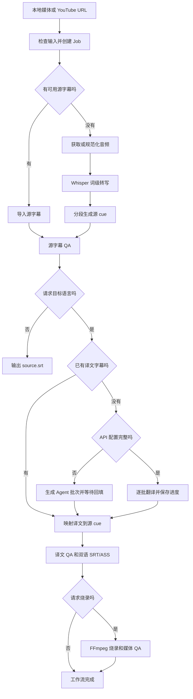

# 项目交接说明

更新时间：2026-10-21

> 2026-10-20 及以前的日期条目已搬进 [HANDOFF 历史档案](docs/HANDOFF_ARCHIVE.md)。档案按日期倒序保留原文，**只供 `rg` / `grep` 考古，不要整份读入上下文**。

## 当前快照

| 项目 | 状态 |
| --- | --- |
| 包名 | `xvt-video-translate` |
| CLI | `xvt` |
| 版本 | `0.2.0`（2026-10-17 发布） |
| Python | 3.11 及以上 |
| 当前主线 | 先完成字幕质量与自适应源字幕闭环，再评估 App |
| Job schema | v1（端到端目标为可选 `config.workflow` / `WorkflowConfig`） |
| 自动化测试 | 1006 个测试、263 个子测试，全部通过（2026-10-18） |
| 静态检查 | Ruff lint 和 formatter 通过 |
| 打包 | wheel 和 source distribution 已验证 |
| CI | GitHub Actions（ubuntu + macos × Python 3.11/3.13 矩阵）跑 ruff、pytest、CLI 冒烟与 `uv build` |
| Git | 功能修改使用 `codex/` 开发分支，Review 通过后以 PR 合并 `main` |
| 默认 CLI 路径 | `run` → `status` → `continue`（批处理 `batch` / `batch-continue`） |

当前代码可以完成本地视频或 YouTube 视频的转写、翻译、双语字幕生成和可选烧录。端到端流程收敛到 `xvt run`；中断后先 `xvt status` 查看 `recovery_plan` / `advance_steps`，再 `xvt continue` 按持久化目标补齐。翻译与烧录推进与 status 共用 `plan_advance_steps`。由 `run` / `continue` 按持久化目标完成的烧录写入 checksum 保护的 `version=2` burn proof，绑定烧录 fingerprint、`burned_video` checksum 和实际源媒体内容 checksum；高级原子 `xvt burn` 不签发 workflow proof。仅有效 v2 proof 可让 `relink-burned-output` 重新关联已移动成品。若其余静态条件满足但已登记成品缺失或 checksum 失效，`status` 返回 `awaiting_input`，首选重新关联占位命令、备选显式 `continue` 重烧；这只表示成品可能可重新关联，执行时仍会校验实际源媒体内容。`batch-continue` 停在该状态，不自动重烧。旧/legacy fingerprint、媒体 QA/proof/fingerprint 无效仍为 `retryable`，只推荐重烧。

## 项目背景

这个项目要解决的是视频字幕翻译链路中最容易失控的三件事：时间轴、翻译上下文和最终显示质量。用户可以只提供视频，也可以同时提供源字幕、机翻字幕或译文字幕。系统需要识别哪些步骤可以跳过，并且始终以源 cue 的时间轴为准。

方案选择了 Python CLI 作为核心，原因是 FFmpeg、yt-dlp、Whisper 和字幕生态在 Python 中接入成本较低。Skill 只负责调用 CLI 或完成 Agent 翻译，不拥有时间轴和媒体处理逻辑。App 暂缓，未来只消费 `job.json` 和 JSONL 事件，不复制业务逻辑。

## 已完成能力

### 输入和素材获取

- 支持本地视频、音频和 HTTP/HTTPS 远程 URL。
- YouTube 通过 yt-dlp 获取元数据、人工字幕、自动字幕、音频或完整视频。
- 人工字幕优先。只有显式传入 `--allow-auto-subtitles` 才使用自动字幕。
- yt-dlp 把语言写进字幕文件名，同一 Job 的下载目录可能同时留有多个语言或变体；选取时先精确匹配 `source.<language>.srt`，再匹配 `source.<language>-*` / `source.<language>.*`（大小写不敏感），都没有才回退字典序首个。
- 请求烧录时，远程完整视频在前置阶段下载一次，ASR 和烧录复用同一文件。
- Cookie 来源和代理必须显式传入，不会默认读取浏览器状态。

### 转写和时间轴

- 支持 MLX Whisper 和 faster-whisper，保留词级时间戳；faster-whisper 提供真实百分比，MLX 提供运行时长心跳。
- 分段综合停顿、标点、字幕时长和显示宽度；`conservative`、`balanced`、`compact` 预设仅调整 ASR 的停顿和最大时长，默认保持平衡行为。
- 可导入 SRT、VTT、ASS 和 SSA 源字幕，默认保留用户时间轴。
- 输入字幕必须是 UTF-8（带不带 BOM 都可以）。非 UTF-8（GBK、Big5、Shift_JIS、带 BOM 的 UTF-16/32）与解析失败都归为 `invalid_input`（退出码 2），报错指向用户传入的原始路径并给出 `iconv` 转码建议；带 BOM 的 UTF-16/32 会点名疑似编码，无 BOM 的 UTF-16/32 走解析失败分支，消息里按 NUL 字节提示疑似宽字符编码。XVT 不做本地字符集探测——宽松解码器会把内容「成功」解成乱码，乱码会流进翻译 API 并固化进 checksum。
- 源字幕可直接作为 `run` 输入创建纯字幕 Job，无需媒体即可翻译、QA、恢复和导出三种 SRT；无媒体时不生成 ASS，也不支持预览、烧录或重分段。
- `--align-subtitles` 会额外运行 ASR，并用顺序模糊对齐修正整体偏移或漂移；它必须与 `--subtitles` 同用。强制对齐 fail-closed：置信度低于阈值失败（`--allow-low-confidence-alignment` 可显式放行），对齐后字幕 QA 出现 error 级问题同样失败且该参数不放行。去掉 `--align-subtitles` 保留的是源字幕原时间轴，不是 ASR 分段；需要 ASR 时间轴要用 `--source-strategy asr`。
- cue 结束时间、相邻重叠和媒体边界会在分段与 QA 阶段校正或阻断。
- 分段遵守中日文**行首行尾禁则**（禁則処理）：cue 不以闭合括号、句读、连字符、中点、小字假名、长音符或叠字记号开头，也不以起始括号结尾。字符类取自 JIS X 4051 / JLREQ 并与 UAX #14 对齐，中文侧按 GB/T 15834 补齐；唯一谓词是 `segment.forbidden_break`，cue 边界的三个产出点（主循环的句末/停顿/超时切、`_soft_cut`、`_partition_words` 的宽度切）都走它。形态是罚分不是硬禁，整行全是禁则字符时仍切得动。**它只管排版，挡不住词法边界**——日文逐字转写下仍可能切在词中间（`科学|的`），那一半要靠分词器，结论与代价评估见 `docs/REVIEW_FINDINGS_2026_10_17.md` 的 P7。
- 分段与对齐共用同一个边界归一实现：重叠优先按中点切开；中点无法给两条 cue 都留出正时长（严重重叠、完全嵌套、词时间戳回退）时把后一条推到前一条结束处，仍不足则补足 1ms 最小时长，受影响的 cue 在 `warnings` 留痕但不产生新的 QA 问题。尾部收口的 `min(padded_end, next_start, media_duration_ms)` 同样钳制回正时长。归一后做单调性自检，不把零/负时长时间轴交给下游 QA。

### 翻译

- 支持 OpenAI-compatible Chat Completions，实际请求地址为 `<base-url>/chat/completions`。
- 默认环境变量为 `XVT_TRANSLATION_BASE_URL`、`XVT_TRANSLATION_MODEL` 和 `XVT_TRANSLATION_API_KEY`。
- `--provider auto` 在配置完整时调用 API，配置不完整时降级为 Agent 批次。
- `--provider openai-compatible` 缺少配置时直接失败，不静默降级。
- `translate` 和 `prepare-translation` 支持 JSON 术语表与 `faithful`、`natural`、`concise` 风格；批次仅携带命中源 cue 的术语。
- `run` 也支持同一套参数，并将解析后的策略快照写入工作流配置；`continue` 不依赖原术语表文件，始终复用该快照。
- 译文 QA 对命中源 cue 的术语确定性检查目标词；违规生成 `glossary_violation`、保留 QA 报告并阻断渲染和烧录。阻断的 error 全部是 `glossary_violation` 时，`status` / `continue` 给出 `retranslate-cues --cue … --target-language …` 出口（该 severity 不能由 acknowledge 通道放行）；`standard` 只改指定 cue，`polished` 会写成新草稿并重启润色与语义校对。必需术语优先取端到端 Job 的 `config.workflow` 策略快照，顶层 `config.translation_policy` 只是原子 Job 的回退位置；`prepare-translation` 在最后一次落盘前写入该顶层配置，兼容 API 模式下也不会被随后的 `load_job` 丢弃。
- API 翻译按批次保存进度，指纹包含源 cue checksum、语言、端点、模型、批次大小、提示词版本、语义分组版本和翻译策略。
- 默认兼容 API 翻译批次为 25 个 cue，请求超时为 180 秒；单个新 Job 可通过 `--batch-size` / `--timeout-seconds` 覆盖，已创建 Job 始终复用持久化配置。
- 429、部分 4xx、5xx、网络异常、远端断连、响应读取连接重置、分块响应中途断开（`IncompleteRead` / `BadStatusLine` / `LineTooLong`）和 TLS 连接中途终止（`SSLEOFError` / `SSLZeroReturnError` / `SSLSyscallError`）具有明确的传输重试分类；证书与握手类 `SSLError` 在请求和响应两个阶段都立即失败（请求阶段经 `URLError` 包装，按 `reason` 判定）。传输故障默认最多重试 4 次，优先使用最长 30 秒的有效 `Retry-After`（RFC 9110 的 delta-seconds 与 HTTP-date 两种形态，其余值退回本地退避），否则按 equal jitter 指数退避；结构性无效响应另有固定 2 次纠错重试，两个预算互不消耗，且传输重试保留上一轮的纠正提示。
- 翻译响应必须完整覆盖 cue ID，不允许重复、缺失或额外 ID；`id` 必须是真正的整数，JSON 布尔值（`true` / `false`）与全部其他解析器一致被拒绝，不再当作 cue 1。
- 标准 Agent manifest 记录 `source_cues_checksum`，回填时拒绝源 cue 已变化的陈旧响应；已登记的 manifest 若 checksum 失效、缺失或内容损坏同样拒绝回填并引导重新 `prepare-translation`。从未登记 manifest 的极旧 Job 与没有该字段的旧 manifest 仍按原样接受，只读查询路径不受影响。
- 回填的输入校验是纯只读的，失败不改写 Job 状态：`apply-translation`（含统一 `xvt apply`）与 `import-translation` 把「读不出 / 非 UTF-8 / 结构不符 / 覆盖不全 / manifest 失配 / 源 cue 无效」这些检查全部放在触碰 stage 之前，坏输入下 `TRANSLATE` 原地保持 `awaiting_input`。否则等待态被顶成 `failed`，`plan_advance_steps` 不再返回 `await_agent_translation`，统一 `xvt apply` 会误报「not awaiting Agent input」，恢复计划也从「等待回填」降级成「重跑翻译」——用户只是敲错一个文件，却要重付一次翻译成本。校验通过后才置 `running`，随后真正的改写（`import-translation` 的字幕拷贝与 artifact 登记、`finalize_translation` 的落盘与 QA）失败仍按原约定收口成 `failed`。`translate_and_polish`（一次翻译加润色）分支不在此列，仍按原有的 stage 记账。
- 翻译在不改动 cue 的前提下建立确定性语义组：句末标点或 650ms 间隔结束组，组上限为 `min(20, batch_size)` 个 cue 或 30 秒，超限按软标点、连接词前和最大停顿择边；单个超长 cue 单独成组。provider 批次只按完整组装箱，批次外前后各一个完整相邻组仅作只读上下文。
- `TranslationBatch.semantic_groups` 记录当前批次的组 ID；响应仍只覆盖当前 `items` 的原 cue ID，不得输出上下文 ID。局部重译使用 singleton groups；`max_target_characters` 是显示建议，最终显示风险仍由确定性 QA 判定。
- `resegment-translation` 仅对超过硬显示阈值且具有 ASR 词级时间戳的 cue 按语义优先边界重切；它重建 source cue 和 source SRT，废弃旧翻译及其下游产物，禁止复用或字符拆分旧译文。
- `retranslate-cues` 只翻译指定 cue ID，保留其他译文和时间轴；每个目标 cue 带相邻源 cue 作为上下文，回填后完整重跑译文 QA 并使旧渲染/烧录产物失效。Agent 模式的等待是 `plan_advance_steps` 的正式步骤 `await_cue_retranslation`：`status` 归 `awaiting_input` 并拼出带具体 cue ID 与目标语言的 `apply-cue-retranslation` 命令，`continue` 不宣告完成，`batch-continue` 停在该条目。谓词严格绑定当前 source/translated cue checksum，回填后的残留 manifest 不会盖掉后续的润色或语义等待。回填失败不再丢掉这次等待，两种模式的 stage 收口不同：用户显式跑的 `apply-cue-retranslation`，其校验（响应 fingerprint 对不上、`--cue` / `--target-language` 写错、manifest 与当前 XVT 版本失配等）全是只读动作，失败不改写 Job 状态，`TRANSLATE` 原地保持 `awaiting_input`；API 模式（`retranslate-cues` 直连提供方）下响应是 XVT 自己刚落盘并登记的内部产物、stage 已由调用方置 `running`，同一段校验失败属于内部故障，仍按原约定收口成 `failed`。两种情形下盘上的 manifest 都原样保留且仍然有效，那次等待并没有作废，因此 `cue_retranslation_waiting` 的 stage 条件同时接受 `awaiting_input` 与 `failed`；`failed` 这一支现在只覆盖 API 模式重译失败与旧版本留下的历史 Job（旧版本把用户输入错误也打成 `failed`）。`status` / `continue` 继续提示回填，不会在 `SUBTITLE_QA` 成功时改口报完成、也不会在 `SUBTITLE_QA` 失败时重复给出用户已经跑过的 `retranslate-cues`。`failed` 情形额外要求「没有更新的在途整轮翻译请求」：用户改走整轮重翻时 `prepare_agent_translation` 写出的新 `translation_batches` 在 `job.artifacts` 里排在重译 manifest 之后，此时整轮等待优先，回填出口不会指向已被取代的那一份。恢复计划拼出的 `--cue` 顺序与 manifest 内的批次顺序一致（不排序）：`apply-cue-retranslation` 对 manifest 做全等比对，乱序 `--cue` 的 Job 上排序会让复制的命令必然失败。放弃一次重译不必手工删文件：`prepare_agent_translation` 写出新的整轮 `translation_batches` 时会把 `cue_retranslation_batches` 移出登记，否则残留 manifest 会遮蔽合法的初译等待。`polished` Job 上回填结果会成为新草稿并重启润色与语义校对（真实模型成本），`standard` Job 只改选中的 cue。

### 字幕和显示质量

- 输出 `source.srt`、`translated.srt`、`bilingual.srt` 和 `bilingual.ass`。
- 模型生成的显式简中译文（`zh-CN`、`zh-Hans` 及 `zh-Hans-*` 区域后缀形式）写入时消除全角 `，`、`。`：句中按需替换为一个半角空格以保留词边界，行尾与换行前直接移除；连续全角句号归一为单个 `…`；问号、感叹号、分号、冒号、破折号、ASCII 标点和原有换行保留。源 cue 末尾问句而译文缺少句末语义标点时补 `？`，位置镜像源文中问号相对末尾闭合符号的位置。导入译文、人工修订、源字幕、bare `zh`、繁中及其他目标语言不变。
- 双语字幕固定为译文一行、原文一行。每种语言内部的原始换行会被折叠。
- 16:9 横版英文在 64 个显示单位以内通过，65 到 72 为警告，超过 72 需要复核。窄画幅会收紧限制，中文限制更严格。
- ASR / `asr_resegmented` 的 `low_timing_confidence` 为 warning；对齐或用户导入字幕的低置信度仍为 review，需确认后继续。
- ASS 使用独立的中英文字体和字号。macOS 默认中文字幕字体为 libass 可读取的 `Hiragino Sans GB`。
- cue 文本中的字面 `{` `}` 在 ASS 渲染时转义为 libass 的 `\{` `\}`，不再被当作覆盖标签块吞掉，`{\an8}` 一类内容也不会真的改变字幕位置；`\N` 换行与 `{\rSource}` 样式切换是渲染器拼接的结构，不参与转义。反斜杠刻意不转义（ASS 无标准反斜杠转义，libass 原样输出未知序列）。SRT/VTT 导出保留花括号。导入端已同口径收口：`load_subtitles`（`--subtitles`、`--translation-subtitles`、`import-translation`）按 pysubs2 解析出的实际格式分叉，SRT/VTT 保留字面花括号、只剥 `{\…}` 形态的覆盖块，ASS/SSA 仍整段剥除（那里 `{...}` 是标签语法本身），导出→人工编辑→导回链路不再丢内容；人工修订 SRT 走独立纯文本解析器，同样保留。仍存在的限制：SRT/VTT 里 `{\…}` 形态的字面文本与真覆盖标签无法区分，仍会被剥除。
- 字幕 QA error 记为 `failed`；纯 `needs_review` 记为 `awaiting_input`。两者都会停止工作流且不允许继续烧录，原子命令也不会误发 `cli_completed`。
- 高级原子 `xvt burn` / `xvt preview` 与端到端链路共用同一道 fail-closed 译文 QA 门（`pipeline.review.review_gate_satisfied`），不能绕过 QA：要求 checksum 有效的译文 cue 与 QA 报告，`pass` / `warning` 放行，`needs_review` 只在报告内全部 review 问题都被当前有效确认覆盖时放行，error、缺失、checksum 失效或结构异常一律拒绝。确认通道只有 `continue --acknowledge-subtitle-review`，因此原子 Job 的报错文案指向重跑 `xvt translate`，不指向不可用的 `continue`。
- 语义复核确认后，若译文候选和渲染产物已有效或被补齐，`translate` stage 会收口为 `succeeded` 并清除旧 QA 错误；字幕 QA 的独立 `needs_review` 仍需单独确认。
- 「译文已满足」的判定包含译文 QA 报告与双语 ASS：需要 checksum 有效的 `translated_cues`、`translated_srt`、`bilingual_srt`、`translated_subtitle_qa`，外加**已登记过**的 `bilingual_ass`（`workflow._translation_satisfied` 与 polished 链路的 finalize 短路共用同一口径）。漏掉 QA 报告会让报告单独失效的 Job 被判成「已完成」而空转，`continue` 永不重建。`bilingual_ass` 同理：它是 README / 架构说明列出的交付物，也是 `workflow_completed` 汇报的产物之一，删掉或改坏 `bilingual.ass` 后旧口径会让 `continue` / `status` / `batch-continue` 三路都报完成，而 CLI 没有任何命令能单独重建它；补上之后 `plan_advance_steps` 给出 `render`，走零 API 成本的重渲染。该条件只对已登记过 `bilingual_ass` 的 Job 生效——纯音频、纯字幕等没有分辨率的 Job 从来不渲染 ASS，对它们要求 ASS 会让 `continue` 永远收敛不了。烧录 Job 不额外分叉：至多多渲染一次 ASS，代价为零。原子 Job 上这条缺口的零成本出口（`recovery.atomic_translated_qa_rebuild_command`，`status` 与 `pipeline.burnin` 的 QA 门共用）只对 `standard` 成立：`import-translation` 与其余回填路径共用 `finalize_translation`，在 `polished` Job 上走 draft 分支，QA 不重建、渲染不执行、整条润色腿失效，因此该函数对 `polished` 返回 `None`，两处调用方各自落回既有引导。
- 恢复计划的判定顺序有一条硬约束：局部重译等待必须排在 `qa_blocked` 之前。术语死锁的出口就是 `retranslate-cues`，跑完后译文 QA 还没重跑、`SUBTITLE_QA` 仍是 `failed`，排在后面会把等待重报成 `manual_fix` 并重复给出同一条命令，端到端 Job 上还与 `plan_advance_steps` 的 `await_cue_retranslation` 自相矛盾。原子与端到端两条分支共用 `_cue_retranslation_waiting_plan`。
- 同构的第二条让路：端到端 Job 上 `qa_blocked` 也要给**任何**在途 Agent 等待让路。`SUBTITLE_QA=failed` 只说明上一次译文 QA 没过，它不会因为随后开了一次新的等待而自动复位——用户改走整轮重翻时 `prepare_agent_translation` 会移走重译 manifest、写入新的 `translation_batches` 并把 `TRANSLATE` 置为 `awaiting_input`，却不碰 `SUBTITLE_QA`。此时 `plan_advance_steps` 首步是正式等待步骤，等待才是真状态：`recovery._build_recovery_plan` 与 `workflow._advance_workflow` 用同一口径把 QA 引导排在等待之后，于是 `status` 报等待、`continue` 返回 `awaiting_input` 而不是抛错要求重跑、`batch-continue` 停在该条目并给出统一 `xvt apply` 或 `apply-cue-retranslation` 回填引导，三侧不再各说各话。
- 恢复计划里出现的 `--target-language` 一律 `shlex.quote`：该值只被 Job 保存、没有内容校验，而恢复计划是「复制即执行」面。
- 字幕 QA `needs_review` 被确认后，`continue` 会清除 `translate` stage 上的过期阻断错误（要求 QA 门已放行、确认仍对当前源 cue 有效、译文 cue 与两份 SRT 均有效）；旧 Job 下次 `continue` 自动收口。

### 烧录和媒体 QA

- FFmpeg 烧录支持 VideoToolbox 和 libx264。
- 默认优先硬件编码，只在明确的硬件编码器错误时回退 libx264。
- 视频码率按分辨率选择，不再使用 FFmpeg 8.1 不兼容的 VideoToolbox 质量参数。
- 输出媒体会检查视频流、音频流、AAC 音频、分辨率和时长偏差。
- 烧录派生 fingerprint 包含译文 checksum、媒体身份、编码方式和字体；端到端 `run` / `continue` 烧录写入 checksum 保护的 `version=2` `burn_fingerprint` proof（`burn-fingerprint.json`），并绑定 `burned_video` checksum 与实际源媒体内容 checksum；高级原子 `xvt burn` 不签发 workflow proof。旧 Job 若仅有 `workflow.burn_fingerprint` 仍可按既有轻量完成语义读取，但不能作为 relink 证明；必须 `continue` 重烧一次生成 v2 proof。`continue` 只复用成品、proof/指纹与媒体 QA 均有效时的结果。
- 烧录目标只有在 `burned_video` checksum、烧录指纹和媒体 QA 全部有效时才算完成；指纹失效或媒体 QA 失败会通过 `status`/`continue` 提示重新烧录。
- 源媒体永久搬家（路径变了、内容没变）后，`xvt relink-source-media JOB NEW_MEDIA_PATH`（advanced）把持久化的 `config.workflow.burn_media` 指到新位置：只认内容 checksum（必须等于 checksum 有效的 v2 proof 登记的 `source_media_checksum`，没有 v2 proof 拒绝），只写这一个字段，不重烧、不碰 artifact 登记、不改 stage、不发 artifact 事件；写入后烧录派生指纹的内容 checksum 回退即成立，Job 零重烧回到 `complete`。远程 Job 不支持。恢复导航已接入：源媒体不在登记路径且 Job 够格（`workflow.source_media_relink_available`）时，`status` 的 `primary_command` 就是 `xvt relink-source-media JOB NEW_MEDIA_PATH`（新路径为占位符）；只有 legacy fingerprint 的旧 Job 维持 `None`。
- `preview` 可按 cue 或起始时间生成短片段预览；未显式覆盖时复用工作流保存的烧录媒体、字体和编码设置，不修改正式烧录 stage。缺 checksum 有效的译文与 QA 报告时以退出码 4（`workflow`）失败，不再按用户输入错误退 2；`burn` 的 QA 门在远程媒体下载之前执行。
- 预览生成 `preview.ass` 和 `preview.mp4` checksum artifact；译文局部重译或重新分段后旧预览会失效。
- 烧录与预览输出允许写到 Job 目录外的绝对路径，但不得覆盖源媒体、`job.json` 或其他已登记 artifact；同 kind（`burned_video` / `preview_video`）允许重写；路径别名和硬链接也会在写入前检查（`xvt.paths`）。
- 字幕经 `-vf ass=filename=...` 进入 filtergraph，路径按两层规则转义（先 filter 选项值层 `\ : '`，再 filtergraph 层 `\ ' , ; [ ]`）且不加引号包裹，因此 Job 目录含单引号（如 `Tom's Videos`）、逗号、分号或方括号时也能正常烧录与预览。

### Job、恢复和事件

- 每次 `run` 创建独立 Job，stage 和 artifact 写入 `job.json`。
- 普通 CLI 默认把人类可读的阶段、下载、翻译批次、转写和烧录进度写入 stderr，最终路径继续写入 stdout。
- `job_started` 在 Job 首次持久化后立即携带 `job_file`，早期素材获取失败也能定位任务文件。
- 已有 Job 的原子命令会从 CLI 参数预先记录任务路径，早期失败不会误报为任务尚未创建。
- `run` / `continue` / `apply --continue` / `batch` / `batch-continue` 停在 `awaiting_input` 时默认返回退出码 0；显式 `--fail-on-waiting` 时返回 10（`AWAITING_INPUT`），批处理有失败条目时仍是 6（6 优先于 10）。`apply` 的旗标经 continuation Namespace 透传给 `_cmd_continue`，不加 `--continue` 时无作用。该旗标只改退出码，不发 `cli_failed`、不改 Job/batch 状态与事件流。Skill 不使用它。
- Ctrl-C 返回退出码 130、SIGTERM 返回 143，两者都清理外部进程组并把当前 `running` stage 持久化为 `failed`，错误为 `interrupted by user`；改写既有 Job 的命令与 `batch-continue` 以 flock 独占执行，冲突退出码 7；独立预览中断不会生成正式工作流恢复计划，而是提示重新运行 preview。`interrupt_running_stage` 是中断处理块的第一条语句，因此它的 except 元组必须包含 `XvtError`（`job.json` 在运行期间被删除或改坏时 `load_job` 抛 `UserInputError`）：漏掉会让整个收尾落空，退出码退化成 1。批处理另有四个 `_process_item` 自身管不到的中断窗口：批次已落盘但 `batch_started` 正在发射、两个条目之间、条目置 `running` 落盘后但还没进入内层 `try`、以及最后一个条目完成后汇总落盘前。这些窗口由 `_process_batch` 的兜底 `except`（不是 `finally`，避免与内层收尾打架）统一收口：仍标 `running` 的条目降级为 `interrupted`，`batch.status` 写成 `interrupted` 并留下 `next_action`，`batch.json` 不会停在 `status=running` 且无下一步。该处理与 `_process_item` 已有的持久化天然幂等。中断状态落盘后的 JSONL/人读终态报告是 best-effort：终端或管道关闭等普通输出异常不得覆盖原取消异常，退出码仍保持 130/143。
- 人读终端输出统一经 `cli._terminal_safe` 转义控制字符，漏斗收在 `_HumanEventSink._line` / `_progress` 与 `_print_safe` 三处：叙述行里嵌的文件名（目录扫描而来）、远端标题（yt-dlp 元数据）和错误消息都可以合法地带 `\r` / ESC，足以覆盖已打印的行、清屏并伪造出一条看起来出自 XVT 的 `next:` 命令，`shlex.quote` 不设防（单引号内的控制字符照样被终端解释）。转义幂等，因此批处理条目导航里逐字段的既有调用可以照旧保留。**例外**：stdout 上的纯产物路径清单（供 xargs / 管道消费的 `print(path)`）是契约行，不转义。
- `load_user_response_json` 只服务用户提交的响应文件，`translation.load_translation_response` 是它的间接路径；读已登记 artifact 用 `translation.translations_from_response`（接受已解析载荷）。以该 helper 为底的只读谓词，except 元组里必须有 `XvtError`。非 UTF-8 的响应文件与非 UTF-8 的输入字幕同口径归 `invalid_input`（退出码 2）：`UnicodeDecodeError` 是 `ValueError` 子类但不是 `JSONDecodeError` 子类，`load_user_response_json` 与 `xvt apply` 的 except 元组都必须显式带上 `UnicodeError`，否则同一次失败会出现两个分类（`stage_failed` 记 `workflow`、顶层按 `isinstance(ValueError)` 记 `invalid_input`），`xvt apply` 那条路径还会逃逸成裸 codec 报错；`apply` 的报错额外给出 `iconv` 转码建议。
- `doctor` 的 ffmpeg 能力探测与 libass 渲染探测走 `process.run_command` 而不是裸 `subprocess.run`：以进程组方式启动并在所有退出路径（含超时）清理孙进程，同时响应全局取消事件。doctor 自行判定通过/失败，因此用 `CommandError` 捞回 `result`，超时按 `returncode == 124` 识别。
- artifact 使用 SHA-256 checksum，`verify` 会重新计算。
- `resume` 只恢复转写 checkpoint；`continue` 读取 `job.config.workflow` 完成翻译和烧录目标。远程 Job 的 `resume` 优先复用 checksum 有效的已下载媒体，没有可复用媒体时委派远程恢复路径重新获取，可能触发一次媒体下载。
- 远程端到端 Job 在检查或下载阶段失败后，可以通过 `continue` 在同一个 Job 中重试；checksum 有效的远程元数据、字幕和媒体会被复用。
- `--cookies-from-browser` 和 `--proxy` 同时作用于远程检查与下载，重试时可以重新显式提供。
- `status`、普通失败输出和 Ctrl-C 共用结构化 `RecoveryPlan`，只复用 checksum 验证通过的 artifact。
- 端到端 Job 的恢复计划通过 `plan_advance_steps` 与 `continue` 对齐，并暴露 `advance_steps`（人类可读 `steps:` 行与 JSON `recovery_plan`）。
- 恢复计划区分 `retryable`、`awaiting_input`、`manual_fix`、`unrecoverable` 和 `complete`。
- 当前 schema 的 Job 若缺少必填字段、stage 或字段类型错误，会作为可控的无效输入失败，不输出 Python traceback。cue 产物（`source-cues.json`、`translated-cues.json` 等）同样：未知字段前向兼容忽略，结构确实无法解析时报 `invalid cue artifact`（退出码 2 并发出 `cli_failed`），不再抛裸 `TypeError`。命令行给出的 `job.json` / `batch.json` 路径不存在或指向目录时同样归退出码 2 并点名路径，不再报「外部依赖或子进程故障」；Job 内**已登记** artifact 缺失不走这条路——路径来源是 Job 自己，仍按依赖或工作流问题处理。
- `polished` Job 的润色草稿失效时，只有 `translation_progress` 能零 API 成本重建草稿（fingerprint 匹配、覆盖全部批次、每个批次 cue 都有译文）才允许 `continue` 继续；否则以人工修复文案停下，不会静默重新翻译加润色。`status` 与 `continue` 共用该谓词，可重建时归 `retryable`、否则 `manual_fix`；谓词无副作用，provider 不可解析时按不可重建处理。
- Agent 降级会进入 `awaiting_input`，不会发出虚假的完成事件。
- JSONL 已覆盖工作流、stage、artifact、翻译批次、下载、转写和烧录进度。
- `workflow_completed` 和 `cli_completed` 会列出 checksum 有效的用户产物；仅生成源字幕的任务也会返回 `source.srt`。
- `batch` 会固定目录输入清单并串行创建独立 Job；单项失败不会阻断后续文件，`batch.json` 原子记录汇总状态和恢复计划。
- `batch-continue` 校验已有 Job 后只恢复未完成项，Agent 等待和人工修复仍保持显式阻断。已完成条目上只有中间 checkpoint（`normalized_audio`、`word_transcript`、批次 manifest 等）失效时保持 `completed`，只在 `item["verification"]` 与 `batch_item_completed` 事件里标注 `degraded` 并列出失效 kind（旧行为是 `failed` + 退出码 6，且引导只报告不修复，构成死循环）；目标产物失效不走这条放行——缺烧录成品停在 relink 的 `awaiting_input`，缺 `source.srt` 落到 `continue` 由 `resume` 重建，缺 `bilingual.ass` 由 `_translation_satisfied` 判成未完成后落到 `continue` 重渲染（不再被标成 `degraded` 并宣称「不影响成品」）。普通模式会在汇总行后逐条打印待处理条目及其恢复命令（取自已持久化的 `recovery_plan`，最多 10 条）。
- `--events-jsonl` 继续保持 stdout 纯 JSONL，不与普通进度文本混合。
- 命令参数、URL 用户信息、常见签名查询参数、Cookie 和鉴权信息会在事件边界脱敏。

## 支持的输入组合

| 输入 | 行为 |
| --- | --- |
| 本地视频 | ASR，按需翻译和烧录 |
| 本地视频 + 源字幕 | 跳过 ASR，保留源字幕时间轴 |
| 本地视频 + 源字幕 + 译文字幕 | 跳过 ASR 和翻译 API，合并后可烧录 |
| 本地音频 | ASR 和字幕输出；烧录时必须增加 `--burn-media` |
| YouTube URL | 按参数选择平台字幕或 Whisper |
| YouTube URL + 人工字幕请求 | 优先下载人工字幕，缺失时按配置回退自动字幕或 ASR |
| 本地目录 | `batch` 按稳定顺序创建独立 Job，失败隔离并生成可恢复汇总报告 |
| 已有 Job | `status` 查看下一步，`verify` 校验，`resume` 恢复转写，`continue` 完成端到端目标 |

纯字幕文件可以直接创建 Job；一个 Job 仍然只能生成一个目标语言。

## 端到端工作流



## 常用命令

完整本地流程：

```bash
uv run --no-sync xvt run "/path/to/video.mp4" \
  --output "/absolute/output" \
  --language en \
  --target-language zh-CN \
  --provider auto \
  --burn \
  --events-jsonl
```

YouTube 平台字幕优先：

```bash
uv run --no-sync xvt run "https://www.youtube.com/watch?v=VIDEO_ID" \
  --output "/absolute/output" \
  --youtube-subtitles \
  --subtitle-language en \
  --allow-auto-subtitles \
  --target-language zh-CN \
  --burn
```

已有源字幕和译文字幕：

```bash
uv run --no-sync xvt run "/path/to/video.mp4" \
  --output "/absolute/output" \
  --subtitles "/path/to/source.srt" \
  --translation-subtitles "/path/to/translated.srt" \
  --target-language zh-CN \
  --burn
```

恢复和诊断（优先 `status` → `continue`）：

```bash
uv run --no-sync xvt status "/path/to/job.json"
uv run --no-sync xvt status "/path/to/job.json" --json   # recovery_plan.advance_steps
uv run --no-sync xvt continue "/path/to/job.json" --events-jsonl
uv run --no-sync xvt verify "/path/to/job.json" --json
# advanced：仅转写 checkpoint
uv run --no-sync xvt resume "/path/to/job.json" --events-jsonl
uv run --no-sync xvt preview "/path/to/job.json" --cue 18 --duration 15
uv run --no-sync xvt batch "/path/to/input-directory" --output "/absolute/output"
uv run --no-sync xvt batch-continue "/path/to/batch.json" --events-jsonl
```

Agent 翻译回填：

```bash
uv run --no-sync xvt apply-translation "/path/to/job.json" \
  "/path/to/translation-response.json" \
  --target-language zh-CN

uv run --no-sync xvt continue "/path/to/job.json"
```

局部重译与 Agent 回填：

```bash
uv run --no-sync xvt retranslate-cues "/path/to/job.json" \
  --cue 18 --target-language zh-CN --provider agent

uv run --no-sync xvt apply-cue-retranslation "/path/to/job.json" \
  "/path/to/cue-retranslation-response.json" \
  --cue 18 --target-language zh-CN

uv run --no-sync xvt continue "/path/to/job.json"
```

## Job 模型

Stage 包含：

```text
inspect
acquire
normalize_audio
import_subtitles
transcribe
align
segment
translate
subtitle_qa
render
burn
media_qa
```

Stage 状态为 `pending`、`running`、`awaiting_input`、`succeeded`、`failed` 或 `skipped`。

典型 artifact 包含：

```text
media.json
remote.json
audio.wav
words.json
source-cues.json
source.srt
translation-batches.json
translation-progress.json
translation-response.json
translated-cues.json
translated.srt
bilingual.srt
bilingual.ass
preview.ass
preview.mp4
qa.json
qa-translated.json
burned.mp4
media-qa.json
```

`job.config.workflow` 保存目标语言、请求产物、翻译提供方、模型、API Key 环境变量名、分段预设、烧录参数和派生指纹。它不保存 API Key 或代理凭据。

批处理使用独立的 `batch.json` schema v1，不改变 Job schema。报告位于 `output/batches/<batch-id>/batch.json`，保存固定输入清单、共享工作流参数、每项 Job 文件、产物、状态、脱敏错误和恢复计划。批处理不复制媒体或字幕算法。

## 关键设计决定

1. CLI 是唯一业务内核。Skill 和未来 App 都只做调用与展示。
2. Python 继续作为当前实现语言。暂时没有迁移到 TypeScript 的收益，App 层可以使用 React 和 TypeScript。
3. 时间轴优先于翻译文本。任何翻译优化都必须保持 cue ID 和时间不变。
4. 单目标语言对应单 Job。多语言需求创建多个 Job，避免现在就改 schema 和 artifact 命名。
5. `resume` 和 `continue` 保持独立。一个处理转写 checkpoint，一个处理用户目标。
6. 平台字幕和用户字幕属于可跳过 ASR 的输入，不是 ASR 结果的附属品。
7. Agent 降级是明确的等待状态。缺少 API 配置时不能假装端到端任务已经完成。
8. 硬件编码回退只识别编码器错误。字幕文件、路径或滤镜错误必须原样失败。
9. 批处理只做串行编排；每个输入仍由独立 Job 和原有恢复计划负责状态与产物正确性。

## 已知限制

- 翻译后的目标文本若超过硬显示阈值仍由 QA 阻断；自动重切并重新翻译尚未实现。
- 新 Job 默认生成单遍语义组译文，也可显式选择 `--translation-quality polished`；Agent 主链真实 E2E 已通过，但默认切换仍需多样本质量与成本对照。
- `rebuild-source` 只适用于有媒体的 Job；纯字幕 Job 的源字幕问题仍需人工修复。
- 高级命令 `retranslate-cues` 已与主翻译共用传输/结构重试和 retry 事件语义，但仍只在全部选定 cue 翻译完成后写最终响应；中途失败会重复请求该次命令中已成功的批次，因此不会提前发送意味着已持久化的 `translation_batch_completed`。端到端主翻译的逐批 checkpoint 不受影响。
- 回填失败后的等待保持已修复（见「翻译」一节：用户模式的 `apply-cue-retranslation` / `apply-translation` / `import-translation` 校验失败不改写 stage，`cue_retranslation_waiting` 另外接受 `failed` 以兜住 API 模式重译失败与历史 Job）。仍存在的限制：stage 语义不区分「重译失败」与「等待被放弃」，放弃一次已请求的重译没有专门命令，靠重跑 `retranslate-cues` 重建 manifest，或直接开一轮整轮翻译取代它（`prepare_agent_translation` 会移走重译 manifest，且在途整轮请求优先）。用户模式的回填错误也不在 Job 上留痕（只有命令行报错，stage 不记 `error`），排查要看命令输出而不是 `job.json`。等待期间 `TRANSLATE` stage 停在 `awaiting_input` / `failed` 是表象，不影响判定。
- 目录批处理当前串行执行，不支持后台队列、目录监控或每项不同参数；请求烧录时目录只能包含视频，音频和纯字幕输入必须拆成不烧录的独立批次。
- 不支持远程执行或多租户 Web 服务。
- 没有可视化校对界面和桌面 App。
- `continue` 只适用于带 `job.config.workflow` 的端到端 Job。旧 Job 继续使用原子命令。
- 字面花括号在渲染、导出和导入三侧已闭环（导入端按实际格式分叉，SRT/VTT 保留、ASS/SSA 剥除）。仍存在的边界：SRT/VTT 正文里 `{\…}` 形态的字面文本（`{\an8}`、`{\alpha}` 一类）与真覆盖标签无法区分，仍会被剥除，`{` 与 `\` 之间有空白也一样；SRT 文本里的字面 `\N` 仍被当作换行标签转换。

## 后续任务规划

### Q1-Q6.1：字幕质量与自适应源字幕

完整方案见 [字幕质量与自适应源字幕技术方案](docs/SUBTITLE_QUALITY_PLAN.md)。Q1–Q6.1 已按顺序全部完成：翻译传输可靠性 → 新 Job 自适应源字幕 → 已有 Job 源字幕重建 → 语义组翻译 → 可恢复字幕润色 → 语义校对与一次修复 → 人工修订与提示词加固；逐条完成记录见 [HANDOFF 历史档案](docs/HANDOFF_ARCHIVE.md)。polished Agent 主链真实 E2E 已通过，默认保持 `standard + faithful`。Q6.2 剩余的模型收敛实测需单独授权，已移出近期计划（见 [路线图](ROADMAP.md) 的「暂不规划」）。

关键兼容性决定：不新增 `StageName`，Job schema 继续为 v1；润色和语义校对通过 artifact、事件和现有 stage 的细分状态表达。旧 Job 缺少新配置时保持当前平台字幕/单遍翻译行为。GUI 延后到本方案完成真实 E2E 验收之后。

### R 系列：架构改进与工程加固

2026-08-02 的全量审查（基线 `ab28aff`）产出 [架构改进与工程加固技术方案](docs/ARCH_IMPROVEMENT_PLAN.md)，含 F1–F15 审查发现与 R1/R2/R3 分阶段任务。R1、R2 已全部完成，逐条记录见 [HANDOFF 历史档案](docs/HANDOFF_ARCHIVE.md)。

- **R3 进度**：R3.1 已收尾（Phase 1/2/4a/4b/4c 完成，四条链路共用 `run_provider_batches`；Phase 5 已关闭），R3.2 已取消，R3.3 保持待评估。结论、理由与重新立项的触发条件以 [路线图](ROADMAP.md) 和 [架构改进与工程加固技术方案](docs/ARCH_IMPROVEMENT_PLAN.md) 为准。

## 接手步骤

> 当前待办的首选入口是 [2026-10-17 review 发现清单](docs/REVIEW_FINDINGS_2026_10_17.md)，它比 ROADMAP 更具体、带锚点与触发条件。

1. 阅读 [AGENTS.md](AGENTS.md)、[README.md](README.md)、[架构说明](docs/ARCHITECTURE.md)、[恢复与回填契约](docs/RECOVERY.md)、[路线图](ROADMAP.md) 和 [贡献指南](CONTRIBUTING.md)。
2. 运行 `uv run --no-sync xvt --help`，确认命令面与本文一致。
3. 运行 Ruff 和全量测试，确认基线没有漂移。
4. 运行 `git status --short --branch -uall`，确认当前分支和 `origin/main` 的同步状态。
5. 从后续任务规划中选择一个小阶段，先提交方案和验收标准，再开始编码。
6. 修改完成后同步相关文档，并更新本文件的测试数量、当前限制和下一步。

基线验证命令：

```bash
uv run --no-sync ruff check src tests
uv run --no-sync ruff format --check src tests
uv run --no-sync pytest -q
uv run --no-sync xvt --help
```

真实 YouTube、API 和烧录验收不应默认执行。需要运行时，先确认公开测试素材、输出目录、网络权限和用户凭据，完成后只记录结论，不记录密钥、Cookie、代理凭据或个人文件路径。
