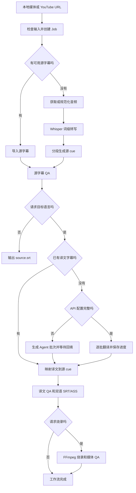

# 项目交接说明

更新时间：2026-07-20

## 当前快照

| 项目 | 状态 |
| --- | --- |
| 包名 | `xvt-video-translate` |
| CLI | `xvt` |
| 版本 | `0.1.0` |
| Python | 3.11 及以上 |
| 当前主线 | 先打磨 CLI，再评估 App |
| Job schema | v1 |
| 自动化测试 | 279 个，全部通过 |
| 静态检查 | Ruff lint 和 formatter 通过 |
| 打包 | wheel 和 source distribution 已验证 |
| CI | GitHub Actions（ubuntu + macos 矩阵）跑 ruff、pytest 与 CLI 冒烟 |
| Git | 功能修改使用 `codex/` 开发分支，Review 通过后以 PR 合并 `main` |

当前代码可以完成本地视频或 YouTube 视频的转写、翻译、双语字幕生成和可选烧录。端到端流程已经收敛到 `xvt run`，中断后由 `xvt continue` 根据持久化目标补齐剩余步骤。

## 项目背景

这个项目要解决的是视频字幕翻译链路中最容易失控的三件事：时间轴、翻译上下文和最终显示质量。用户可以只提供视频，也可以同时提供源字幕、机翻字幕或译文字幕。系统需要识别哪些步骤可以跳过，并且始终以源 cue 的时间轴为准。

方案选择了 Python CLI 作为核心，原因是 FFmpeg、yt-dlp、Whisper 和字幕生态在 Python 中接入成本较低。Skill 只负责调用 CLI 或完成 Agent 翻译，不拥有时间轴和媒体处理逻辑。App 暂缓，未来只消费 `job.json` 和 JSONL 事件，不复制业务逻辑。

## 已完成能力

### 输入和素材获取

- 支持本地视频、音频和 HTTP/HTTPS 远程 URL。
- YouTube 通过 yt-dlp 获取元数据、人工字幕、自动字幕、音频或完整视频。
- 人工字幕优先。只有显式传入 `--allow-auto-subtitles` 才使用自动字幕。
- 请求烧录时，远程完整视频在前置阶段下载一次，ASR 和烧录复用同一文件。
- Cookie 来源和代理必须显式传入，不会默认读取浏览器状态。

### 转写和时间轴

- 支持 MLX Whisper 和 faster-whisper，保留词级时间戳；faster-whisper 提供真实百分比，MLX 提供运行时长心跳。
- 分段综合停顿、标点、字幕时长和显示宽度；`conservative`、`balanced`、`compact` 预设仅调整 ASR 的停顿和最大时长，默认保持平衡行为。
- 可导入 SRT、VTT、ASS 和 SSA 源字幕，默认保留用户时间轴。
- 源字幕可直接作为 `run` 输入创建纯字幕 Job，无需媒体即可翻译、QA、恢复和导出三种 SRT；无媒体时不生成 ASS，也不支持预览、烧录或重分段。
- `--align-subtitles` 会额外运行 ASR，并用顺序模糊对齐修正整体偏移或漂移。
- cue 结束时间、相邻重叠和媒体边界会在分段与 QA 阶段校正或阻断。

### 翻译

- 支持 OpenAI-compatible Chat Completions，实际请求地址为 `<base-url>/chat/completions`。
- 默认环境变量为 `XVT_TRANSLATION_BASE_URL`、`XVT_TRANSLATION_MODEL` 和 `XVT_TRANSLATION_API_KEY`。
- `--provider auto` 在配置完整时调用 API，配置不完整时降级为 Agent 批次。
- `--provider openai-compatible` 缺少配置时直接失败，不静默降级。
- `translate` 和 `prepare-translation` 支持 JSON 术语表与 `faithful`、`natural`、`concise` 风格；批次仅携带命中源 cue 的术语。
- `run` 也支持同一套参数，并将解析后的策略快照写入工作流配置；`continue` 不依赖原术语表文件，始终复用该快照。
- 译文 QA 对命中源 cue 的术语确定性检查目标词；违规生成 `glossary_violation`、保留 QA 报告并阻断渲染和烧录。
- API 翻译按批次保存进度，指纹包含源 cue checksum、语言、端点、模型、批次大小、提示词版本和翻译策略。
- 429、部分 4xx、5xx、网络异常和超时具有明确的重试分类。`Retry-After` 会优先使用。
- 翻译响应必须完整覆盖 cue ID，不允许重复、缺失或额外 ID。
- 批次包含相邻上下文。上下文只用于理解，输出仍按原 cue ID 回填。
- `resegment-translation` 仅对超过硬显示阈值且具有 ASR 词级时间戳的 cue 按语义优先边界重切；它重建 source cue 和 source SRT，废弃旧翻译及其下游产物，禁止复用或字符拆分旧译文。
- `retranslate-cues` 只翻译指定 cue ID，保留其他译文和时间轴；每个目标 cue 带相邻源 cue 作为上下文，回填后完整重跑译文 QA 并使旧渲染/烧录产物失效。

### 字幕和显示质量

- 输出 `source.srt`、`translated.srt`、`bilingual.srt` 和 `bilingual.ass`。
- 双语字幕固定为译文一行、原文一行。每种语言内部的原始换行会被折叠。
- 16:9 横版英文在 64 个显示单位以内通过，65 到 72 为警告，超过 72 需要复核。窄画幅会收紧限制，中文限制更严格。
- ASS 使用独立的中英文字体和字号。macOS 默认中文字幕字体为 libass 可读取的 `Hiragino Sans GB`。
- 字幕 QA 失败或进入 `needs_review` 时，工作流停止，不允许继续烧录。

### 烧录和媒体 QA

- FFmpeg 烧录支持 VideoToolbox 和 libx264。
- 默认优先硬件编码，只在明确的硬件编码器错误时回退 libx264。
- 视频码率按分辨率选择，不再使用 FFmpeg 8.1 不兼容的 VideoToolbox 质量参数。
- 输出媒体会检查视频流、音频流、AAC 音频、分辨率和时长偏差。
- 烧录派生指纹包含译文 checksum、媒体身份、编码方式和字体。`continue` 只复用 artifact 与指纹都有效的成品。
- 烧录目标只有在 `burned_video` checksum、烧录指纹和媒体 QA 全部有效时才算完成；媒体 QA 失败会保留 Job 并提示重新烧录检查。
- `preview` 可按 cue 或起始时间生成短片段预览；未显式覆盖时复用工作流保存的烧录媒体、字体和编码设置，不修改正式烧录 stage。
- 预览生成 `preview.ass` 和 `preview.mp4` checksum artifact；译文局部重译或重新分段后旧预览会失效。
- 预览输出不能覆盖源媒体、Job 文件或正式 artifact；路径别名和硬链接也会在写入前检查。

### Job、恢复和事件

- 每次 `run` 创建独立 Job，stage 和 artifact 写入 `job.json`。
- 普通 CLI 默认把人类可读的阶段、下载、翻译批次、转写和烧录进度写入 stderr，最终路径继续写入 stdout。
- `job_started` 在 Job 首次持久化后立即携带 `job_file`，早期素材获取失败也能定位任务文件。
- 已有 Job 的原子命令会从 CLI 参数预先记录任务路径，早期失败不会误报为任务尚未创建。
- Ctrl-C 返回退出码 130、SIGTERM 返回 143，两者都清理外部进程组并把当前 `running` stage 持久化为 `failed`，错误为 `interrupted by user`；改写既有 Job 的命令与 `batch-continue` 以 flock 独占执行，冲突退出码 7；独立预览中断不会生成正式工作流恢复计划，而是提示重新运行 preview。
- artifact 使用 SHA-256 checksum，`verify` 会重新计算。
- `resume` 只恢复转写 checkpoint；`continue` 读取 `job.config.workflow` 完成翻译和烧录目标。
- 远程端到端 Job 在检查或下载阶段失败后，可以通过 `continue` 在同一个 Job 中重试；checksum 有效的远程元数据、字幕和媒体会被复用。
- `--cookies-from-browser` 和 `--proxy` 同时作用于远程检查与下载，重试时可以重新显式提供。
- `status`、普通失败输出和 Ctrl-C 共用结构化 `RecoveryPlan`，只复用 checksum 验证通过的 artifact。
- 恢复计划区分 `retryable`、`awaiting_input`、`manual_fix`、`unrecoverable` 和 `complete`。
- 当前 schema 的 Job 若缺少必填字段、stage 或字段类型错误，会作为可控的无效输入失败，不输出 Python traceback。
- Agent 降级会进入 `awaiting_input`，不会发出虚假的完成事件。
- JSONL 已覆盖工作流、stage、artifact、翻译批次、下载、转写和烧录进度。
- `workflow_completed` 和 `cli_completed` 会列出 checksum 有效的用户产物；仅生成源字幕的任务也会返回 `source.srt`。
- `batch` 会固定目录输入清单并串行创建独立 Job；单项失败不会阻断后续文件，`batch.json` 原子记录汇总状态和恢复计划。
- `batch-continue` 校验已有 Job 后只恢复未完成项，Agent 等待和人工修复仍保持显式阻断。
- `--events-jsonl` 继续保持 stdout 纯 JSONL，不与普通进度文本混合。
- 命令参数、URL 用户信息、常见签名查询参数、Cookie 和鉴权信息会在事件边界脱敏。

## 支持的输入组合

| 输入 | 行为 |
| --- | --- |
| 本地视频 | ASR，按需翻译和烧录 |
| 本地视频 + 源字幕 | 跳过 ASR，保留源字幕时间轴 |
| 本地视频 + 源字幕 + 译文字幕 | 跳过 ASR 和翻译 API，合并后可烧录 |
| 本地音频 | ASR 和字幕输出；烧录时必须增加 `--burn-media` |
| YouTube URL | 按参数选择平台字幕或 Whisper |
| YouTube URL + 人工字幕请求 | 优先下载人工字幕，缺失时按配置回退自动字幕或 ASR |
| 本地目录 | `batch` 按稳定顺序创建独立 Job，失败隔离并生成可恢复汇总报告 |
| 已有 Job | `status` 查看下一步，`verify` 校验，`resume` 恢复转写，`continue` 完成端到端目标 |

纯字幕文件可以直接创建 Job；一个 Job 仍然只能生成一个目标语言。

## 端到端工作流



## 常用命令

完整本地流程：

```bash
uv run --no-sync xvt run "/path/to/video.mp4" \
  --output "/absolute/output" \
  --language en \
  --target-language zh-CN \
  --provider auto \
  --burn \
  --events-jsonl
```

YouTube 平台字幕优先：

```bash
uv run --no-sync xvt run "https://www.youtube.com/watch?v=VIDEO_ID" \
  --output "/absolute/output" \
  --youtube-subtitles \
  --subtitle-language en \
  --allow-auto-subtitles \
  --target-language zh-CN \
  --burn
```

已有源字幕和译文字幕：

```bash
uv run --no-sync xvt run "/path/to/video.mp4" \
  --output "/absolute/output" \
  --subtitles "/path/to/source.srt" \
  --translation-subtitles "/path/to/translated.srt" \
  --target-language zh-CN \
  --burn
```

恢复和诊断：

```bash
uv run --no-sync xvt status "/path/to/job.json"
uv run --no-sync xvt verify "/path/to/job.json" --json
uv run --no-sync xvt continue "/path/to/job.json" --events-jsonl
uv run --no-sync xvt resume "/path/to/job.json" --events-jsonl
uv run --no-sync xvt preview "/path/to/job.json" --cue 18 --duration 15
uv run --no-sync xvt batch "/path/to/input-directory" --output "/absolute/output"
uv run --no-sync xvt batch-continue "/path/to/batch.json" --events-jsonl
```

Agent 翻译回填：

```bash
uv run --no-sync xvt apply-translation "/path/to/job.json" \
  "/path/to/translation-response.json" \
  --target-language zh-CN

uv run --no-sync xvt continue "/path/to/job.json"
```

局部重译与 Agent 回填：

```bash
uv run --no-sync xvt retranslate-cues "/path/to/job.json" \
  --cue 18 --target-language zh-CN --provider agent

uv run --no-sync xvt apply-cue-retranslation "/path/to/job.json" \
  "/path/to/cue-retranslation-response.json" \
  --cue 18 --target-language zh-CN

uv run --no-sync xvt continue "/path/to/job.json"
```

## Job 模型

Stage 包含：

```text
inspect
acquire
normalize_audio
import_subtitles
transcribe
align
segment
translate
subtitle_qa
render
burn
media_qa
```

Stage 状态为 `pending`、`running`、`awaiting_input`、`succeeded`、`failed` 或 `skipped`。

典型 artifact 包含：

```text
media.json
remote.json
audio.wav
words.json
source-cues.json
source.srt
translation-batches.json
translation-progress.json
translation-response.json
translated-cues.json
translated.srt
bilingual.srt
bilingual.ass
preview.ass
preview.mp4
qa.json
qa-translated.json
burned.mp4
media-qa.json
```

`job.config.workflow` 保存目标语言、请求产物、翻译提供方、模型、API Key 环境变量名、分段预设、烧录参数和派生指纹。它不保存 API Key 或代理凭据。

批处理使用独立的 `batch.json` schema v1，不改变 Job schema。报告位于 `output/batches/<batch-id>/batch.json`，保存固定输入清单、共享工作流参数、每项 Job 文件、产物、状态、脱敏错误和恢复计划。批处理不复制媒体或字幕算法。

## 关键设计决定

1. CLI 是唯一业务内核。Skill 和未来 App 都只做调用与展示。
2. Python 继续作为当前实现语言。暂时没有迁移到 TypeScript 的收益，App 层可以使用 React 和 TypeScript。
3. 时间轴优先于翻译文本。任何翻译优化都必须保持 cue ID 和时间不变。
4. 单目标语言对应单 Job。多语言需求创建多个 Job，避免现在就改 schema 和 artifact 命名。
5. `resume` 和 `continue` 保持独立。一个处理转写 checkpoint，一个处理用户目标。
6. 平台字幕和用户字幕属于可跳过 ASR 的输入，不是 ASR 结果的附属品。
7. Agent 降级是明确的等待状态。缺少 API 配置时不能假装端到端任务已经完成。
8. 硬件编码回退只识别编码器错误。字幕文件、路径或滤镜错误必须原样失败。
9. 批处理只做串行编排；每个输入仍由独立 Job 和原有恢复计划负责状态与产物正确性。

## 已知限制

- 翻译后的目标文本若超过硬显示阈值仍由 QA 阻断；自动重切并重新翻译尚未实现。
- 目录批处理当前串行执行，不支持后台队列、目录监控或每项不同参数；请求烧录时目录只能包含视频，音频和纯字幕输入必须拆成不烧录的独立批次。
- 不支持远程执行或多租户 Web 服务。
- 没有可视化校对界面和桌面 App。
- `continue` 只适用于带 `job.config.workflow` 的端到端 Job。旧 Job 继续使用原子命令。

## 后续任务规划

### P1：CLI 阶段语义与完成摘要打磨

CLI 执行生命周期加固（Job/Batch 独占执行锁、SIGINT/SIGTERM 取消、进程组清理、持久化中断状态）与 JSONL 事件协议 v1 均已完成，详见 [路线图](ROADMAP.md) 和 [CHANGELOG](CHANGELOG.md)。Job/artifact 路径安全边界和输出覆盖策略仍待固定，之后再开始桌面端可视化校对界面。界面只读取 Job、artifact、`batch.json` 和 JSONL 事件，不复制业务逻辑。

真实 YouTube 字幕翻译与烧录验收已确认功能链路、checksum 和媒体 QA 正常，后续需单独优化 CLI 阶段语义与完成摘要：

- 下载平台字幕和下载源视频使用不同提示，避免重复显示“获取素材”。
- 端到端任务不得先显示“跳过翻译/烧录”再实际执行；API 自动翻译准备批次时不得显示“等待用户输入”。
- 区分源字幕 QA/渲染与译文字幕 QA/渲染，避免重复且含义不明的阶段名称。
- 翻译重试的人类可读输出补齐下一次尝试序号和等待时间（事件已携带 `attempt` 与 `delay_seconds`；批次总数与重试原因显示已完成）。
- 完成摘要按最终视频、字幕和 Job 分类，只默认展示用户交付物，并由 XVT 显示总耗时。

## 接手步骤

1. 阅读 [AGENTS.md](AGENTS.md)、[README.md](README.md)、[架构说明](docs/ARCHITECTURE.md)、[路线图](ROADMAP.md) 和 [贡献指南](CONTRIBUTING.md)。
2. 运行 `uv run --no-sync xvt --help`，确认命令面与本文一致。
3. 运行 Ruff 和全量测试，确认基线没有漂移。
4. 运行 `git status --short --branch -uall`，确认当前分支和 `origin/main` 的同步状态。
5. 从后续任务规划中选择一个小阶段，先提交方案和验收标准，再开始编码。
6. 修改完成后同步相关文档，并更新本文件的测试数量、当前限制和下一步。

基线验证命令：

```bash
uv run --no-sync ruff check src tests
uv run --no-sync ruff format --check src tests
uv run --no-sync pytest -q
uv run --no-sync xvt --help
```

真实 YouTube、API 和烧录验收不应默认执行。需要运行时，先确认公开测试素材、输出目录、网络权限和用户凭据，完成后只记录结论，不记录密钥、Cookie、代理凭据或个人文件路径。
