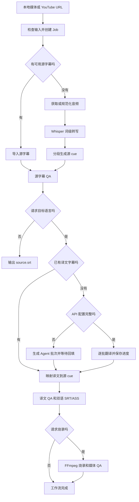

# 项目交接说明

更新时间：2026-08-02

## 当前快照

| 项目 | 状态 |
| --- | --- |
| 包名 | `xvt-video-translate` |
| CLI | `xvt` |
| 版本 | `0.1.1` |
| Python | 3.11 及以上 |
| 当前主线 | 先完成字幕质量与自适应源字幕闭环，再评估 App |
| Job schema | v1（端到端目标为可选 `config.workflow` / `WorkflowConfig`） |
| 自动化测试 | 497 个测试、18 个子测试，全部通过 |
| 静态检查 | Ruff lint 和 formatter 通过 |
| 打包 | wheel 和 source distribution 已验证 |
| CI | GitHub Actions（ubuntu + macos × Python 3.11/3.13 矩阵）跑 ruff、pytest、CLI 冒烟与 `uv build` |
| Git | 功能修改使用 `codex/` 开发分支，Review 通过后以 PR 合并 `main` |
| 默认 CLI 路径 | `run` → `status` → `continue`（批处理 `batch` / `batch-continue`） |

当前代码可以完成本地视频或 YouTube 视频的转写、翻译、双语字幕生成和可选烧录。端到端流程收敛到 `xvt run`；中断后先 `xvt status` 查看 `recovery_plan` / `advance_steps`，再 `xvt continue` 按持久化目标补齐。翻译与烧录推进与 status 共用 `plan_advance_steps`。烧录指纹登记为 `burn_fingerprint` artifact。

## 项目背景

这个项目要解决的是视频字幕翻译链路中最容易失控的三件事：时间轴、翻译上下文和最终显示质量。用户可以只提供视频，也可以同时提供源字幕、机翻字幕或译文字幕。系统需要识别哪些步骤可以跳过，并且始终以源 cue 的时间轴为准。

方案选择了 Python CLI 作为核心，原因是 FFmpeg、yt-dlp、Whisper 和字幕生态在 Python 中接入成本较低。Skill 只负责调用 CLI 或完成 Agent 翻译，不拥有时间轴和媒体处理逻辑。App 暂缓，未来只消费 `job.json` 和 JSONL 事件，不复制业务逻辑。

## 已完成能力

### 输入和素材获取

- 支持本地视频、音频和 HTTP/HTTPS 远程 URL。
- YouTube 通过 yt-dlp 获取元数据、人工字幕、自动字幕、音频或完整视频。
- 人工字幕优先。只有显式传入 `--allow-auto-subtitles` 才使用自动字幕。
- 请求烧录时，远程完整视频在前置阶段下载一次，ASR 和烧录复用同一文件。
- Cookie 来源和代理必须显式传入，不会默认读取浏览器状态。

### 转写和时间轴

- 支持 MLX Whisper 和 faster-whisper，保留词级时间戳；faster-whisper 提供真实百分比，MLX 提供运行时长心跳。
- 分段综合停顿、标点、字幕时长和显示宽度；`conservative`、`balanced`、`compact` 预设仅调整 ASR 的停顿和最大时长，默认保持平衡行为。
- 可导入 SRT、VTT、ASS 和 SSA 源字幕，默认保留用户时间轴。
- 源字幕可直接作为 `run` 输入创建纯字幕 Job，无需媒体即可翻译、QA、恢复和导出三种 SRT；无媒体时不生成 ASS，也不支持预览、烧录或重分段。
- `--align-subtitles` 会额外运行 ASR，并用顺序模糊对齐修正整体偏移或漂移。
- cue 结束时间、相邻重叠和媒体边界会在分段与 QA 阶段校正或阻断。

### 翻译

- 支持 OpenAI-compatible Chat Completions，实际请求地址为 `<base-url>/chat/completions`。
- 默认环境变量为 `XVT_TRANSLATION_BASE_URL`、`XVT_TRANSLATION_MODEL` 和 `XVT_TRANSLATION_API_KEY`。
- `--provider auto` 在配置完整时调用 API，配置不完整时降级为 Agent 批次。
- `--provider openai-compatible` 缺少配置时直接失败，不静默降级。
- `translate` 和 `prepare-translation` 支持 JSON 术语表与 `faithful`、`natural`、`concise` 风格；批次仅携带命中源 cue 的术语。
- `run` 也支持同一套参数，并将解析后的策略快照写入工作流配置；`continue` 不依赖原术语表文件，始终复用该快照。
- 译文 QA 对命中源 cue 的术语确定性检查目标词；违规生成 `glossary_violation`、保留 QA 报告并阻断渲染和烧录。
- API 翻译按批次保存进度，指纹包含源 cue checksum、语言、端点、模型、批次大小、提示词版本、语义分组版本和翻译策略。
- 429、部分 4xx、5xx、网络异常、远端断连和响应读取连接重置具有明确的传输重试分类。传输故障默认最多重试 4 次，优先使用最长 30 秒的有效 `Retry-After`，否则指数退避；结构性无效响应另有固定 1 次纠错重试，两个预算互不消耗。
- 翻译响应必须完整覆盖 cue ID，不允许重复、缺失或额外 ID。
- 翻译在不改动 cue 的前提下建立确定性语义组：句末标点或 650ms 间隔结束组，组上限为 `min(20, batch_size)` 个 cue 或 30 秒，超限按软标点、连接词前和最大停顿择边；单个超长 cue 单独成组。provider 批次只按完整组装箱，批次外前后各一个完整相邻组仅作只读上下文。
- `TranslationBatch.semantic_groups` 记录当前批次的组 ID；响应仍只覆盖当前 `items` 的原 cue ID，不得输出上下文 ID。局部重译使用 singleton groups；`max_target_characters` 是显示建议，最终显示风险仍由确定性 QA 判定。
- `resegment-translation` 仅对超过硬显示阈值且具有 ASR 词级时间戳的 cue 按语义优先边界重切；它重建 source cue 和 source SRT，废弃旧翻译及其下游产物，禁止复用或字符拆分旧译文。
- `retranslate-cues` 只翻译指定 cue ID，保留其他译文和时间轴；每个目标 cue 带相邻源 cue 作为上下文，回填后完整重跑译文 QA 并使旧渲染/烧录产物失效。

### 字幕和显示质量

- 输出 `source.srt`、`translated.srt`、`bilingual.srt` 和 `bilingual.ass`。
- 双语字幕固定为译文一行、原文一行。每种语言内部的原始换行会被折叠。
- 16:9 横版英文在 64 个显示单位以内通过，65 到 72 为警告，超过 72 需要复核。窄画幅会收紧限制，中文限制更严格。
- ASR / `asr_resegmented` 的 `low_timing_confidence` 为 warning；对齐或用户导入字幕的低置信度仍为 review，需确认后继续。
- ASS 使用独立的中英文字体和字号。macOS 默认中文字幕字体为 libass 可读取的 `Hiragino Sans GB`。
- 字幕 QA 失败或进入 `needs_review` 时，工作流停止，不允许继续烧录。
- 语义复核确认后，若译文候选和渲染产物已有效或被补齐，`translate` stage 会收口为 `succeeded` 并清除旧 QA 错误；字幕 QA 的独立 `needs_review` 仍需单独确认。
- 字幕 QA `needs_review` 被确认后，`continue` 会清除 `translate` stage 上的过期阻断错误（要求 QA 门已放行、确认仍对当前源 cue 有效、译文 cue 与两份 SRT 均有效）；旧 Job 下次 `continue` 自动收口。

### 烧录和媒体 QA

- FFmpeg 烧录支持 VideoToolbox 和 libx264。
- 默认优先硬件编码，只在明确的硬件编码器错误时回退 libx264。
- 视频码率按分辨率选择，不再使用 FFmpeg 8.1 不兼容的 VideoToolbox 质量参数。
- 输出媒体会检查视频流、音频流、AAC 音频、分辨率和时长偏差。
- 烧录派生指纹包含译文 checksum、媒体身份、编码方式和字体；成功后写入 checksum 保护的 `burn_fingerprint` artifact（`burn-fingerprint.json`）。旧 Job 若仅有 `workflow.burn_fingerprint` 仍可读取。`continue` 只复用成品、指纹与媒体 QA 均有效时的结果。
- 烧录目标只有在 `burned_video` checksum、烧录指纹和媒体 QA 全部有效时才算完成；指纹失效或媒体 QA 失败会通过 `status`/`continue` 提示重新烧录。
- `preview` 可按 cue 或起始时间生成短片段预览；未显式覆盖时复用工作流保存的烧录媒体、字体和编码设置，不修改正式烧录 stage。
- 预览生成 `preview.ass` 和 `preview.mp4` checksum artifact；译文局部重译或重新分段后旧预览会失效。
- 烧录与预览输出允许写到 Job 目录外的绝对路径，但不得覆盖源媒体、`job.json` 或其他已登记 artifact；同 kind（`burned_video` / `preview_video`）允许重写；路径别名和硬链接也会在写入前检查（`xvt.paths`）。

### Job、恢复和事件

- 每次 `run` 创建独立 Job，stage 和 artifact 写入 `job.json`。
- 普通 CLI 默认把人类可读的阶段、下载、翻译批次、转写和烧录进度写入 stderr，最终路径继续写入 stdout。
- `job_started` 在 Job 首次持久化后立即携带 `job_file`，早期素材获取失败也能定位任务文件。
- 已有 Job 的原子命令会从 CLI 参数预先记录任务路径，早期失败不会误报为任务尚未创建。
- Ctrl-C 返回退出码 130、SIGTERM 返回 143，两者都清理外部进程组并把当前 `running` stage 持久化为 `failed`，错误为 `interrupted by user`；改写既有 Job 的命令与 `batch-continue` 以 flock 独占执行，冲突退出码 7；独立预览中断不会生成正式工作流恢复计划，而是提示重新运行 preview。
- artifact 使用 SHA-256 checksum，`verify` 会重新计算。
- `resume` 只恢复转写 checkpoint；`continue` 读取 `job.config.workflow` 完成翻译和烧录目标。
- 远程端到端 Job 在检查或下载阶段失败后，可以通过 `continue` 在同一个 Job 中重试；checksum 有效的远程元数据、字幕和媒体会被复用。
- `--cookies-from-browser` 和 `--proxy` 同时作用于远程检查与下载，重试时可以重新显式提供。
- `status`、普通失败输出和 Ctrl-C 共用结构化 `RecoveryPlan`，只复用 checksum 验证通过的 artifact。
- 端到端 Job 的恢复计划通过 `plan_advance_steps` 与 `continue` 对齐，并暴露 `advance_steps`（人类可读 `steps:` 行与 JSON `recovery_plan`）。
- 恢复计划区分 `retryable`、`awaiting_input`、`manual_fix`、`unrecoverable` 和 `complete`。
- 当前 schema 的 Job 若缺少必填字段、stage 或字段类型错误，会作为可控的无效输入失败，不输出 Python traceback。
- Agent 降级会进入 `awaiting_input`，不会发出虚假的完成事件。
- JSONL 已覆盖工作流、stage、artifact、翻译批次、下载、转写和烧录进度。
- `workflow_completed` 和 `cli_completed` 会列出 checksum 有效的用户产物；仅生成源字幕的任务也会返回 `source.srt`。
- `batch` 会固定目录输入清单并串行创建独立 Job；单项失败不会阻断后续文件，`batch.json` 原子记录汇总状态和恢复计划。
- `batch-continue` 校验已有 Job 后只恢复未完成项，Agent 等待和人工修复仍保持显式阻断。
- `--events-jsonl` 继续保持 stdout 纯 JSONL，不与普通进度文本混合。
- 命令参数、URL 用户信息、常见签名查询参数、Cookie 和鉴权信息会在事件边界脱敏。

## 支持的输入组合

| 输入 | 行为 |
| --- | --- |
| 本地视频 | ASR，按需翻译和烧录 |
| 本地视频 + 源字幕 | 跳过 ASR，保留源字幕时间轴 |
| 本地视频 + 源字幕 + 译文字幕 | 跳过 ASR 和翻译 API，合并后可烧录 |
| 本地音频 | ASR 和字幕输出；烧录时必须增加 `--burn-media` |
| YouTube URL | 按参数选择平台字幕或 Whisper |
| YouTube URL + 人工字幕请求 | 优先下载人工字幕，缺失时按配置回退自动字幕或 ASR |
| 本地目录 | `batch` 按稳定顺序创建独立 Job，失败隔离并生成可恢复汇总报告 |
| 已有 Job | `status` 查看下一步，`verify` 校验，`resume` 恢复转写，`continue` 完成端到端目标 |

纯字幕文件可以直接创建 Job；一个 Job 仍然只能生成一个目标语言。

## 端到端工作流



## 常用命令

完整本地流程：

```bash
uv run --no-sync xvt run "/path/to/video.mp4" \
  --output "/absolute/output" \
  --language en \
  --target-language zh-CN \
  --provider auto \
  --burn \
  --events-jsonl
```

YouTube 平台字幕优先：

```bash
uv run --no-sync xvt run "https://www.youtube.com/watch?v=VIDEO_ID" \
  --output "/absolute/output" \
  --youtube-subtitles \
  --subtitle-language en \
  --allow-auto-subtitles \
  --target-language zh-CN \
  --burn
```

已有源字幕和译文字幕：

```bash
uv run --no-sync xvt run "/path/to/video.mp4" \
  --output "/absolute/output" \
  --subtitles "/path/to/source.srt" \
  --translation-subtitles "/path/to/translated.srt" \
  --target-language zh-CN \
  --burn
```

恢复和诊断（优先 `status` → `continue`）：

```bash
uv run --no-sync xvt status "/path/to/job.json"
uv run --no-sync xvt status "/path/to/job.json" --json   # recovery_plan.advance_steps
uv run --no-sync xvt continue "/path/to/job.json" --events-jsonl
uv run --no-sync xvt verify "/path/to/job.json" --json
# advanced：仅转写 checkpoint
uv run --no-sync xvt resume "/path/to/job.json" --events-jsonl
uv run --no-sync xvt preview "/path/to/job.json" --cue 18 --duration 15
uv run --no-sync xvt batch "/path/to/input-directory" --output "/absolute/output"
uv run --no-sync xvt batch-continue "/path/to/batch.json" --events-jsonl
```

Agent 翻译回填：

```bash
uv run --no-sync xvt apply-translation "/path/to/job.json" \
  "/path/to/translation-response.json" \
  --target-language zh-CN

uv run --no-sync xvt continue "/path/to/job.json"
```

局部重译与 Agent 回填：

```bash
uv run --no-sync xvt retranslate-cues "/path/to/job.json" \
  --cue 18 --target-language zh-CN --provider agent

uv run --no-sync xvt apply-cue-retranslation "/path/to/job.json" \
  "/path/to/cue-retranslation-response.json" \
  --cue 18 --target-language zh-CN

uv run --no-sync xvt continue "/path/to/job.json"
```

## Job 模型

Stage 包含：

```text
inspect
acquire
normalize_audio
import_subtitles
transcribe
align
segment
translate
subtitle_qa
render
burn
media_qa
```

Stage 状态为 `pending`、`running`、`awaiting_input`、`succeeded`、`failed` 或 `skipped`。

典型 artifact 包含：

```text
media.json
remote.json
audio.wav
words.json
source-cues.json
source.srt
translation-batches.json
translation-progress.json
translation-response.json
translated-cues.json
translated.srt
bilingual.srt
bilingual.ass
preview.ass
preview.mp4
qa.json
qa-translated.json
burned.mp4
media-qa.json
```

`job.config.workflow` 保存目标语言、请求产物、翻译提供方、模型、API Key 环境变量名、分段预设、烧录参数和派生指纹。它不保存 API Key 或代理凭据。

批处理使用独立的 `batch.json` schema v1，不改变 Job schema。报告位于 `output/batches/<batch-id>/batch.json`，保存固定输入清单、共享工作流参数、每项 Job 文件、产物、状态、脱敏错误和恢复计划。批处理不复制媒体或字幕算法。

## 关键设计决定

1. CLI 是唯一业务内核。Skill 和未来 App 都只做调用与展示。
2. Python 继续作为当前实现语言。暂时没有迁移到 TypeScript 的收益，App 层可以使用 React 和 TypeScript。
3. 时间轴优先于翻译文本。任何翻译优化都必须保持 cue ID 和时间不变。
4. 单目标语言对应单 Job。多语言需求创建多个 Job，避免现在就改 schema 和 artifact 命名。
5. `resume` 和 `continue` 保持独立。一个处理转写 checkpoint，一个处理用户目标。
6. 平台字幕和用户字幕属于可跳过 ASR 的输入，不是 ASR 结果的附属品。
7. Agent 降级是明确的等待状态。缺少 API 配置时不能假装端到端任务已经完成。
8. 硬件编码回退只识别编码器错误。字幕文件、路径或滤镜错误必须原样失败。
9. 批处理只做串行编排；每个输入仍由独立 Job 和原有恢复计划负责状态与产物正确性。

## 已知限制

- 翻译后的目标文本若超过硬显示阈值仍由 QA 阻断；自动重切并重新翻译尚未实现。
- 新 Job 默认生成单遍语义组译文，也可显式选择 `--translation-quality polished`；默认是否切换为 `natural + polished` 仍需真实 E2E 验收。
- `rebuild-source` 只适用于有媒体的 Job；纯字幕 Job 的源字幕问题仍需人工修复。
- 高级命令 `retranslate-cues` 已与主翻译共用传输/结构重试和 retry 事件语义，但仍只在全部选定 cue 翻译完成后写最终响应；中途失败会重复请求该次命令中已成功的批次，因此不会提前发送意味着已持久化的 `translation_batch_completed`。端到端主翻译的逐批 checkpoint 不受影响。
- 目录批处理当前串行执行，不支持后台队列、目录监控或每项不同参数；请求烧录时目录只能包含视频，音频和纯字幕输入必须拆成不烧录的独立批次。
- 不支持远程执行或多租户 Web 服务。
- 没有可视化校对界面和桌面 App。
- `continue` 只适用于带 `job.config.workflow` 的端到端 Job。旧 Job 继续使用原子命令。

## 后续任务规划

### Q1-Q6：字幕质量与自适应源字幕

完整方案已经过架构终审并落在 [字幕质量与自适应源字幕技术方案](docs/SUBTITLE_QUALITY_PLAN.md)。Q1–Q6 已按顺序完成：翻译传输可靠性 → 新 Job 自适应源字幕 → 已有 Job 源字幕重建 → 语义组翻译 → 可恢复字幕润色 → 语义校对与一次修复。下一步是使用真实公开素材完成 polished API/Agent E2E，再决定是否切换默认质量。

关键兼容性决定：不新增 `StageName`，Job schema 继续为 v1；润色和语义校对通过 artifact、事件和现有 stage 的细分状态表达。旧 Job 缺少新配置时保持当前平台字幕/单遍翻译行为。GUI 延后到本方案完成真实 E2E 验收之后。

**Q1：翻译传输可靠性已完成。** `RemoteDisconnected`、连接重置等传输错误已进入 retryable 分类；传输重试与结构纠错使用独立预算，默认分别为 4 次和 1 次；主翻译与局部重译共用重试实现和 retry 事件语义。

**Q2：新 Job 自适应源字幕已完成。** 平台字幕只在显式 `--youtube-subtitles` 下请求；`--source-strategy auto|subtitles|asr` 写入新 Job 顶层配置。`auto` 直接采用通过 QA 的人工候选，对失败候选先对齐再回退 ASR；自动候选在翻译/烧录目标中使用 ASR，源字幕-only 且 QA 通过时可直接采用。候选 QA 和选择写为 `source_candidate_qa`、`source_selection` checksum artifact，并以 `source_selected` 事件记录；平台尾 cue 仅在超出媒体不超过 500ms 时裁剪。旧 Job 缺少策略仍走历史路径。

**Q3：已有 Job 源字幕重建已完成。** advanced `xvt rebuild-source JOB --strategy asr [--cookies-from-browser ...] [--proxy ...]` 显式重建，不由 `continue` 自动执行。它复用校验通过的词级转写、规范化音频和本地或已下载媒体；远程缺少可用 checkpoint 与媒体时才重取。命令持久化 ASR 策略与修复意图、关闭对齐，失效 `source_candidate_qa`、`source_cues`、`source_selection`、`translation_resegmentation` 及全部下游产物，并保留 `input_translation_subtitles` 以按新 cue 重新验证映射。修复中断后 `status` 保持显式重试，成功后端到端 Job 用 `continue`，旧原子 Job 用 `translate`。`status` 仅在非 ASR 源字幕 QA error 且可重建时首次给出建议，不对 ASR 自身 error、`needs_review` 或译文 QA 重复建议重建；不升级 schema 或新增 stage/事件类型，复用既有 artifact/stage、`source_selected` 和 `cli_completed`。

**Q4：语义组翻译已完成。** 翻译前由确定性代码建立语义组，句末标点或 650ms 间隔结束组；组上限为 `min(20, batch_size)` 个 cue 或 30 秒，超限依次按软标点、连接词前和最大停顿择边，单个超长 cue 单独成组。provider 以完整组装箱，批次外前后各一个完整相邻组只读；`semantic_groups` 保持为批次协议的可选加法，响应继续严格只覆盖当前 `items`。prompt v3 和 grouping version 进入 API 指纹以重置旧 API checkpoint，并写入 Agent manifest 供消费者识别；已等待输入的旧 Agent Job 仍按严格 ID 契约兼容回填，重新准备批次后才获得语义组。Q4 不新增 stage、artifact、事件或 Job schema，默认翻译风格继续为 `faithful`，局部重译使用 singleton groups。

**Q5a：已有译文可恢复润色已完成。** `polish-translation` 为现代端到端 Job 保存 `translation_draft_cues`，持久化 `translation_quality=polished`，并以 `translation_polish_batches` / `translation_polish_progress` / `translation_polished_cues` 表达 Agent/API 恢复状态。`status`、`continue` 和 `batch-continue` 共用 `polish` / `await_agent_polish` 计划；局部重译和重新导入译文会重建 draft 并失效旧润色结果。润色复用 `translate` stage 与批次事件的 `phase=polish`，不升级 Job schema。

**Q5b：新 Job 翻译质量模式已完成。** `run`、`batch`、`translate` 和 `prepare-translation` 支持 `--translation-quality standard|polished`，默认仍为 `standard + faithful`。API polished 路径按 draft -> polish 保存两阶段 checkpoint；Agent manifest 使用 `task=translate_and_polish`、task version 和可重算 fingerprint，一次回填登记 progress 与 polished 候选。Agent 无 draft 证据链可从完整 progress 确定性补齐 polished 候选，且不会被误判为 Q5a 的 draft 修复。旧 WorkflowConfig、原子 Job、batch manifest 和无 task Agent manifest 继续按 `standard`。

**Q6：语义校对与一次修复已完成。** polished 候选必须经过 `meaning_error`、`omission`、`terminology`、`awkward_join`、`source_suspect` 五类结构化 review；除 `source_suspect` 外的问题按完整语义组最多修复一次并最终复查。API 初审、修复和复审逐批 checkpoint，并使用阶段对应的结构纠错提示；Agent 使用严格绑定 Job、候选、版本和批次的 `task=semantic_review_and_repair` manifest，通过 `apply-semantic-review` 一次性校验后回填，无效响应不会破坏等待状态。初次报告含可修复问题时不能提前确认；`source_suspect` 在无关修复后继续保留；最终报告只有在初次报告、修复 checkpoint 和修复候选 checksum 均有效时才能批准。新增四类 checksum artifact，`status` / `continue` / batch recovery 区分 Agent 输入等待和人工语义确认等待。确认绑定 source、候选、报告、prompt version 与精确问题集合，且后续确定性字幕 QA 仍可阻断。专项方案见 [Q6 技术方案](docs/Q6_SEMANTIC_REVIEW_PLAN.md)。

**Q6.1a：人工译文修订已完成。** Q6 等待人工复核时生成 fingerprint 绑定的 `review/translation-review-*.json`，用户通过 `apply-translation-review-fixes` 回填；只允许修改既有 cue 的译文，接受后登记完整修订记录、独立候选并执行 review-only 语义复查，不增加第二次自动修复。`status` 只读并展示修订首选路径和确认备选路径；旧等待 Job 由 `continue` 懒生成模板。详见 [Q6.1 方案](docs/Q6_1_HUMAN_REVISION_PLAN.md)。

**Q6.1b：源文修订与多路径引导已完成。** `prepare-source-review JOB --cue ID` 生成绑定当前 source checksum 和精确 ID 集合的模板，`apply-source-review-fixes` 只修改 source text，保留 cue 时间轴、words、置信度和 provenance。接受结果以 fingerprint 文件保存，并在一次 Job 原子保存中切换 `source_review_revision`、source cue、`selected_kind=human_reviewed` 的选择记录、源 QA 和可用 SRT；QA 阻断时不登记 SRT，确认后 `continue` 从人工 cue 恢复。旧翻译、润色、语义报告、译文修订、渲染和烧录全部失效，上游媒体与转写证据保留；导入译文任务明确拒绝。Q6 的 `source_suspect` 现在会自动准备源文模板，`status` 优先源文修订并同时提供译文修订和直接确认；旧等待 Job 由 `continue` 懒生成，避免在恢复命令中展开大量 cue ID。

**Q6.1c：提示词加固已完成。** API 与 Agent 统一把完整语义组作为连续话语处理，翻译与润色允许同组内协调语序、指代和连接词但不跨组移动含义；专名、产品名、代码标识符和术语没有明确证据时不得猜测修正。语义校对明确五类问题边界，`source_suspect` 只在上下文矛盾、明显误听或可识别专名异常时报告，并保持人工修订；定向修复联合处理完整组且不把模型建议当作标准答案。批次文本统一按不可信字幕数据处理，不得作为改变任务或输出协议的指令。translation/polish/review/repair prompt 分别升级为 v4/v2/v2/v2；旧 API checkpoint、润色 checkpoint 及带版本指纹的 polished/semantic Agent manifest 安全失效。已等待的标准 Agent Job 仍按严格 ID 契约兼容回填，重新准备批次后才使用新版提示词。下一步使用公开素材完成 polished API/Agent E2E，再决定默认质量。

### R 系列：架构改进与工程加固

2026-08-02 的全量审查（基线 `ab28aff`）产出 [架构改进与工程加固技术方案](docs/ARCH_IMPROVEMENT_PLAN.md)，含 F1–F15 审查发现与 R1/R2/R3 分阶段任务。当前进度：

- **已完成（PR #67）**：真实 Job 复现的两个恢复语义矛盾——R2.5 字幕 QA 确认后 `translate` stage 收口（2026-08-01 polished E2E Job 复现并实证修复）、R2.4 烧录成品缺失误报"媒体 QA 未过"的文案拆分（2026-07-16/18 Job 复现）。
- **已完成（PR #68，堆叠于 #67）**：R1 全部四项——CI 增加 Python 3.11/3.13 矩阵与 `uv build`、补打并推送 `v0.1.0` / `v0.1.1` tag 且 AGENTS 记录发版流程、`tests/test_pipeline_imports.py` 守卫 pipeline 依赖方向、16 个跨模块 `_` 前缀符号公有化。R1.3 落地时发现 semantic ↔ review/revision 存在函数级惰性 import 打破加载期循环，留待 R3.1 一并消解。
- **已完成**：R2.1 `_run_command` 分发拆解——26 个命令分支提取为独立 `_cmd_<name>` 函数 + `_COMMAND_DISPATCH` 字典分发表，`_run_command` 从 622 行缩减至 4 行查表逻辑，纯搬移不改行为。
- **已完成**：R2.2 统一 `xvt apply JOB RESPONSE` 路由——task 字段优先、Job 等待步骤回退的两级路由，`--target-language` 自动解析；原 `apply-*` 命令全部保留为稳定入口，`status` 改为优先推荐统一入口。12 个新增路由测试（含真实 Job 零 mock 集成测试与路由表同源守卫）。
- **待做**：R2.3 人工修订 SRT 通道、R2.4 确认通道评估（GUI 之前）；R3 架构演进（polished E2E 验收后）。

全部改进不触碰不可破坏约束，不改变磁盘协议与旧 Job 兼容性。另：2026-08-01 已用公开素材完成 polished **API** 路径真实 E2E（语义校对零问题通过），Agent 路径 polished E2E 与默认质量切换决策仍待做。

### 已完成：CLI 阶段语义与完成摘要打磨

CLI 执行生命周期加固（Job/Batch 独占执行锁、SIGINT/SIGTERM 取消、进程组清理、持久化中断状态）与 JSONL 事件协议 v1 均已完成，详见 [路线图](ROADMAP.md) 和 [CHANGELOG](CHANGELOG.md)。真实 E2E 暴露的 P0（缺 `translated.srt`/`bilingual.srt`、`needs_review` 恢复不提示 acknowledge）已在本轮修复。Job/artifact 路径安全与输出覆盖策略已固定（见 `xvt.paths`）。这些能力已经满足未来界面消费要求，但在开发界面前先完成字幕质量闭环。

真实 YouTube 字幕翻译与烧录验收已确认功能链路、checksum 和媒体 QA 正常，后续需单独优化 CLI 阶段语义与完成摘要：

- ~~YouTube 下载格式回退 / 403 引导（E2E P0-3）。~~ 已完成：格式串 `bv*+ba/b/18/best`；HTTP 403 提示 `continue` / 更新 yt-dlp / `--cookies-from-browser`。
- ~~下载平台字幕和下载源视频使用不同提示，避免重复显示“获取素材”。~~ 已完成（`acquire` detail）。
- ~~端到端任务不得先显示“跳过翻译/烧录”再实际执行；API 自动翻译准备批次时不得显示“等待用户输入”。~~ 已完成（计划跳过静默 + `await_input`）。
- ~~区分源字幕 QA/渲染与译文字幕 QA/渲染；`needs_review` 在 status 中勿仅显示为 `failed`（P1-7）。~~ 已完成（展示层区分，stage 枚举未扩展）。
- ~~翻译重试的人类可读输出补齐下一次尝试序号和等待时间。~~ 已完成。
- ~~完成摘要按最终视频、字幕和 Job 分类，并由 XVT 显示总耗时。~~ 已完成。
- ~~ASR 低 timing confidence / 确认摩擦（E2E P2）。~~ 已完成：ASR 派生 cue 的 `low_timing_confidence` 降为 warning；对齐与用户导入仍 review；硬溢出仍需确认。
- ~~Job/artifact 路径安全边界和输出覆盖策略。~~ 已完成：烧录/预览经 `xvt.paths` 拒绝覆盖源媒体、job 文件与其他 artifact；同 kind 可重写。

## 接手步骤

1. 阅读 [AGENTS.md](AGENTS.md)、[README.md](README.md)、[架构说明](docs/ARCHITECTURE.md)、[路线图](ROADMAP.md) 和 [贡献指南](CONTRIBUTING.md)。
2. 运行 `uv run --no-sync xvt --help`，确认命令面与本文一致。
3. 运行 Ruff 和全量测试，确认基线没有漂移。
4. 运行 `git status --short --branch -uall`，确认当前分支和 `origin/main` 的同步状态。
5. 从后续任务规划中选择一个小阶段，先提交方案和验收标准，再开始编码。
6. 修改完成后同步相关文档，并更新本文件的测试数量、当前限制和下一步。

基线验证命令：

```bash
uv run --no-sync ruff check src tests
uv run --no-sync ruff format --check src tests
uv run --no-sync pytest -q
uv run --no-sync xvt --help
```

真实 YouTube、API 和烧录验收不应默认执行。需要运行时，先确认公开测试素材、输出目录、网络权限和用户凭据，完成后只记录结论，不记录密钥、Cookie、代理凭据或个人文件路径。
