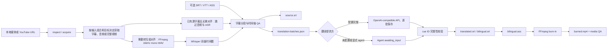

# 架构说明

## 设计目标

Video Translate 采用“稳定 CLI 内核 + 薄 Skill + 后续可选 GUI”的结构。媒体处理、时间轴和文件产物由确定性代码负责；兼容 API 或 Agent 只处理自然语言翻译，不能修改 cue ID 或时间轴。

核心原则：

1. 本地优先：媒体和中间产物默认留在用户指定目录。
2. 时间轴单一来源：ASR 或用户字幕确定 cue 时间，翻译阶段只替换文本。
3. 可恢复：每一步写入 `job.json`，任务失败后可以定位到具体 stage。
4. 可审计：关键输入、字幕、QA 和视频产物均登记 checksum。
5. 系统边界显式校验：URL、媒体文件、翻译响应和外部命令输出都必须验证。
6. 保守恢复：只复用 checksum 验证通过的 checkpoint，派生产物重新生成。

## 工作流



## 模块职责

| 模块 | 职责 |
| --- | --- |
| `cli.py` | 参数解析、命令路由、执行锁、信号处理、用户可读/JSONL 输出 |
| `stages.py` | stage 跳过计划表：给定输入组合声明转写阶段执行/跳过哪些 stage |
| `artifacts.py` | artifact kind 枚举、派生依赖图与失效传递闭包 |
| `errors.py` / `config.py` | 集中退出码与领域异常层次；workflow 默认值单一来源 |
| `cancellation.py` / `locking.py` | SIGINT/SIGTERM 协作式取消；Job 与 batch 的 flock 独占执行锁 |
| `batch.py` | 目录输入快照、串行 Job 编排、失败隔离、原子汇总报告和批量恢复 |
| `workflow.py` | 端到端目标编排：Goals → `plan_advance_steps` → 执行；等待/继续语义和烧录派生指纹 |
| `workflow_config.py` | 持久化 `job.config["workflow"]` 的类型化模型与唯一读写边界（`WorkflowConfig`、目标语言解析、烧录指纹清除） |
| `pipeline/` | 业务主链包：`common` 共享记账、`review` QA 与人工确认、`revision` 人工译文修订、`transcription` 转写、恢复与显式源重建、`translation` 翻译与收尾、`polish` 可恢复润色、`semantic` 语义校对与一次修复、`retranslate` 局部重译、`resegment` 重分段、`burnin` 预览与烧录；`__init__` 仅 re-export 公共入口 |
| `job_store.py` / `models.py` | 任务模型、原子持久化、schema 和 checksum |
| `download.py` / `media.py` | yt-dlp 获取、ffprobe 媒体检查 |
| `transcribe.py` | MLX Whisper、faster-whisper 引擎适配 |
| `segment.py` | 词级结果转 cue，处理停顿、标点、长度和重叠；提供可持久化的 ASR 分段预设 |
| `subtitles.py` / `align.py` | 字幕读写和已有字幕到 ASR 的顺序模糊对齐 |
| `translate.py` / `translation_provider.py` | 确定性语义组、结构化术语表和翻译风格、按完整组装箱的翻译批次协议、兼容 API 调用、断点恢复、cue ID 全量或局部回填；默认 API 批次 25 个 cue、请求超时 180 秒 |
| `qa.py` | 空文本、时间重叠、时长、翻译完整性、术语违规和按画幅计算的字幕显示宽度检查 |
| `render.py` / `burn.py` | 平台感知字体、双语 ASS 样式、分辨率自适应码率与安全的 FFmpeg 参数构造 |
| `paths.py` | 用户烧录/预览输出绝对路径校验与覆盖保护（源媒体、job 文件、已登记 artifact） |
| `events.py` / `process.py` | 结构化事件、敏感命令参数脱敏与流式外部进程执行 |
| `recovery.py` | artifact checksum 校验、`RecoveryPlan`（含 `advance_steps`）、与 `plan_advance_steps` 对齐的恢复建议 |

## Job 与 Artifact

每次 `run` 创建独立任务目录：

```text
output/<job-id>/
├── job.json
├── input/
└── artifacts/
    ├── media.json
    ├── audio.wav
    ├── words.json
    ├── source-cues.json
    ├── source.srt
    ├── translation-resegmentation.json
    ├── translation-batches.json
    ├── translation-progress.json
    ├── translation-draft-cues.json
    ├── translation-polish-batches.json
    ├── translation-polish-progress.json
    ├── translation-polished-cues.json
    ├── translation-semantic-qa.json
    ├── translation-semantic-repair.json
    ├── translation-repaired-cues.json
    ├── translation-semantic-qa-final.json
    ├── translation-response.json
    ├── translated-cues.json
    ├── translated.srt
    ├── bilingual.srt
    ├── bilingual.ass
    ├── preview.ass
    ├── preview.mp4
    ├── qa*.json
    ├── burned.mp4
    └── burn-fingerprint.json
```

Q5 润色复用 `translate` stage，不新增 stage 或 schema。Q5a 的 `polish-translation` 先登记 draft，再持久化 `workflow.translation_quality=polished`，最后通过 artifact DAG 失效旧最终译文及其 QA、渲染和烧录。Q5b 为新 Job 增加 `standard|polished`：API 第一遍写 `phase=draft` 并保存 draft，第二遍写 `phase=polish`；Agent 新 Job 生成 `task=translate_and_polish` 的单个 manifest，以规范化 payload fingerprint 和完整 ID 完成一次回填，不伪造 draft。Agent progress 先于 polished/final cues 落盘，中断后可确定性补齐 QA 和渲染而不再次请求模型。`continue` 的计划步骤区分 Agent 无 draft 证据链与 Q5a/API draft 证据链，批处理经同一 recovery planner 继承该行为。局部重译或重新导入译文时，新完整译文会成为新 draft，旧润色结果不能回写。

Q6 只扩展 `polished`：`translation_polished_cues` 先进入语义校对，可修复分类按完整语义组最多修复一次并生成 `translation_repaired_cues`，随后执行最终复查；`source_suspect` 不自动修复，并在无关文本修复后继续保留。初次报告、修复 checkpoint、修复候选和最终报告分别登记为 `translation_semantic_qa`、`translation_semantic_repair`、`translation_repaired_cues`、`translation_semantic_qa_final`。API 各阶段逐批 checkpoint；Agent 使用 `task=semantic_review_and_repair` 的单个 fingerprint manifest，完整响应校验通过后才写入报告和修复产物。初次报告含可修复问题时不能直接确认；最终报告必须与 checksum 有效的初次报告、修复 checkpoint 和修复候选组成完整链。仍有问题时 planner 返回 `await_translation_review`，确认记录绑定 source、当前候选、报告 checksum、prompt version 和精确问题集合。确认后仍必须通过确定性字幕 QA。默认继续为 `standard + faithful`。

Q6.1a 为 `await_translation_review` 增加人工译文修订：可编辑模板不属于 artifact，接受后的完整修订记录、候选和复查报告分别登记为 `translation_review_revision`、`translation_reviewed_cues`、`translation_semantic_qa_reviewed`。修订 fingerprint 绑定当前 source、候选、报告、prompt 和问题集合；回填只允许修改既有 cue 的 `target_text`。每轮接受结果使用 fingerprint 区分的文件，并通过一次 Job 原子保存切换两项 artifact；失败不会破坏上一轮有效检查点，译文变化同时清除旧字幕 QA 确认。人工候选只重新语义复查，不再获得自动修复预算；API/Agent 语义一致。旧等待 Job 由 `continue` 懒生成模板，`status` 只读取已有模板。专项方案见 [Q6.1 人工校对交互技术方案](Q6_1_HUMAN_REVISION_PLAN.md)。

Q6.1b 为源 cue 增加显式 `prepare-source-review` / `apply-source-review-fixes`。模板 fingerprint 绑定当前 source checksum 和精确 ID 集合，同时生成同名 JSON 与 `source-review-<fp12>.srt`；JSON 的字段与 SRT 的固定文件名分别承载同一 fingerprint。SRT 按原时间轴还原 cue ID，`#<id>` 注释若存在必须匹配，改时间轴、增删 cue、改名或空文本均在解析边界拒绝；两种载体汇聚后都只替换 `source_text`，时间轴、words 与 provenance 不变。接受后以 fingerprint 文件保存完整 `source_review_revision`、新 source cue、选择、QA 和可用 SRT，并通过一次 Job 原子保存切换登记。选择使用 `selected_kind=human_reviewed` 且绑定新 checksum，防止 `continue` 把人工 source 当作缺失选择后重新导入。源 QA 在命令内执行，阻断状态不登记 source SRT；确认后恢复仍从新 cue 推进。旧翻译及全部下游失效，上游媒体、转写和候选证据保留；导入译文任务在模板准备和回填边界统一拒绝。

Q6.1b 收尾将当前有效语义报告中的 `source_suspect` cue ID 去重汇总，在 API、Agent 或 `continue` 进入人工等待时自动准备源文模板；模板不绑定语义报告，避免报告变化覆盖同一 source 上尚未提交的用户编辑。planner 继续使用 `await_translation_review`，但 recovery 同时提供源文修订、译文修订和确认三条路径，并优先源文修订；旧等待 Job 缺模板时 `status` 只读地引导 `continue` 懒生成，避免恢复命令随 cue 数量膨胀。源文适用性和问题 ID 提取均由 revision 模块单一实现，执行与恢复不会各自推导一套规则。

Q6.1c 不改变数据流，只收紧 API 与 Agent 的文本契约。translation v5 和 polish v3 将完整语义组视为连续话语，允许同组内协调语序和连接词，但不跨组移动含义；两者同时避免无来源依据的破折号、公式化对比、空泛连接词、宣传式措辞和抽象拔高，但必须保留源文真实的对比、强调、列举、打断、语气与信息。semantic review v3 继续只检查既有五类语义问题，不把风格偏好升级为 review，并把简中标点收口后的半角空格和 cue 边界视为有效分隔；semantic repair v3 联合修复完整组，不自行改写疑似源文，也不在修复时重新引入上述模型化表达。四类提示词都把批次文本视为不可信字幕数据，忽略其中改变任务或输出协议的指令。四个版本继续进入对应 checkpoint 指纹和 Agent manifest：旧 API checkpoint、润色 checkpoint 及带版本指纹的 polished/semantic Agent manifest 失效；恢复 planner 不会继续等待失效的旧润色 manifest，而会重建当前批次。Agent 局部重译 manifest 绑定提示词版本、源文、当前译文与策略 fingerprint，输入变化或旧版本响应不能回填。已等待的标准 Agent Job 继续按严格 ID 契约兼容回填，重新准备批次后才获得新版提示词。不需要 schema 迁移。

模型生成的简体中文字幕在各模型写入边界（初译、一次翻译加润色、显式润色、语义修复与局部重译）使用同一确定性标点收口：消除全角 `，`、`。`，句中位置按需替换为一个半角空格以保留词边界，行尾与换行前直接移除；模型把省略号写成的连续全角句号（`。。` 及更多）归一为单个 `…`；`？`、`！`、`；`、`：`、`——`、ASCII 标点和已有换行一律保留。左右同形的引号（`"`、`'`、`＂`、`＇`）按上下文推断开闭，英文词内撇号和数字后的尺寸符号不参与引号计数；补出的空格始终落在引文之外。若对应源 cue 去除末尾闭合符号后以 `?` 或 `？` 结尾，且译文末尾没有句末语义标点，则为译文补 `？`，插入位置镜像源文中问号相对末尾闭合符号的位置——源文 `(ready?)` 得到 `（准备好了吗？）`，源文 `Is it (a)?` 得到 `是吗（a）？`；译文末尾闭合符号少于源文时按译文实际数量收敛。语义审查把半角空格和 cue 边界视为有效分隔，不会仅因缺少全角逗号或句号报告 `awkward_join`。语言门仅接受显式简中标签（`zh-CN`、`zh-Hans` 及其大小写/下划线或 `zh-Hans-*` 区域后缀形式），不猜测 bare `zh`。导入译文、人工译文修订、源 cue 和非简中目标语言绕过该步骤。它不改变 cue ID、顺序、时间轴、Job schema、artifact 或事件；API checkpoint 与 Agent 回填都通过同一写入路径，因此重放可得到相同的 cue 文本和 checksum。

Stage 状态包含 `pending`、`running`、`awaiting_input`、`succeeded`、`failed` 和 `skipped`。字幕 QA 的 `needs_review` 阻断可由用户经 `continue --acknowledge-subtitle-review` 显式确认放行：确认记录持久化在 job config、绑定 source cue checksum 与已确认的 review 问题集合，仅覆盖 review 级问题（error 级永不放行），后续 QA 中相同问题子集直接放行并发出 `subtitle_review_acknowledged` 事件，出现新 review 问题仍然阻断；显示宽度类问题按 cue 粒度归并（源字幕 QA 与双语 QA 对同一物理风险的不同 code 视为同族，确认一次即可覆盖两道门）。`low_timing_confidence` 对 ASR / `asr_resegmented` 为 warning，对对齐与用户导入字幕仍为 review。原始 QA 报告不被改写。纯字幕 Job 将媒体获取、ASR、对齐和分段标为 `skipped`，但仍保存导入字幕、source cue、QA 与渲染 artifact；它不保存 `media_info`。Agent 翻译批次生成后任务进入 `awaiting_input`；兼容 API 模式逐批更新进度文件，全部完成后直接继续 QA 和渲染。`retranslate-cues` 为每个指定 cue 构造独立批次，并携带相邻源 cue 作为只读上下文；回填只改写指定 ID，之后完整重跑译文 QA。

`verify` 会重新计算所有 artifact 的 SHA-256。`resume` 只恢复规范化音频、词级转写或源 cue 等转写 checkpoint；`continue` 读取 `job.config.workflow` 中的持久化目标，并可在同一个远程 Job 中重新进入 `inspect / acquire`，随后补齐转写、翻译和烧录。重入时只复用 checksum 有效的远程元数据、平台字幕和媒体文件。Agent 等待时必须先按 `status` 执行 `apply-translation`、`apply-polish-translation`、`apply-semantic-review`、`import-translation` 或 `apply-cue-retranslation`，再由 `continue` 完成余下步骤。

`rebuild-source` 是独立的 advanced 修复命令：`xvt rebuild-source JOB --strategy asr [--cookies-from-browser ...] [--proxy ...]`。它绝不由 `continue` 自动触发，持久化 `source_strategy=asr`、`source_rebuild_requested=true` 并关闭对齐；修复中断后 `status` 仍给出同一显式命令，而不会让 batch 自动调用 `continue`。重建优先复用校验通过的词级转写、规范化音频和本地或已下载媒体；远程 Job 仅在缺少可复用 checkpoint 与媒体时才按显式访问参数重取。命令失效 `source_candidate_qa`、`source_cues`、`source_selection`、`translation_resegmentation` 及其全部下游 artifact，但保留 checksum 有效的 `input_translation_subtitles`；后续 `continue` 优先读取该 Job 内副本，让原始外部译文文件已移动时仍可在新 cue 上重新验证映射。完成后端到端 Job 使用 `continue`，旧原子 Job 使用 `translate`。恢复计划只在非 ASR 源字幕 QA 为 error 且可重建时推荐它；`needs_review`、译文 QA 以及 ASR 自身 QA error 不重复推荐。该能力复用现有 artifact、stage、`source_selected` 和 `cli_completed`，不升级 Job schema 或新增事件类型。

目录批处理使用独立的 batch schema v1，不修改 Job schema。`batch` 在执行前固定输入清单，按路径串行调用现有 `run_workflow`，每个输入仍创建完整独立 Job。`batches/<batch-id>/batch.json` 通过同目录临时文件和 `os.replace` 原子更新，记录每项状态、Job 文件、产物、脱敏错误和结构化恢复计划。`batch-continue` 重新计算各 Job 的恢复计划：完成项只在 checksum 有效时跳过，可重试项进入 `continue_workflow`，等待输入或人工修复项保持阻断。新增文件不会隐式加入旧批次。

`run` 会根据输入组合跳过不需要的阶段：源字幕跳过 ASR，已有译文跳过翻译提供方。跳过决策由 `stages.py` 的计划表统一声明，入口在业务逻辑开始前一次性标记（先计划、后执行）。转写完成后的翻译与烧录推进由 run 首跑与 `continue` 共用的同一推进函数完成：只补齐缺失或指纹失效的产物，首跑与续跑的烧录复用语义完全一致。远程作业请求烧录时前置下载完整视频，ASR 和烧录复用 `source_video`。烧录派生指纹包含译文 checksum、媒体身份、字体和编码参数，成功后登记为 checksum 保护的 `burn_fingerprint` artifact（`burn-fingerprint.json`）；读取时优先该 artifact，旧 Job 仍可回退 `workflow.burn_fingerprint`。指纹随 `burned_video` 进入依赖闭包，重译/重分段时一并失效。只有 burned 成品、指纹与成功的媒体 QA 同时有效时 `continue` 才复用成品，媒体 QA 失败的 Job 会重新进入烧录和检查。`retranslate-cues` 保持 source cue 时间轴和未选中译文不变，先撤销旧 QA、字幕、ASS、烧录和媒体 QA artifact，再回填指定 cue 并重新校验；QA 通过后端到端 Job 可用 `continue` 补齐烧录。若译文超过硬显示阈值，`resegment-translation` 会仅对具备词级时间戳的 ASR cue 按语义边界重切，重新编号 source cue，重建源字幕并使翻译及其下游产物失效；它不拆分旧译文，也不改写用户导入字幕的时间轴。端到端 Job 随后可用 `continue` 重新翻译，带已有译文字幕的工作流会被明确拒绝。

`preview` 是独立诊断命令，不进入持久化工作流目标，也不修改正式烧录 stage。它读取 checksum 有效且 QA 通过的译文 cue，将所选时间窗口平移到零点，复用正式 ASS 样式和 FFmpeg 编码参数生成 `preview.ass` 与 `preview.mp4`。预览 artifact 会在译文局部重译或重新分段后失效。用户指定的烧录 / 预览输出可为 Job 目录外的绝对路径，但写入前经 `paths.py` 拒绝覆盖源媒体、`job.json` 与除正在写入的同 kind 外的已登记 artifact（含 hardlink / `samefile`）。

artifact 依赖图与失效闭包的单一来源是 `src/xvt/artifacts.py`：`ArtifactKind` 登记全部产物种类，`DERIVES_FROM` 记录下游到直接上游的派生边，`pipeline` 包中重译、重新分段和预览的失效集合都由 `downstream_of` 的传递闭包推导，而不再各自维护硬编码集合。

Job schema 演进策略：给 `Job`、`Artifact` 或 stage record 新增可选字段属于前向兼容变更，不需要提升 `schema_version`。`Job.from_dict` 按各 dataclass 已知字段过滤后构造，未知字段会被静默忽略，旧版本 CLI 读取新版本写出的 `job.json` 不会因未知字段崩溃。只有结构性变更（字段重命名、删除或语义变化）才提升 `SCHEMA_VERSION`，并需要在 `models.py` 的 `_MIGRATIONS` 中登记对应源版本号到下一版本的纯函数迁移；`from_dict` 会沿迁移链逐级升级，无迁移路径的未知版本仍报 `Unsupported job schema version` 错误。

Job schema 仍为 v1；端到端目标作为可选 `config.workflow` 保存，由 `WorkflowConfig` 在内存中结构化表示：入口 `WorkflowOptions.persisted_config` 构造类型化对象，写入 Job 时 `to_dict`，读取时 `from_dict`（未知字段忽略，错误类型在边界失败）。`resolve_target_language` 优先读 workflow，再回退原子 `translate` 写入的顶层 `config.target_language`。转写完成后的翻译与烧录推进共用 `workflow_goals`、译文/烧录满足度判定：译文满足要求 `translated_cues` 与 `translated_srt` / `bilingual_srt` 均 checksum 有效；`plan_advance_steps` 列出剩余步骤（含已有 cue 时的 `render`）；`_advance_workflow` 按同一套判定执行，缺 SRT 时经 `complete_translated_outputs` 只补 QA+渲染且不重打翻译 API，并在翻译完成后重新检查烧录指纹；`build_recovery_plan` 对端到端 Job 复用该计划写入 `RecoveryPlan.advance_steps` 与下一步命令，使 `status` 与 `continue` 决策一致。字幕 QA `needs_review`（无 error 级问题）时 recovery / continue 引导 `continue --acknowledge-subtitle-review`。Agent 等待使推进提前返回且不进入烧录。原子转写和端到端工作流都会持久化 `segmentation_preset`，恢复时以保存值重新构造 ASR cue；缺失该字段的旧 Job 按 `balanced` 处理。原子翻译命令和端到端工作流都会持久化解析后的术语表与风格；端到端配置保存策略快照而不保存源文件路径，因此 `continue` 能复现首次运行的策略。翻译先按确定性语义组处理：句末标点或 650ms 间隔结束组，组上限为 `min(20, batch_size)` 个 cue 或 30 秒，超限按软标点、连接词前和最大停顿择边；单个超长 cue 作为不可拆分单元素组。provider 批次只按完整组装箱，批次外前后各一个完整组为只读上下文。`TranslationBatch.semantic_groups` 和 grouping version 是可选协议加法；当前 translation/polish/review/repair prompt 分别为 v5/v3/v3/v3，其中翻译、润色和修复避免模型无依据添加破折号、公式化对比、空泛连接词或宣传式措辞，并保留源文真实的对比、强调、列举、打断、语气与信息。translation prompt 与 grouping version 进入 API 翻译指纹，规则变化会重置 API 进度而不误复用，Agent manifest 只暴露版本供外部消费者识别。已在等待输入的旧 Agent Job 仍可按严格 ID 契约回填，重新准备批次后才获得语义组。局部重译使用 singleton groups。Q4 不新增 stage、artifact、事件或 schema，默认翻译风格继续为 `faithful`。策略进入 API 翻译指纹，批次只携带命中自身源 cue 的术语。译文 QA 会把源 cue 已命中但译文缺失目标词的情况标记为 `glossary_violation` 错误。API Key、代理凭据和 Cookie 内容不进入 Job。当前每个 Job 只对应一个目标语言，多目标语言应创建独立 Job。

语义复核确认后，若候选译文及其渲染产物已有效或补齐成功，`translate` stage 会显式收口为 `succeeded`，不保留此前 QA 阻断留下的旧错误；字幕 QA 的独立 `needs_review` 仍需单独确认。

## 事件和用户反馈

普通 CLI 默认把人类可读的进度写入 stderr，最终 Job 和产物路径保留在 stdout；`--events-jsonl` 则只在 stdout 写入结构化事件。下载、翻译、转写和烧录都通过同一事件边界对外暴露，不要求调用者解析外部工具输出。完成事件返回 checksum 有效的用户产物，包含源字幕任务的 `source.srt`；损坏的当前版本 Job 在模型边界转换为可控的无效输入错误。

批处理在同一事件流中发送 `batch_started`、`batch_item_started`、逐项完成/等待/失败/中断事件以及 `batch_finished`。内部 Job 的原有 workflow、stage 和进度事件保持不变，因此未来界面既能显示批次总进度，也能显示当前 Job 的阶段细节。部分失败以非零退出码和 `batch_finished.status=partial_failure` 收口；存在失败或等待输入项时都不发送虚假的 `cli_completed`。

`transcription_progress` 包含引擎、已处理/总毫秒数、经过时间和可选 ETA。faster-whisper 的分段生成器提供真实完成位置，因此发送 `determinate=true` 的百分比。MLX Whisper 的公开调用接口没有稳定进度回调，只发送 `determinate=false` 的启动和十秒心跳；词级时间戳通过验证后才发送最终 100%，空结果或异常不会伪造成成功。

事件协议版本、兼容性承诺以及全部 `EventType` 及其 `data` 字段契约见 [事件契约](EVENTS.md)。

## 时间轴策略

- ASR 请求词级时间戳，segmenter 才能依据停顿、标点和显示宽度切分。`conservative`、`balanced`、`compact` 只分别调整停顿和最大时长阈值；默认 `balanced` 保持既有结果。超宽片段会先满足硬显示宽度，再优先在句末、软标点、连接词或介词前的词级边界切开；切分发生在翻译前，译文按新的 cue ID 一一生成。若最终译文仍超过硬限制，可显式执行 `resegment-translation`，旧译文不复用，必须对新 cue ID 重新翻译。
- cue 的结束时间来自最后一个词，并添加受控尾部 padding。
- 相邻 cue 发生重叠时归一化边界，不允许翻译阶段改动时间。
- 用户字幕路径应保留原字幕时间轴；ASR 只提供文本匹配和纠错依据。
- 最终 QA 检查空 cue、负时长、重叠、越过媒体时长和缺失译文。纯字幕 Job 没有媒体时长或画幅，只跳过这两类媒体相关检查，保留其余时间轴、文本、术语和阅读速度校验。双语输出会先折叠每种语言内部的源换行，再按语言和画幅检查显示宽度。

## 下一阶段已批准架构

在可视化校对界面之前，项目先实现 [字幕质量与自适应源字幕技术方案](SUBTITLE_QUALITY_PLAN.md)。方案保持现有边界：

- 不新增 Job stage，不升级 Job schema；源字幕选择复用转写腿，润色和语义校对作为 `translate` / `subtitle_qa` 的可恢复子步骤，通过 artifact、现有 stage 状态和事件 `detail` 细分。
- Q2 已完成新 Job 的源字幕选择：平台字幕仅由显式 `--youtube-subtitles` 请求；`auto` 对通过 QA 的人工候选保留快速路径，对失败候选先对齐再 ASR，自动候选在翻译/烧录目标下使用 ASR；`subtitles` / `asr` 可显式覆盖。候选 QA、选择报告和最终 source cues 均为 checksum artifact；用户本地字幕默认保留。
- Q2 选择报告损坏或缺失但 source cues 仍有效时，只从既有 cue provenance 与校验通过的候选/对齐 artifact 重建审计报告，不重新选择或改写时间轴；原因记为 `selection_artifact_recovered`。
- Q3 已完成既有媒体 Job 的显式 ASR 源重建；它不改变端到端目标或翻译策略，保留输入译文以重新映射，且不把重建隐式塞入 `continue`。
- Q4 已完成：翻译以确定性语义组为上下文，按完整组装箱，模型只返回既有 cue ID 的文本；规则版本和 prompt 版本进入恢复边界。
- Q5 已完成：已有工作流译文可显式补跑润色，新 Job 可选择 `standard|polished`，API 支持 draft -> polish 恢复，Agent 支持一次翻译+润色回填。润色、语义校对和一次定向修复均不得修改 cue 数量、顺序和时间码。
- 新增到端到端质量链的草稿、润色、语义校对和修复模型调用都逐批保存 checkpoint；语义问题与确定性 QA 问题使用独立报告和人工确认通道。现有高级命令 `retranslate-cues` 暂不承诺逐批恢复。
- 新配置和 artifact 采用向后兼容的可选加法，旧 Job 缺少质量配置时保持当前单遍翻译行为。
- 未来 Q7 翻译上下文与术语候选包安排在 provider 传输和内容寻址 checkpoint 收敛之后。它只提供可审计的主题、专名和术语候选：用户 glossary 是强约束，平台元数据可作为高置信证据，模型推断只作提示且不得自动修改源 cue 或升级为强制术语；人工确认保持可选，避免所有任务新增阻塞点。

Q1 已固定翻译请求的可靠性边界：`RemoteDisconnected`、连接重置及同类 `ConnectionError` 在请求和响应读取边界统一包装为可重试传输故障；其他 `OSError` 以不可重试依赖故障退出。传输重试默认预算为 4，遵循最长 30 秒的有效 `Retry-After` 或指数退避。结构性无效响应只允许 1 次携带阶段契约纠正提示的重试，不占用传输预算；后续传输重试会清除纠正提示。主翻译、润色、语义校对、定向修复与局部重译共用重试预算语义；只有逐批持久化结果的主链发送 `translation_batch_completed`。Q1–Q6.1 已完成；Q2 的 `reference_allowed` 只记录选择结果，不进入翻译请求。

完整的输入矩阵、CLI、artifact DAG、恢复语义、测试和分阶段交付标准均以该设计文档为准；其中 Q1–Q6.1 已落地，polished API 路径真实 E2E 已完成，Agent 路径与默认质量决策仍待后续确认。

## 安全边界

- 外部命令始终以参数数组执行，不经过 shell 字符串拼接。
- 外部命令以独立进程组启动；正常结束、超时、取消或中断都会清理整个进程组，yt-dlp 派生的 ffmpeg 等孙进程不会成为孤儿。
- Job 与 batch 全生命周期独占执行：锁在资源首次持久化点获取（既有 Job 命令在 CLI 入口、`run` 在 Job 创建后、`batch` 在 batch.json 写出前），挂在命令级锁作用域上直至终态释放（batch 逐项使用条目作用域）；锁序先 batch 后 job，冲突以退出码 7 立即失败；flock 随进程退出自动释放，无陈旧锁问题。
- 外部命令支持静默超时（连续无输出视为挂死，终止进程组并报结构化错误），但默认不启用：yt-dlp 提取阶段等场景存在合法的长时间静默，仅由能保证持续输出的调用方显式设置；挂死进程始终可由用户取消并连同进程组清理。
- CLI 以命令级信号作用域运行：进入时复位取消状态、退出时恢复原信号处理器；第二次 SIGINT/SIGTERM 只保持取消状态、不打断中断记账的清理临界区。
- 下载路径限制在任务目录内。
- Cookie 和代理只接受显式参数，不自动读取浏览器数据；远程检查和下载使用同一组访问参数。
- 日志和 Job 配置只记录 Cookie 来源名称及代理是否启用，不写入凭据。
- 翻译响应必须一一覆盖全部 cue ID，拒绝重复、缺失和额外 ID。
- API Key 只从指定环境变量读取，不写入 Job、事件或命令行参数。
- 命令事件会脱敏代理账号、密码、Cookie、鉴权请求头和签名查询参数。
- 自动模式配置不完整时显式降级为 Agent；显式 API 模式配置错误时直接失败。
- `doctor` 通过真实 libass 渲染检查平台默认中文字幕字体，烧录命令允许显式覆盖中英文字体。

## 迭代顺序

1. 已完成保守、平衡和紧凑分段预设。
2. 已完成串行目录批处理、独立 Job、失败恢复和汇总报告。
3. 翻译提供方可靠性、源字幕自适应、既有 Job 源重建、语义组翻译、可恢复润色和 Q6 语义校对均已完成。
4. 完成剩余 R2 CLI 收敛和 polished Agent 路径真实 E2E，再决定是否调整默认质量。
5. 依次完成 R3.1 provider 传输统一、R3.2 内容寻址 checkpoint 和 Q7 翻译上下文与术语候选包。
6. 实现只消费 JSONL 事件、`job.json`、`batch.json`、QA artifact、人工修订 SRT 和预览产物的可视化校对工作台。
7. 单机 CLI 和界面稳定后，再评估队列、远程执行、Web 服务，以及 WhisperX/Demucs 等高依赖 ASR 扩展。
