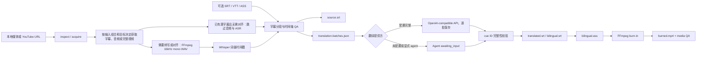

# 架构说明

## YouTube 完整视频画质选择

`download.download_remote_media` 统一转写与远程烧录的完整视频获取。显式 Cookie 的 YouTube 输入串行查询配置访问与匿名访问：yt-dlp 内部按原音轨和分辨率排序，跨访问方式优先已标记原音轨，再比较短边尺寸，无分辨率上限。获选格式 ID 固定，下载在输出目录的独立临时子目录进行，ffprobe 核对尺寸、音视频流和时长后以原子无覆盖 hard link 发布；失败不登记有效媒体。

可选白名单摘要由 `pipeline.common.record_media_download_selection` 在媒体登记后关联。`media_download_selection` 依赖 `downloaded_media` / `source_video` 的失效传播；媒体不反向依赖摘要。缺失、损坏或 checksum 不匹配的摘要被忽略，不影响媒体恢复。摘要事件仅提供 Job 字段与 `summary_path`，不携带原始提取日志或签名 URL。

## 译文布局 QA 与人工修订预检

`pipeline.common.translation_qa_context` 统一候选 QA、修订预检与译文收尾的媒体、字体和术语上下文；显式 workflow 媒体优先，否则使用 checksum 有效的媒体产物。`render` 共用 ASS 样式构造，单次 FFmpeg/libass 调用测量每条源文、译文的可见宽度及描边。`qa` 将实际超宽判为 review，实际容纳得下的建议字数超限仅 warning；测量失败回退保守规则。报告的 `layout` 保存画幅、样式及测量结果，确认记录同时绑定该上下文。

人工修订先经只读解析与完整候选 QA，再由正式 apply 写修订产物和失效下游。`--check` 复用同一入口但不获取执行锁、不写文件、不调用模型。烧录对实际媒体和字体重跑 QA；原子烧录与预览的布局检查只读，不覆盖正式 QA artifact 或更新字幕 QA stage；此前发生的远程媒体获取仍正常持久化。`workflow._ensure_burn` 显式启用 `persist_workflow_qa`，仅按持久化目标执行的烧录保存布局 QA 并更新字幕 QA stage。此路径不改变 cue ID 或时间轴，不新增 stage、artifact kind 或事件类型。

## 设计目标

Video Translate 采用“稳定 CLI 内核 + 薄 Skill + 后续可选 GUI”的结构。媒体处理、时间轴和文件产物由确定性代码负责；兼容 API 或 Agent 只处理自然语言翻译，不能修改 cue ID 或时间轴。

核心原则：

1. 本地优先：媒体和中间产物默认留在用户指定目录。
2. 时间轴单一来源：ASR 或用户字幕确定 cue 时间，翻译阶段只替换文本。
3. 可恢复：每一步写入 `job.json`，任务失败后可以定位到具体 stage。
4. 可审计：关键输入、字幕、QA 和视频产物均登记 checksum。
5. 系统边界显式校验：URL、媒体文件、翻译响应和外部命令输出都必须验证。
6. 保守恢复：只复用 checksum 验证通过的 checkpoint，派生产物重新生成。

## 工作流



## 模块职责

| 模块 | 职责 |
| --- | --- |
| `cli.py` | 参数解析、命令路由、执行锁、信号处理、用户可读/JSONL 输出 |
| `stages.py` | stage 跳过计划表：给定输入组合声明转写阶段执行/跳过哪些 stage |
| `artifacts.py` | artifact kind 枚举、派生依赖图与失效传递闭包 |
| `errors.py` / `config.py` | 集中退出码与领域异常层次；workflow 默认值单一来源 |
| `cancellation.py` / `locking.py` | SIGINT/SIGTERM 协作式取消；Job 与 batch 的 flock 独占执行锁 |
| `batch.py` | 目录输入快照、串行 Job 编排、失败隔离、原子汇总报告和批量恢复 |
| `workflow.py` | 端到端目标编排：Goals → `plan_advance_steps` → 执行；等待/继续语义和烧录派生指纹 |
| `workflow_config.py` | 持久化 `job.config["workflow"]` 的类型化模型与唯一读写边界（`WorkflowConfig`、目标语言解析、烧录指纹清除） |
| `pipeline/` | 业务主链包：`common` 共享记账、`review` QA 与人工确认、`revision` 人工译文修订、`transcription` 转写、恢复与显式源重建、`translation` 翻译与收尾、`polish` 可恢复润色、`semantic` 语义校对与一次修复、`retranslate` 局部重译、`resegment` 重分段、`burnin` 预览与烧录；`__init__` 仅 re-export 公共入口 |
| `job_store.py` / `models.py` | 任务模型、原子持久化、schema 和 checksum |
| `download.py` / `media.py` | yt-dlp 获取、ffprobe 媒体检查 |
| `transcribe.py` | MLX Whisper、faster-whisper 引擎适配；后端缺失时的引擎回退与 `transcription_fallback` 留痕 |
| `segment.py` | 词级结果转 cue，处理停顿、标点、长度和重叠；提供可持久化的 ASR 分段预设 |
| `subtitles.py` / `align.py` | 字幕读写（SRT/VTT 导出保留字面 `{}`）和已有字幕到 ASR 的顺序模糊对齐 |
| `translate.py` / `translation_provider.py` | 确定性语义组、结构化术语表和翻译风格、按完整组装箱的翻译批次协议、兼容 API 调用、断点恢复、cue ID 全量或局部回填；默认 API 批次 25 个 cue、请求超时 180 秒 |
| `qa.py` | 空文本、时间重叠、时长、翻译完整性、术语违规和按画幅计算的字幕显示宽度检查 |
| `render.py` / `burn.py` | 平台感知字体、双语 ASS 样式（cue 文本的字面 `{}` 转义为 libass `\{` `\}`）、分辨率自适应码率与安全的 FFmpeg 参数构造（filtergraph 路径两层转义） |
| `paths.py` | 用户烧录/预览输出绝对路径校验与覆盖保护（源媒体、job 文件、Job 记着的用户原始输入、已登记 artifact） |
| `events.py` / `process.py` | 结构化事件、敏感命令参数脱敏与流式外部进程执行 |
| `recovery.py` | artifact checksum 校验、`RecoveryPlan`（含 `advance_steps`）、与 `plan_advance_steps` 对齐的恢复建议 |

## Job 与 Artifact

每次 `run` 创建独立任务目录：

```text
output/<job-id>/
├── job.json
├── input/
└── artifacts/
    ├── media.json
    ├── audio.wav
    ├── words.json
    ├── source-cues.json
    ├── source.srt
    ├── translation-resegmentation.json
    ├── translation-batches.json
    ├── translation-progress.json
    ├── translation-draft-cues.json
    ├── translation-polish-batches.json
    ├── translation-polish-progress.json
    ├── translation-polished-cues.json
    ├── translation-semantic-qa.json
    ├── translation-semantic-repair.json
    ├── translation-repaired-cues.json
    ├── translation-semantic-qa-final.json
    ├── translation-response.json
    ├── translated-cues.json
    ├── translated.srt
    ├── bilingual.srt
    ├── bilingual.ass
    ├── preview.ass
    ├── preview.mp4
    ├── qa*.json
    ├── burned.mp4
    └── burn-fingerprint.json
```

Q5 润色复用 `translate` stage，不新增 stage 或 schema。Q5a 的 `polish-translation` 先登记 draft，再持久化 `workflow.translation_quality=polished`，最后通过 artifact DAG 失效旧最终译文及其 QA、渲染和烧录。Q5b 为新 Job 增加 `standard|polished`：API 第一遍写 `phase=draft` 并保存 draft，第二遍写 `phase=polish`；Agent 新 Job 生成 `task=translate_and_polish` 的单个 manifest，以规范化 payload fingerprint 和完整 ID 完成一次回填，不伪造 draft。Agent progress 先于 polished/final cues 落盘，中断后可确定性补齐 QA 和渲染而不再次请求模型。`continue` 的计划步骤区分 Agent 无 draft 证据链与 Q5a/API draft 证据链，批处理经同一 recovery planner 继承该行为。局部重译或重新导入译文时，新完整译文会成为新 draft，旧润色结果不能回写。

Q6 只扩展 `polished`：`translation_polished_cues` 先进入语义校对，可修复分类按完整语义组最多修复一次并生成 `translation_repaired_cues`，随后执行最终复查；`source_suspect` 不自动修复，并在无关文本修复后继续保留。初次报告、修复 checkpoint、修复候选和最终报告分别登记为 `translation_semantic_qa`、`translation_semantic_repair`、`translation_repaired_cues`、`translation_semantic_qa_final`。API 各阶段逐批 checkpoint；Agent 使用 `task=semantic_review_and_repair` 的单个 fingerprint manifest，完整响应校验通过后才写入报告和修复产物。初次报告含可修复问题时不能直接确认；最终报告必须与 checksum 有效的初次报告、修复 checkpoint 和修复候选组成完整链。仍有问题时 planner 返回 `await_translation_review`，确认记录绑定 source、当前候选、报告 checksum、prompt version 和精确问题集合。确认后仍必须通过确定性字幕 QA。默认继续为 `standard + faithful`。

Q6.1a 为 `await_translation_review` 增加人工译文修订：可编辑模板不属于 artifact，接受后的完整修订记录、候选和复查报告分别登记为 `translation_review_revision`、`translation_reviewed_cues`、`translation_semantic_qa_reviewed`。polished 候选还必须具备 checksum 绑定且结构有效的 `translation_candidate_qa`；候选变化、报告缺失或损坏均重算并 fail closed，只有可修改目标译文解决的问题进入人工译文模板。修订 fingerprint 绑定当前 source、候选、语义报告、候选 QA 和问题集合；JSON 与 SRT 回填都必须保留模板的完整 cue ID 集合，并且只允许修改既有 cue 的 `target_text`。修订记录持久化实际变化的 `changed_ids`、原问题集合和父修订证据；后续 API/Agent 复查只拥有包含变化 cue 的完整语义组，相邻组仅作为只读上下文，未触及的问题继续保留。旧修订记录缺少范围证据时安全回退为全量复查。`apply --continue` 可在译文回填后继续同一工作流；源文修订因失效下游而拒绝该组合。人工候选只重新语义复查，不再获得自动修复预算；API/Agent 语义一致。纯 `needs_review` 记为 `awaiting_input`，只有 error 级 QA 记为 `failed`。专项方案见 [Q6.1 人工校对交互技术方案](Q6_1_HUMAN_REVISION_PLAN.md)。

Q6.1b 为源 cue 增加显式 `prepare-source-review` / `apply-source-review-fixes`。模板 fingerprint 绑定当前 source checksum 和精确 ID 集合，同时生成同名 JSON 与 `source-review-<fp12>.srt`；JSON 的字段与 SRT 的固定文件名分别承载同一 fingerprint。SRT 按原时间轴还原 cue ID，`#<id>` 注释若存在必须匹配，改时间轴、增删 cue、改名或空文本均在解析边界拒绝；两种载体汇聚后都只替换 `source_text`，时间轴、words 与 provenance 不变。接受后以 fingerprint 文件保存完整 `source_review_revision`、新 source cue、选择、QA 和可用 SRT，并通过一次 Job 原子保存切换登记。选择使用 `selected_kind=human_reviewed` 且绑定新 checksum，防止 `continue` 把人工 source 当作缺失选择后重新导入。源 QA 在命令内执行，阻断状态不登记 source SRT；确认后恢复仍从新 cue 推进。旧翻译及全部下游失效，上游媒体、转写和候选证据保留；导入译文任务在模板准备和回填边界统一拒绝。

Q6.1b 收尾将当前有效语义报告中的 `source_suspect` cue ID 去重汇总，在 API、Agent 或 `continue` 进入人工等待时自动准备源文模板；模板不绑定语义报告，避免报告变化覆盖同一 source 上尚未提交的用户编辑。planner 继续使用 `await_translation_review`，但 recovery 同时提供源文修订、译文修订和确认三条路径，并优先源文修订；旧等待 Job 缺模板时 `status` 只读地引导 `continue` 懒生成，避免恢复命令随 cue 数量膨胀。源文适用性和问题 ID 提取均由 revision 模块单一实现，执行与恢复不会各自推导一套规则。

Q6.1c 不改变数据流，只收紧 API 与 Agent 的文本契约。translation v5 和 polish v3 将完整语义组视为连续话语，允许同组内协调语序和连接词，但不跨组移动含义。semantic review v4 只检查既有五类语义问题，并在解析边界拒绝无实际文本变化的建议、`source_suspect` 的非空建议以及不足两个相邻 cue 的 `awkward_join`；semantic repair v3 联合修复完整组。人工修订后的 `semantic_review_only` 可只包含受 `changed_ids` 影响的批次，清单外相邻组只读。四类提示词版本继续进入 checkpoint 指纹和 Agent manifest，使旧状态安全失效；不需要 schema 迁移。

模型生成的简体中文字幕在各模型写入边界（初译、一次翻译加润色、显式润色、语义修复与局部重译）使用同一确定性标点收口：消除全角 `，`、`。`，句中位置按需替换为一个半角空格以保留词边界，行尾与换行前直接移除；模型把省略号写成的连续全角句号（`。。` 及更多）归一为单个 `…`；`？`、`！`、`；`、`：`、`——`、ASCII 标点和已有换行一律保留。左右同形的引号（`"`、`'`、`＂`、`＇`）按上下文推断开闭，英文词内撇号和数字后的尺寸符号不参与引号计数；补出的空格始终落在引文之外。若对应源 cue 去除末尾闭合符号后以 `?` 或 `？` 结尾，且译文末尾没有句末语义标点，则为译文补 `？`，插入位置镜像源文中问号相对末尾闭合符号的位置——源文 `(ready?)` 得到 `（准备好了吗？）`，源文 `Is it (a)?` 得到 `是吗（a）？`；译文末尾闭合符号少于源文时按译文实际数量收敛。语义审查把半角空格和 cue 边界视为有效分隔，不会仅因缺少全角逗号或句号报告 `awkward_join`。语言门仅接受显式简中标签（`zh-CN`、`zh-Hans` 及其大小写/下划线或 `zh-Hans-*` 区域后缀形式），不猜测 bare `zh`。导入译文、人工译文修订、源 cue 和非简中目标语言绕过该步骤。它不改变 cue ID、顺序、时间轴、Job schema、artifact 或事件；API checkpoint 与 Agent 回填都通过同一写入路径，因此重放可得到相同的 cue 文本和 checksum。

Stage 状态包含 `pending`、`running`、`awaiting_input`、`succeeded`、`failed` 和 `skipped`。字幕 QA 的 `needs_review` 阻断可由用户经 `continue --acknowledge-subtitle-review` 显式确认放行：确认记录持久化在 job config、绑定 source cue checksum、被确认的那份 QA 报告（`report_kind` + `report_checksum`，译文变化即失效，报告未登记时 `report_checksum: null` 也不放行）与已确认的 review 问题集合，仅覆盖 review 级问题（error 级永不放行），后续 QA 中相同问题子集直接放行并发出 `subtitle_review_acknowledged` 事件，出现新 review 问题仍然阻断；显示宽度类问题按 cue 粒度归并（源字幕 QA 与双语 QA 对同一物理风险的不同 code 视为同族，确认一次即可覆盖两道门）。`low_timing_confidence` 对 ASR / `asr_resegmented` 为 warning，对对齐与用户导入字幕仍为 review。原始 QA 报告不被改写。纯字幕 Job 将媒体获取、ASR、对齐和分段标为 `skipped`，但仍保存导入字幕、source cue、QA 与渲染 artifact；它不保存 `media_info`。Agent 翻译批次生成后任务进入 `awaiting_input`；兼容 API 模式逐批更新进度文件，全部完成后直接继续 QA 和渲染。`retranslate-cues` 为每个指定 cue 构造独立批次，并携带相邻源 cue 作为只读上下文；回填只改写指定 ID，之后完整重跑译文 QA。

`verify` 会重新计算所有 artifact 的 SHA-256。`resume` 只恢复规范化音频、词级转写或源 cue 等转写 checkpoint（远程 Job 优先复用 checksum 有效的已下载媒体，缺少可复用媒体时委派远程恢复路径，可能重新下载）；`continue` 读取 `job.config.workflow` 中的持久化目标，并可在同一个远程 Job 中重新进入 `inspect / acquire`，随后补齐转写、翻译和烧录。重入时只复用 checksum 有效的远程元数据、平台字幕和媒体文件。Agent 等待时必须先按 `status` 执行 `apply-translation`、`apply-polish-translation`、`apply-semantic-review`、`import-translation` 或 `apply-cue-retranslation`，再由 `continue` 完成余下步骤。对于登记烧录成品缺失且静态资格满足重新关联的 Job，`status` 将其归类为 `awaiting_input`，优先输出显式 `relink-burned-output`，同时给出 `continue` 重烧的备选；该静态导航不计算源媒体内容 checksum。

`rebuild-source` 是独立的 advanced 修复命令：`xvt rebuild-source JOB --strategy asr [--cookies-from-browser ...] [--proxy ...]`。它绝不由 `continue` 自动触发，持久化 `source_strategy=asr`、`source_rebuild_requested=true` 并关闭对齐；修复中断后 `status` 仍给出同一显式命令，而不会让 batch 自动调用 `continue`。重建优先复用校验通过的词级转写、规范化音频和本地或已下载媒体；远程 Job 仅在缺少可复用 checkpoint 与媒体时才按显式访问参数重取。命令失效 `source_candidate_qa`、`source_cues`、`source_selection`、`translation_resegmentation` 及其全部下游 artifact，但保留 checksum 有效的 `input_translation_subtitles`；后续 `continue` 优先读取该 Job 内副本，让原始外部译文文件已移动时仍可在新 cue 上重新验证映射。完成后端到端 Job 使用 `continue`，旧原子 Job 使用 `translate`。恢复计划只在非 ASR 源字幕 QA 为 error 且可重建时推荐它；`needs_review`、译文 QA 以及 ASR 自身 QA error 不重复推荐。该能力复用现有 artifact、stage、`source_selected` 和 `cli_completed`，不升级 Job schema 或新增事件类型。

目录批处理使用独立的 batch schema v1，不修改 Job schema。`batch` 在执行前固定输入清单，按路径串行调用现有 `run_workflow`，每个输入仍创建完整独立 Job。`batches/<batch-id>/batch.json` 通过同目录临时文件和 `os.replace` 原子更新，记录每项状态、Job 文件、产物、脱敏错误和结构化恢复计划。中断有一条兜底契约：`_process_item` 只覆盖它自己那次中断，批次已落盘但 `batch_started` 正在发射、两个条目之间、条目置 `running` 落盘后但还没进入内层 `try`、以及最后一个条目完成后汇总落盘前这四个窗口由 `_process_batch` 外层的 `except (KeyboardInterrupt, CommandCancelled)` 统一收口（用 `except` 而非 `finally`，避免与内层已完成的收尾打架）。它把仍标 `running` 的条目降级为 `interrupted`，将 `batch.status` 写成 `interrupted`，补上 `next_action` 后原样重新抛出，因此 `batch.json` 不会停在 `status=running` 且没有下一步。它与 `_process_item` 已有的持久化天然幂等（已写过的条目原样重写），也不改变退出码。事件流上条目级终态覆盖全部中断窗口：外层兜底先落盘，再为每个由它降级的条目补发一条 `batch_item_interrupted`（字段口径与内层一致），因此发过 `batch_item_started` 的条目一定会收到终态事件。内层已处理的条目此刻已是 `interrupted`、不在降级集合内，两者互斥，不会重复发送；补发的每次 sink 调用都单独兜住异常，坏 sink 不能顶掉中断本身的传播与退出码。若中断发生在 `batch_started` 发射期间，尚无条目开始，批次仍会落成 `interrupted` 并留下 `next_action`，但不会伪造条目级中断事件。`batch-continue` 重新计算各 Job 的恢复计划：完成项只在 checksum 有效时跳过，可重试项进入 `continue_workflow`，等待输入或人工修复项保持阻断。缺失成品而可重新关联的 Job 是 `awaiting_input`，批处理不得代替用户选择候选文件或自动进入整段重烧；proof、fingerprint 或媒体 QA 不有效（含 legacy proof）的缺失成品则是 `retryable`，可按正常恢复重烧。新增文件不会隐式加入旧批次。

`run` 会根据输入组合跳过不需要的阶段：源字幕跳过 ASR，已有译文跳过翻译提供方。跳过决策由 `stages.py` 的计划表统一声明，入口在业务逻辑开始前一次性标记（先计划、后执行）。转写完成后的翻译与烧录推进由 run 首跑与 `continue` 共用的同一推进函数完成：只补齐缺失或指纹失效的产物，首跑与续跑的烧录复用语义完全一致。远程作业请求烧录时前置下载完整视频，ASR 和烧录复用 `source_video`。烧录派生 fingerprint 包含译文 checksum、媒体身份、字体和编码参数；端到端 `run` / `continue` 烧录登记 checksum 保护的 `version=2` `burn_fingerprint` proof（`burn-fingerprint.json`），其中还绑定 `burned_video` checksum 与实际源媒体内容 checksum。允许临时覆盖媒体、字体或编码参数的高级原子 `xvt burn` 不签发 workflow proof。旧 Job 仍可按既有轻量语义读取 artifact 或 `workflow.burn_fingerprint`，但它们不能作为 relink 证明；要重新关联必须先 `continue` 重烧一次生成有效 v2 proof。指纹随 `burned_video` 进入依赖闭包，重译/重分段时一并失效。只有 burned 成品、proof/指纹与成功的媒体 QA 同时有效时 `continue` 才复用成品，媒体 QA 失败的 Job 会重新进入烧录和检查。「媒体 QA 是否通过」只有一份实现（`workflow.media_qa_failure`：stage succeeded → 报告 checksum 有效 → 可解析 → `status == "pass"`），烧录满足度、relink 资格、`relink-burned-output` 与恢复原因文案一律复用；v2 proof 的指纹比对同样单点实现，源媒体内容 checksum 是否参与由参数表达。指纹判定本身是两段式的单点实现：元数据快路径不匹配时，再用 proof 里登记的烧录时媒体身份（可选字段 `source_media_identity`，只对本地媒体登记）重算一次指纹并比对源媒体当前内容 checksum，证明差异只来自文件元数据才放行，否则照旧判失效（详见[恢复与回填契约](RECOVERY.md#指纹不匹配时的源媒体内容-checksum-回退)）。推进函数在发 `workflow_completed` 之前还会重跑一次恢复计划做 fail-closed 终检，计划非空即抛内部错误，不允许「执行侧报完成、planner 还列步骤」的不一致流出。普通 `status` 不会为 v2 proof 额外计算源媒体内容 checksum，该 checksum 只在烧录落证、relink 校验，以及指纹快路径已判不匹配后的回退判定时计算。`retranslate-cues` 保持 source cue 时间轴和未选中译文不变，先撤销旧 QA、字幕、ASS、烧录和媒体 QA artifact，再回填指定 cue 并重新校验；QA 通过后端到端 Job 可用 `continue` 补齐烧录。若译文超过硬显示阈值，`resegment-translation` 会仅对具备词级时间戳的 ASR cue 按语义边界重切，重新编号 source cue，重建源字幕并使翻译及其下游产物失效；它不拆分旧译文，也不改写用户导入字幕的时间轴。端到端 Job 随后可用 `continue` 重新翻译，带已有译文字幕的工作流会被明确拒绝。

`relink-burned-output` 是烧录成品被移动后的显式恢复边界，不复制、移动、删除或重新编码文件。它要求 Job 身份、持久化烧录目标、唯一且带 checksum 的 `burned_video`、成功且内容为 pass 的媒体 QA、checksum 有效的当前译文，以及 checksum 有效的 `version=2` burn proof；proof 必须同时匹配当前配置的烧录 fingerprint、登记成品 checksum 和重新计算的实际源媒体内容 checksum，候选文件还必须与原成品完全相同的 SHA-256。`status` 只静态判定是否值得提示重新关联，不提前 hash 源媒体；最终命令仍必须执行上述源媒体内容校验。legacy proof/fingerprint 只能维持既有轻量完成语义，不能 relink，且与媒体 QA、proof 或 fingerprint 无效的情形一并归为 `retryable`；用户可 `continue` 重烧一次。任一重复 `burned_video` 登记或校验失败都 fail closed。全部验证通过后才原子更新 `burned_video.path`，保留 checksum，并复用 `artifact_invalidated` / `artifact_created` 事件。`relink-source-media` 是它的对偶：源媒体**永久搬家**（路径变了、内容没变）时把持久化的 `workflow.burn_media` 指到新路径。同样 fail closed 且只认内容 checksum——新文件的 SHA-256 必须等于 v2 proof 登记的 `source_media_checksum`，没有 checksum 有效的 v2 proof 一律拒绝；远程 Job 不支持（媒体是 Job 内登记的下载产物，把 `burn_media` 指向本地路径反而会让媒体身份口径从内容 checksum 换成 `{path, size, mtime_ns}`，逼出一次重烧）。它只写这一个字段，不重烧、不碰 artifact 登记、不改 stage，因此**不发** artifact 事件；零重烧来自上面那条两段式指纹判定的回退，不是本命令自己的承诺（存量 proof 缺可选的 `source_media_identity` 时仍放行，此时 Job 落到 `burn` 重烧一次，新 proof 随即补上该字段）。缺失成品但静态资格齐全时，恢复计划归类为 `awaiting_input`，优先提示人工提供候选文件重新关联，同时保留显式重烧路径；`batch-continue` 对这类项目保持阻断。

`preview` 是独立诊断命令，不进入持久化工作流目标，也不修改正式烧录 stage。它与原子 `burn` 共用 `pipeline.review.review_gate_satisfied` 这一无副作用的放行谓词，口径与 `complete_qa_stage` 完全一致：要求 checksum 有效的译文 cue 与译文 QA 报告，`pass` / `warning` 放行，`needs_review` 只在报告内全部 review 问题都被对当前源 cue 仍有效的确认覆盖时放行，其余情形（error、缺失、checksum 失效、报告结构异常）一律 fail closed。门未通过按 `RuntimeError` 收口为 `workflow` 类别、退出码 4；`burn` 的门在远程媒体下载之前执行。它把所选时间窗口平移到零点，复用正式 ASS 样式和 FFmpeg 编码参数生成 `preview.ass` 与 `preview.mp4`。预览 artifact 会在译文局部重译或重新分段后失效。用户指定的烧录 / 预览输出可为 Job 目录外的绝对路径，但写入前经 `paths.py` 拒绝覆盖源媒体、`job.json` 与除正在写入的同 kind 外的已登记 artifact（含 hardlink / `samefile`）。

artifact 依赖图与失效闭包的单一来源是 `src/xvt/artifacts.py`：`ArtifactKind` 登记全部产物种类，`DERIVES_FROM` 记录下游到直接上游的派生边，`pipeline` 包中重译、重新分段和预览的失效集合都由 `downstream_of` 的传递闭包推导，而不再各自维护硬编码集合。

Job schema 演进策略：给 `Job`、`Artifact` 或 stage record 新增可选字段属于前向兼容变更，不需要提升 `schema_version`。`Job.from_dict` 按各 dataclass 已知字段过滤后构造，未知字段会被静默忽略，旧版本 CLI 读取新版本写出的 `job.json` 不会因未知字段崩溃。只有结构性变更（字段重命名、删除或语义变化）才提升 `SCHEMA_VERSION`，并需要在 `models.py` 的 `_MIGRATIONS` 中登记对应源版本号到下一版本的纯函数迁移；`from_dict` 会沿迁移链逐级升级，无迁移路径的未知版本仍报 `Unsupported job schema version` 错误。

Job schema 仍为 v1；端到端目标作为可选 `config.workflow` 保存，由 `WorkflowConfig` 在内存中结构化表示：入口 `WorkflowOptions.persisted_config` 构造类型化对象，写入 Job 时 `to_dict`，读取时 `from_dict`（未知字段忽略，错误类型在边界失败）。`resolve_target_language` 优先读 workflow，再回退原子 `translate` 写入的顶层 `config.target_language`。转写完成后的翻译与烧录推进共用 `workflow_goals`、译文/烧录满足度判定：译文满足要求 `translated_cues`、`translated_srt` / `bilingual_srt`、译文 QA 报告（`translated_subtitle_qa`）以及**已登记过**的 `bilingual_ass` 均 checksum 有效——QA 报告是烧录/预览安全门的硬前置，`bilingual_ass` 是产物表列出的交付物且没有任何命令能单独重建它，两者单独失效时都按未满足处理，由 `render` 步骤零成本重建（重算 QA + 重新渲染，不调用翻译 API、不重写 cue）。`bilingual_ass` 这一项是条件性的：渲染侧只在媒体有正整数宽高时写 ASS，纯音频与纯字幕 Job 从来不登记该 kind，对它们要求 ASS 会让 `continue` 永远收敛不了，因此判定以「Job 上是否登记过该 kind」为前提，登记过才要求有效；不按 `--burn` 分叉，烧录 Job 至多多渲染一次 ASS，代价为零；`plan_advance_steps` 列出剩余步骤（含已有 cue 时的 `render`）；它在函数体最前先判定局部重译等待——`retranslate-cues --provider agent` 会把一个译文目标已经满足的 Job 置为等待，不早退就会返回空计划、让 `status` 与 `continue` 一起报完成。该谓词（`pipeline.retranslate.cue_retranslation_waiting`）严格要求五项全真：`TRANSLATE` 停在 `awaiting_input` **或** `failed`、重译 manifest checksum 有效、当前 `translated_cues` checksum 有效、manifest 记录的 source/translated cue checksum 与当前逐一相等，以及（仅 `failed` 情形）没有更新的在途整轮翻译请求。第一项接受 `failed`：manifest 一经登记就独立于 stage 状态——API 模式的 `retranslate-cues` 先写出并登记 manifest 再逐批调用提供方，中途失败把 `TRANSLATE` 记为 `failed` 而 manifest 仍然有效（可改走 Agent 回填用完它），API 模式回填自身落盘响应时的校验失败同样收口为 `failed`，更早版本的 xvt 还会在用户显式回填失败时置 `failed`。这些情形下等待都没有作废，只认 `awaiting_input` 会让 `status` / `continue` 不再提示回填（`SUBTITLE_QA` 成功时误报完成，失败时给出一条用户已经跑过的 `retranslate-cues`）。用户显式 `apply-cue-retranslation` 的校验全是只读动作，失败不改写 stage（`TRANSLATE` 保持 `awaiting_input`），与本项无关。整轮回填侧是同一条约定：`apply_agent_translation`（统一入口 `xvt apply` 的翻译路由同理）与 `apply_subtitle_translation` 的响应/字幕读取、结构校验、ID 覆盖比对与映射都前置到 `set_stage(RUNNING)` 之前，坏输入原样抛出而不写 Job 状态——否则等待态被用户自己的输入顶成 `failed`，`plan_advance_steps` 不再返回等待步骤，`xvt apply` 误报「not awaiting Agent input」，恢复计划从「等你回填」降级成重跑翻译。校验通过后才置 `running`，其后的失败仍由 `finalize_translation` 收口成 `failed`；API 模式（响应是 XVT 自己落盘并登记的内部产物、stage 已在 `running`）不适用该约定，校验失败仍是 `failed`。第五项以 `job.artifacts` 的相对次序判定「更新」——`add_artifact` 先按 kind 去重再追加，整轮批次排在重译 manifest 之后即表示用户改走了整轮重翻，此时整轮等待优先，回填出口不会指向已被取代的那一份。中间两项把「已回填、manifest 只是残留」的旧文件排除干净——`cue_retranslation_batches` 在依赖图上只派生自 `source_cues`，译文改写不会失效它，只看 stage + manifest 有效会把随后的润色/语义等待错误地盖成重译等待。该步骤名 `await_cue_retranslation` 属于 `AWAIT_STEPS`，但不进 `xvt apply` 的步骤路由表（`apply-cue-retranslation` 需要显式 `--cue` / `--target-language`），恢复计划改为直接给出拼好 cue ID 与目标语言的回填命令。同一函数里还有第二处等待早退：`TRANSLATE` 停在 `awaiting_input` 且 `translation_batches` checksum 有效时直接返回 `("await_agent_translation",)`，它必须排在既有的 `translated_cues` → `render` 分支之前——`prepare_agent_translation` 写出新的整轮请求时只把 stage 置为等待，不失效旧译文（等待期间旧译文对用户仍有价值），按 `render` 先判会把「等 Agent 回填整轮译文」误报成「只差渲染」，统一 `xvt apply` 也因为拿不到 `await_agent_translation` 路由而拒收合法响应；批次 manifest checksum 有效是必要条件，manifest 已经不在时没有任何响应能回填这次等待；那种 Job 落到最后的兜底分支，给出可推进的 `translate`（导入译文 Job 给出 `import_translation`）而不是再报一次等待——报等待会让 `status` 说等回填、`xvt apply` 被 manifest 校验拒绝、`continue` 只发 waiting，三方互指没有出口。`_ensure_translation` 的等待分支复述同一个条件，manifest 失效时落到 `run_translation` 重建批次。与「局部重译等待优先于 `qa_blocked`」同构，端到端 Job 上 `qa_blocked` 还要给**任何**在途 Agent 等待让路：`SUBTITLE_QA=failed` 只说明上一次译文 QA 没过，它不会因为随后开了一次新等待而自动复位（`prepare_agent_translation` 移走重译 manifest、写入新的 `translation_batches` 并置 `TRANSLATE=awaiting_input`，却不碰 `SUBTITLE_QA`）。因此 `recovery._build_recovery_plan` 在进入 `qa_blocked` 之前先问 planner，首步是正式等待步骤时改走工作流恢复分支；`workflow._advance_workflow` 把 `subtitle_qa_failure_guidance` 移到 planner 之后、只在首步不是等待步骤时触发。原子 Job（无 workflow 目标）没有 planner，改用等价条件让路：`TRANSLATE` 停在 `awaiting_input` 且 `translation_batches` checksum 有效时跳过 `qa_blocked`，由原子等待分支给出 `apply-translation` 引导——否则术语死锁后改跑 `translate --provider agent` 的用户会拿到一条 `retranslate-cues`，照做会盖掉刚写入的整轮 manifest；manifest 已经不在的等待态残留不放行，QA 引导照旧生效。三侧口径由此一致：`status` 报等待、`continue` 返回 `awaiting_input` 而不是抛错要求重跑、`batch-continue` 停在该条目并给出统一 `xvt apply` 或 `apply-cue-retranslation` 引导。`_advance_workflow` 按同一套判定执行，缺 SRT 时经 `complete_translated_outputs` 只补 QA+渲染且不重打翻译 API，并在翻译完成后重新检查烧录指纹；`build_recovery_plan` 对端到端 Job 复用该计划写入 `RecoveryPlan.advance_steps` 与下一步命令，使 `status` 与 `continue` 决策一致。原子 Job（`workflow` 为 None）另有一条独立分支：译文 cue 有效而已登记的 `translated_subtitle_qa` checksum 失效时不再归 `complete`——烧录/预览门以该报告为硬前置。此时若 Job 内还有 checksum 有效的 `translated_srt`，归 `retryable` 并首选 `import-translation`（与 render 共用 `finalize_translation` 收尾，零翻译 API 调用，但会登记 `input_translation_subtitles` / `translation_mapping`），否则归 `manual_fix` 并只推荐重跑 `translate`。该命令由 `recovery.atomic_translated_qa_rebuild_command` 单点拼装，被原子分支、`qa_blocked` 上 `workflow` 为 None 的分支与 `pipeline.burnin` 的原子 QA 门文案三处共用，保证门、`status` 与 CLI 三处口径一致；门只在「报告缺失或 checksum 失效」这条产物缺口上给该出口，报告存在但判定不放行时仍指向重跑翻译。字幕 QA `needs_review`（无 error 级问题）时 recovery / continue 引导 `continue --acknowledge-subtitle-review`。Agent 等待使推进提前返回且不进入烧录。原子转写和端到端工作流都会持久化 `segmentation_preset`，恢复时以保存值重新构造 ASR cue；缺失该字段的旧 Job 按 `balanced` 处理。原子翻译命令和端到端工作流都会持久化解析后的术语表与风格；端到端配置保存策略快照而不保存源文件路径，因此 `continue` 能复现首次运行的策略。译文 QA 与语义链候选 QA 的必需术语按同一顺序解析——先 `config.workflow.translation_policy` 快照，再回退原子 Job 的顶层 `config.translation_policy`；`prepare-translation` 也在本函数最后一次 `save_job` 之前写入顶层配置，避免兼容 API 模式下随后的 `load_job` 把策略丢弃、让术语校验静默失效。翻译先按确定性语义组处理：句末标点或 650ms 间隔结束组，组上限为 `min(20, batch_size)` 个 cue 或 30 秒，超限按软标点、连接词前和最大停顿择边；单个超长 cue 作为不可拆分单元素组。provider 批次只按完整组装箱，批次外前后各一个完整组为只读上下文。`TranslationBatch.semantic_groups` 和 grouping version 是可选协议加法；当前 translation/polish/review/repair prompt 分别为 v5/v3/v4/v3，其中翻译、润色和修复避免模型无依据添加破折号、公式化对比、空泛连接词或宣传式措辞，并保留源文真实的对比、强调、列举、打断、语气与信息。translation prompt 与 grouping version 进入 API 翻译指纹，规则变化会重置 API 进度而不误复用，Agent manifest 只暴露版本供外部消费者识别。已在等待输入的旧 Agent Job 仍可按严格 ID 契约回填，重新准备批次后才获得语义组。局部重译使用 singleton groups。Q4 不新增 stage、artifact、事件或 schema，默认翻译风格继续为 `faithful`。策略进入 API 翻译指纹，批次只携带命中自身源 cue 的术语。译文 QA 会把源 cue 已命中但译文缺失目标词的情况标记为 `glossary_violation` 错误。该错误是 error 级，`--acknowledge-subtitle-review` 的确认通道只覆盖 review 级，因此阻断的 error 全部是 `glossary_violation` 时，`subtitle_qa_failure_guidance` 直接给出 `retranslate-cues --cue … --target-language …` 作为 `primary_command`（`status` 与 `continue` 共用同一份引导），cue id 取报告里 error 级问题的 `cue_id`、去重升序；混有其他 error 或源字幕 QA 自身有 error 时不给该出口。reason 按质量档分岔：`standard` 上只改写指定 cue、其余译文与时间轴不变；`polished` 上 `apply_cue_retranslation` 经 `finalize_translation` 把结果写成新草稿并失效润色候选、语义校对结论与最终译文，整条润色腿要重跑，因此文案不承诺其余译文不变。API Key、代理凭据和 Cookie 内容不进入 Job。当前每个 Job 只对应一个目标语言，多目标语言应创建独立 Job。

语义复核确认后，若候选译文及其渲染产物已有效或补齐成功，`translate` stage 会显式收口为 `succeeded`，不保留此前 QA 阻断留下的旧错误；字幕 QA 的独立 `needs_review` 仍需单独确认。

## 事件和用户反馈

普通 CLI 默认把人类可读的进度写入 stderr，最终 Job 和产物路径保留在 stdout；`--events-jsonl` 则只在 stdout 写入结构化事件。下载、翻译、转写和烧录都通过同一事件边界对外暴露，不要求调用者解析外部工具输出。完成事件返回 checksum 有效的用户产物，包含源字幕任务的 `source.srt`；损坏的当前版本 Job 在模型边界转换为可控的无效输入错误，cue 产物的加载同样在 `pipeline.common.load_cues` 里按已知字段过滤（未知字段前向兼容忽略）并把结构错误包装为 `invalid cue artifact` 的无效输入错误，不再穿透为裸 `TypeError`。

批处理在同一事件流中发送 `batch_started`、`batch_item_started`、逐项完成/等待/失败/中断事件以及 `batch_finished`。内部 Job 的原有 workflow、stage 和进度事件保持不变，因此未来界面既能显示批次总进度，也能显示当前 Job 的阶段细节。部分失败以非零退出码和 `batch_finished.status=partial_failure` 收口；存在失败或等待输入项时都不发送虚假的 `cli_completed`。

`transcription_progress` 包含引擎、已处理/总毫秒数、经过时间和可选 ETA。faster-whisper 的分段生成器提供真实完成位置，因此发送 `determinate=true` 的百分比。MLX Whisper 的公开调用接口没有稳定进度回调，只发送 `determinate=false` 的启动和十秒心跳；词级时间戳通过验证后才发送最终 100%，空结果或异常不会伪造成成功。

请求的 ASR 后端没有安装时，`transcribe_audio` 回退到另一个引擎（直接失败会把只装了一种后端的用户卡住），但回退必须可见：发出 `transcription_fallback` 事件（普通输出打 `[回退] ASR 引擎：…`），并由 pipeline 把**实际生效的引擎**写回 `job.config["engine"]`。改写而不另加「实际引擎」字段是刻意的——该键的唯一用途是「下次用哪个引擎」（`resume` / `rebuild-source` 都从它取值），加第二个字段会立刻产生两份互相漂移的口径；用户原本请求的引擎留在 JSONL 事件里。

Job 登记表是产物有效性的唯一依据，**不要按固定文件名取产物**：源文修订会把 `source_cues` / `source_srt` / `subtitle_qa` 重新指向 `source-reviewed-*` 命名的文件，`rebuild-source` / `resegment-translation` 会把下游产物移出登记表，两种情况下带旧内容的 `source.srt`、`translated.srt`、`bilingual.*`、`qa-translated.json` 都**仍以陈旧内容留在 `artifacts/` 下**。这些残留是恢复证据，刻意不删除。

事件协议版本、兼容性承诺以及全部 `EventType` 及其 `data` 字段契约见 [事件契约](EVENTS.md)。

## 时间轴策略

- ASR 请求词级时间戳，segmenter 才能依据停顿、标点和显示宽度切分。`conservative`、`balanced`、`compact` 只分别调整停顿和最大时长阈值；默认 `balanced` 保持既有结果。超宽片段会先满足硬显示宽度，再优先在句末、软标点、连接词或介词前的词级边界切开；切分发生在翻译前，译文按新的 cue ID 一一生成。若最终译文仍超过硬限制，可显式执行 `resegment-translation`，旧译文不复用，必须对新 cue ID 重新翻译。
- cue 的结束时间来自最后一个词，并添加受控尾部 padding。
- 相邻 cue 发生重叠时归一化边界，不允许翻译阶段改动时间。ASR 分段与字幕对齐共用 `segment.normalize_cue_boundaries`：默认按中点切开；中点无法给两条 cue 都留出正时长（严重重叠、完全嵌套、词时间戳回退）时把后一条推到前一条结束处（QA 的重叠判定为严格小于，边界相接合法），仍不足则补足 1ms 最小时长；尾部收口的 `min(padded_end, next_start, media_duration_ms)` 同样钳制回正时长。受影响 cue 记录 `warnings`，归一后以单调性自检 fail loudly，不把零/负时长时间轴交给 QA 变成误导性的 `invalid_timestamp`。对齐输出 cue 不与输入 cue 共享 `warnings` 列表。
- 用户字幕路径应保留原字幕时间轴；ASR 只提供文本匹配和纠错依据。
- 最终 QA 检查空 cue、负时长、重叠、越过媒体时长和缺失译文。纯字幕 Job 没有媒体时长或画幅，只跳过这两类媒体相关检查，保留其余时间轴、文本、术语和阅读速度校验。双语输出会先折叠每种语言内部的源换行，再按语言和画幅检查显示宽度。

## 下一阶段已批准架构

在可视化校对界面之前，项目先实现 [字幕质量与自适应源字幕技术方案](SUBTITLE_QUALITY_PLAN.md)。方案保持现有边界：

- 不新增 Job stage，不升级 Job schema；源字幕选择复用转写腿，润色和语义校对作为 `translate` / `subtitle_qa` 的可恢复子步骤，通过 artifact、现有 stage 状态和事件 `detail` 细分。
- Q2 已完成新 Job 的源字幕选择：平台字幕仅由显式 `--youtube-subtitles` 请求；`auto` 对通过 QA 的人工候选保留快速路径，对失败候选先对齐再 ASR，自动候选在翻译/烧录目标下使用 ASR；`subtitles` / `asr` 可显式覆盖。候选 QA、选择报告和最终 source cues 均为 checksum artifact；用户本地字幕默认保留。
- YouTube 显式字幕请求在浏览器 Cookie 查询缺少匹配人工字幕时补做一次匿名查询；仅接受同一视频的匹配人工字幕。查询与字幕下载均忽略 yt-dlp 本机配置、保留显式代理，媒体下载沿用原访问参数。`remote_info.subtitles_anonymous` 记录字幕访问方式，更新后重新登记 checksum；补查失败阻断 inspect，不静默进入 ASR。
- 已有有效下载字幕或用户源字幕时不补查、不替换来源元信息，避免恢复时把旧自动字幕误分类为人工字幕。
- Q2 选择报告损坏或缺失但 source cues 仍有效时，只从既有 cue provenance 与校验通过的候选/对齐 artifact 重建审计报告，不重新选择或改写时间轴；原因记为 `selection_artifact_recovered`。
- Q3 已完成既有媒体 Job 的显式 ASR 源重建；它不改变端到端目标或翻译策略，保留输入译文以重新映射，且不把重建隐式塞入 `continue`。
- Q4 已完成：翻译以确定性语义组为上下文，按完整组装箱，模型只返回既有 cue ID 的文本；规则版本和 prompt 版本进入恢复边界。
- Q5 已完成：已有工作流译文可显式补跑润色，新 Job 可选择 `standard|polished`，API 支持 draft -> polish 恢复，Agent 支持一次翻译+润色回填。润色、语义校对和一次定向修复均不得修改 cue 数量、顺序和时间码。
- 新增到端到端质量链的草稿、润色、语义校对和修复模型调用都逐批保存 checkpoint；语义问题与确定性 QA 问题使用独立报告和人工确认通道。现有高级命令 `retranslate-cues` 暂不承诺逐批恢复。
- 新配置和 artifact 采用向后兼容的可选加法，旧 Job 缺少质量配置时保持当前单遍翻译行为。
- 未来 Q7 翻译上下文与术语候选包安排在 provider 传输和内容寻址 checkpoint 收敛之后。它只提供可审计的主题、专名和术语候选：用户 glossary 是强约束，平台元数据可作为高置信证据，模型推断只作提示且不得自动修改源 cue 或升级为强制术语；人工确认保持可选，避免所有任务新增阻塞点。

Q1 已固定翻译请求的可靠性边界：`RemoteDisconnected`、连接重置及同类 `ConnectionError` 在请求和响应读取边界统一包装为可重试传输故障；其他 `OSError` 以不可重试依赖故障退出。报文层的 `IncompleteRead`（分块传输中途断开）、`BadStatusLine` 和 `LineTooLong` 同样归为可重试传输故障；其余 `http.client.HTTPException` 属于客户端连接状态错误，包装为不可重试依赖故障。TLS 层的 `SSLEOFError`、`SSLZeroReturnError` 和 `SSLSyscallError` 表示连接在传输中途终止，与报文残缺同源，归为可重试；其余 `SSLError`（握手失败、协议版本不匹配、`SSLCertVerificationError` 等证书与信任链问题）重发必然同样失败，归为不可重试。该分类必须在请求和响应两个阶段都成立：`urlopen` 只在请求阶段用 `URLError` 包装底层 `OSError`（含全部 `SSLError`），响应读取阶段不经过该包装，因此 `URLError` 分支按 `reason` 判定、`OSError` 分支按异常本身判定，两者共用同一张 TLS 表；只改其中一处会让证书失败在另一个阶段被空跑满重试预算。`SSLCertVerificationError` 同时继承 `ValueError`，由提供方边界统一包装可确保它按依赖故障退出，而不会被 CLI 顶层误判为用户输入错误。该分支排在 `OSError` 之后，`RemoteDisconnected` 保持既有归类。`HTTPException` 既不是 `OSError` 也不是 `ValueError`，不在提供方边界包装就会穿透 CLI 顶层兜底输出 traceback，因此这里对整个基类 fail closed，而不是逐个枚举子类。传输重试默认预算为 4，遵循最长 30 秒的有效 `Retry-After`（按 RFC 9110 解析 delta-seconds 与 HTTP-date，非有限值与非整数 delta 一律退回本地退避），否则按带 equal jitter 的指数退避等待。结构性无效响应另有固定 2 次携带阶段契约纠正提示的重试（连同首次请求共 3 次），不占用传输预算；传输重试**保留**纠正提示——传输失败意味着请求没有被服务端消费、上一轮提示尚未起效，清除它会把纠错预算白烧掉。主翻译、润色、语义校对、定向修复与局部重译共用重试预算语义；只有逐批持久化结果的主链发送 `translation_batch_completed`。Q1–Q6.1 已完成；Q2 的 `reference_allowed` 只记录选择结果，不进入翻译请求。

完整的输入矩阵、CLI、artifact DAG、恢复语义、测试和分阶段交付标准均以该设计文档为准；其中 Q1–Q6.1 已落地，polished API 路径与 Agent 主链真实 E2E 均已完成，默认保持 `standard + faithful`。Agent 验收覆盖范围见 [验收记录](POLISHED_AGENT_E2E_ACCEPTANCE.md)，默认切换仍需多样本质量与成本对照。

## 安全边界

- 外部命令始终以参数数组执行，不经过 shell 字符串拼接。FFmpeg filtergraph 是单个参数内部的迷你语言，字幕路径按「先 filter 选项值层（`\ : '`）、后 filtergraph 层（`\ ' , ; [ ]`）」两层转义并以裸值嵌入，不使用无法表达内部单引号的引号包裹结构。
- 外部命令以独立进程组启动；正常结束、超时、取消或中断都会清理整个进程组，yt-dlp 派生的 ffmpeg 等孙进程不会成为孤儿。
- Job 与 batch 全生命周期独占执行：锁在资源首次持久化点获取（既有 Job 命令在 CLI 入口、`run` 在 Job 创建后、`batch` 在 batch.json 写出前），挂在命令级锁作用域上直至终态释放（batch 逐项使用条目作用域）；锁序先 batch 后 job，冲突以退出码 7 立即失败；flock 随进程退出自动释放，无陈旧锁问题。
- 外部命令支持静默超时（连续无输出视为挂死，终止进程组并报结构化错误），但默认不启用：yt-dlp 提取阶段等场景存在合法的长时间静默，仅由能保证持续输出的调用方显式设置；挂死进程始终可由用户取消并连同进程组清理。
- CLI 以命令级信号作用域运行：进入时复位取消状态、退出时恢复原信号处理器；第二次 SIGINT/SIGTERM 只保持取消状态、不打断中断记账的清理临界区。
- 下载路径限制在任务目录内。
- Cookie 和代理只接受显式参数，不自动读取浏览器数据；远程检查和下载使用同一组访问参数。
- 日志和 Job 配置只记录 Cookie 来源名称及代理是否启用，不写入凭据。
- 翻译响应必须一一覆盖全部 cue ID，拒绝重复、缺失和额外 ID。
- API Key 只从指定环境变量读取，不写入 Job、事件或命令行参数。
- 命令事件会脱敏代理账号、密码、Cookie、鉴权请求头和签名查询参数。
- 自动模式配置不完整时显式降级为 Agent；显式 API 模式配置错误时直接失败。
- 打进终端的人读行统一转义控制字符（漏斗为 `cli._HumanEventSink._line` / `._progress` 与 `_print_safe`）：文件名、yt-dlp 远端标题和错误消息都可以合法带 `\r` / ESC，足以覆盖已打印的行、清屏并伪造出一条看起来出自 XVT 的 `next:` 命令，而 `shlex.quote` 不设防（单引号内的控制字符照样被终端解释）。转义幂等。反向契约：stdout 上供 xargs / 管道消费的纯产物路径清单与 `--events-jsonl` 的事件流都不转义，那是机器接口。
- `doctor` 通过真实 libass 渲染检查平台默认中文字幕字体，烧录命令允许显式覆盖中英文字体；该渲染检查与 ffmpeg 能力探测都带超时上限，超时按该检查项失败处理。两处探测与其余外部命令一样经 `process.run_command` 执行，因此同样以独立进程组启动、在含超时的所有退出路径清理孙进程并响应全局取消；`doctor` 自行判定通过/失败，用 `CommandError` 捞回 `result`，超时按 `returncode == 124` 识别。

## 迭代顺序

1. 已完成保守、平衡和紧凑分段预设。
2. 已完成串行目录批处理、独立 Job、失败恢复和汇总报告。
3. 翻译提供方可靠性、源字幕自适应、既有 Job 源重建、语义组翻译、可恢复润色和 Q6 语义校对均已完成。
4. R2 CLI 收敛和 polished Agent 主链真实 E2E 已完成；默认保持 `standard + faithful`，下一步完成 Q6.2 语义复查收敛验证，再推进 R3 provider/checkpoint 收敛。
5. 依次完成 R3.1 provider 传输统一、R3.2 内容寻址 checkpoint 和 Q7 翻译上下文与术语候选包。
6. 实现只消费 JSONL 事件、`job.json`、`batch.json`、QA artifact、人工修订 SRT 和预览产物的可视化校对工作台。
7. 单机 CLI 和界面稳定后，再评估队列、远程执行、Web 服务，以及 WhisperX/Demucs 等高依赖 ASR 扩展。
