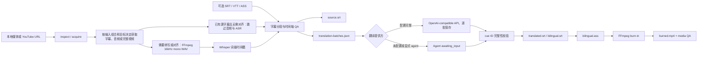

# 架构说明

## 设计目标

Video Translate 采用“稳定 CLI 内核 + 薄 Skill + 后续可选 GUI”的结构。媒体处理、时间轴和文件产物由确定性代码负责；兼容 API 或 Agent 只处理自然语言翻译，不能修改 cue ID 或时间轴。

核心原则：

1. 本地优先：媒体和中间产物默认留在用户指定目录。
2. 时间轴单一来源：ASR 或用户字幕确定 cue 时间，翻译阶段只替换文本。
3. 可恢复：每一步写入 `job.json`，任务失败后可以定位到具体 stage。
4. 可审计：关键输入、字幕、QA 和视频产物均登记 checksum。
5. 系统边界显式校验：URL、媒体文件、翻译响应和外部命令输出都必须验证。
6. 保守恢复：只复用 checksum 验证通过的 checkpoint，派生产物重新生成。

## 工作流



## 模块职责

| 模块 | 职责 |
| --- | --- |
| `cli.py` | 参数解析、命令路由、用户可读/JSONL 输出 |
| `workflow.py` | 端到端目标编排、等待/继续语义和烧录派生指纹 |
| `pipeline.py` | stage 编排、artifact 登记和任务状态推进 |
| `job_store.py` / `models.py` | 任务模型、原子持久化、schema 和 checksum |
| `download.py` / `media.py` | yt-dlp 获取、ffprobe 媒体检查 |
| `transcribe.py` | MLX Whisper、faster-whisper 引擎适配 |
| `segment.py` | 词级结果转 cue，处理停顿、标点、长度和重叠；提供可持久化的 ASR 分段预设 |
| `subtitles.py` / `align.py` | 字幕读写和已有字幕到 ASR 的顺序模糊对齐 |
| `translate.py` / `translation_provider.py` | 结构化术语表和翻译风格、翻译批次协议、兼容 API 调用、断点恢复、cue ID 全量或局部回填 |
| `qa.py` | 空文本、时间重叠、时长、翻译完整性、术语违规和按画幅计算的字幕显示宽度检查 |
| `render.py` / `burn.py` | 平台感知字体、双语 ASS 样式、分辨率自适应码率与安全的 FFmpeg 参数构造 |
| `events.py` / `process.py` | 结构化事件、敏感命令参数脱敏与流式外部进程执行 |

## Job 与 Artifact

每次 `run` 创建独立任务目录：

```text
output/<job-id>/
├── job.json
├── input/
└── artifacts/
    ├── media.json
    ├── audio.wav
    ├── words.json
    ├── source-cues.json
    ├── source.srt
    ├── translation-resegmentation.json
    ├── translation-batches.json
    ├── translation-progress.json
    ├── translation-response.json
    ├── translated-cues.json
    ├── translated.srt
    ├── bilingual.srt
    ├── bilingual.ass
    ├── preview.ass
    ├── preview.mp4
    ├── qa*.json
    └── burned.mp4
```

Stage 状态包含 `pending`、`running`、`awaiting_input`、`succeeded`、`failed` 和 `skipped`。纯字幕 Job 将媒体获取、ASR、对齐和分段标为 `skipped`，但仍保存导入字幕、source cue、QA 与渲染 artifact；它不保存 `media_info`。Agent 翻译批次生成后任务进入 `awaiting_input`；兼容 API 模式逐批更新进度文件，全部完成后直接继续 QA 和渲染。`retranslate-cues` 为每个指定 cue 构造独立批次，并携带相邻源 cue 作为只读上下文；回填只改写指定 ID，之后完整重跑译文 QA。

`verify` 会重新计算所有 artifact 的 SHA-256。`resume` 只恢复规范化音频、词级转写或源 cue 等转写 checkpoint；`continue` 读取 `job.config.workflow` 中的持久化目标，并可在同一个远程 Job 中重新进入 `inspect / acquire`，随后补齐转写、翻译和烧录。重入时只复用 checksum 有效的远程元数据、平台字幕和媒体文件。Agent 等待时必须先执行 `apply-translation`、`import-translation` 或 `apply-cue-retranslation`，再由 `continue` 完成余下步骤。

`run` 会根据输入组合跳过不需要的阶段：源字幕跳过 ASR，已有译文跳过翻译提供方。远程作业请求烧录时前置下载完整视频，ASR 和烧录复用 `source_video`。烧录派生指纹包含译文 checksum、媒体身份、字体和编码参数；只有 artifact 与指纹同时有效时 `continue` 才复用成品。`retranslate-cues` 保持 source cue 时间轴和未选中译文不变，先撤销旧 QA、字幕、ASS、烧录和媒体 QA artifact，再回填指定 cue 并重新校验；QA 通过后端到端 Job 可用 `continue` 补齐烧录。若译文超过硬显示阈值，`resegment-translation` 会仅对具备词级时间戳的 ASR cue 按语义边界重切，重新编号 source cue，重建源字幕并使翻译及其下游产物失效；它不拆分旧译文，也不改写用户导入字幕的时间轴。端到端 Job 随后可用 `continue` 重新翻译，带已有译文字幕的工作流会被明确拒绝。

`preview` 是独立诊断命令，不进入持久化工作流目标，也不修改正式烧录 stage。它读取 checksum 有效且 QA 通过的译文 cue，将所选时间窗口平移到零点，复用正式 ASS 样式和 FFmpeg 编码参数生成 `preview.ass` 与 `preview.mp4`。预览 artifact 会在译文局部重译或重新分段后失效。

Job schema 仍为 v1；端到端目标作为可选 `config.workflow` 保存。原子转写和端到端工作流都会持久化 `segmentation_preset`，恢复时以保存值重新构造 ASR cue；缺失该字段的旧 Job 按 `balanced` 处理。原子翻译命令和端到端工作流都会持久化解析后的术语表与风格；端到端配置保存策略快照而不保存源文件路径，因此 `continue` 能复现首次运行的策略。策略进入 API 翻译指纹，批次只携带命中自身源 cue 的术语。译文 QA 会把源 cue 已命中但译文缺失目标词的情况标记为 `glossary_violation` 错误。API Key、代理凭据和 Cookie 内容不进入 Job。当前每个 Job 只对应一个目标语言，多目标语言应创建独立 Job。

## 事件和用户反馈

普通 CLI 默认把人类可读的进度写入 stderr，最终 Job 和产物路径保留在 stdout；`--events-jsonl` 则只在 stdout 写入结构化事件。下载、翻译、转写和烧录都通过同一事件边界对外暴露，不要求调用者解析外部工具输出。

`transcription_progress` 包含引擎、已处理/总毫秒数、经过时间和可选 ETA。faster-whisper 的分段生成器提供真实完成位置，因此发送 `determinate=true` 的百分比。MLX Whisper 的公开调用接口没有稳定进度回调，只发送 `determinate=false` 的启动和十秒心跳；词级时间戳通过验证后才发送最终 100%，空结果或异常不会伪造成成功。

## 时间轴策略

- ASR 请求词级时间戳，segmenter 才能依据停顿、标点和显示宽度切分。`conservative`、`balanced`、`compact` 只分别调整停顿和最大时长阈值；默认 `balanced` 保持既有结果。超宽片段会先满足硬显示宽度，再优先在句末、软标点、连接词或介词前的词级边界切开；切分发生在翻译前，译文按新的 cue ID 一一生成。若最终译文仍超过硬限制，可显式执行 `resegment-translation`，旧译文不复用，必须对新 cue ID 重新翻译。
- cue 的结束时间来自最后一个词，并添加受控尾部 padding。
- 相邻 cue 发生重叠时归一化边界，不允许翻译阶段改动时间。
- 用户字幕路径应保留原字幕时间轴；ASR 只提供文本匹配和纠错依据。
- 最终 QA 检查空 cue、负时长、重叠、越过媒体时长和缺失译文。纯字幕 Job 没有媒体时长或画幅，只跳过这两类媒体相关检查，保留其余时间轴、文本、术语和阅读速度校验。双语输出会先折叠每种语言内部的源换行，再按语言和画幅检查显示宽度。

## 安全边界

- 外部命令始终以参数数组执行，不经过 shell 字符串拼接。
- 下载路径限制在任务目录内。
- Cookie 和代理只接受显式参数，不自动读取浏览器数据；远程检查和下载使用同一组访问参数。
- 日志和 Job 配置只记录 Cookie 来源名称及代理是否启用，不写入凭据。
- 翻译响应必须一一覆盖全部 cue ID，拒绝重复、缺失和额外 ID。
- API Key 只从指定环境变量读取，不写入 Job、事件或命令行参数。
- 命令事件会脱敏代理账号、密码、Cookie、鉴权请求头和签名查询参数。
- 自动模式配置不完整时显式降级为 Agent；显式 API 模式配置错误时直接失败。
- `doctor` 通过真实 libass 渲染检查平台默认中文字幕字体，烧录命令允许显式覆盖中英文字体。

## 迭代顺序

1. 增加保守、平衡和紧凑分段预设。
2. 实现 Electron + React 桌面壳，只消费 JSONL 事件和 `job.json`，不复制业务逻辑；下载、转写和烧录进度直接复用 CLI 事件。
3. 最后评估目录批处理、队列、远程执行和 Web 服务。
