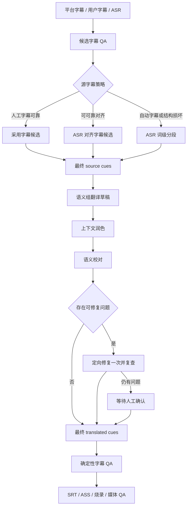
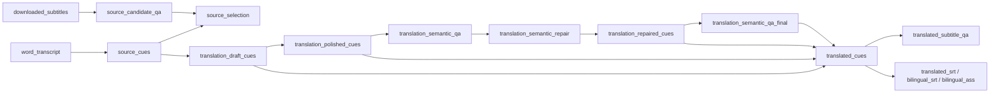

# 字幕质量与自适应源字幕技术方案

状态：已评审，Q1–Q4 已完成
更新时间：2026-07-25

## 背景

真实端到端任务暴露了两类相互关联的问题：

1. YouTube 平台字幕可能包含滚动字幕造成的大量重叠、越过媒体结尾、错误断句或自动识别错误。当前工作流一旦下载到字幕便跳过 ASR，QA 失败后只能人工修复，无法在原 Job 中自动切换到更可靠的时间轴。
2. 当前翻译按固定 cue 批次逐条回填，只把相邻 cue 当作理解上下文。模型没有独立的全文润色和语义校对阶段，容易产生跨 cue 拼接生硬、中文语序不自然、词语被拆开以及专有名词错误等问题。

本方案在不破坏 XVT 时间轴、恢复、checksum 和事件契约的前提下，补齐“可靠源字幕选择 → 上下文翻译 → 润色 → 语义校对 → 确定性 QA”的完整质量链路。

## 目标

- YouTube 平台字幕有结构性问题时，自动尝试对齐或回退 ASR，不让用户从头创建 Job。
- 人工字幕、自动字幕、用户字幕和 ASR 之间有明确、可解释、可恢复的选择规则。
- 翻译能够以完整语义组为上下文生成自然中文，避免机械逐 cue 拼接。
- 新增可恢复的润色、语义校对和最多一次定向修复。
- 模型始终只处理文本，不修改 cue ID、数量、顺序、时间码或媒体参数。
- 所有选择、进度、失败、人工确认和最终结果都有 artifact 与 JSONL 事件可审计。
- 旧 Job 可继续恢复；本轮不升级 Job schema，也不破坏事件协议 v1。

## 不在范围内

- 可视化校对界面、桌面 App、Web 服务、后台队列或多租户。
- 并发调用翻译服务或多模型投票。
- COMET、COMETKiwi 等额外机器翻译质量模型。
- 自动生成并静默应用源字幕专有名词修改。
- 让模型合并、拆分或重新计时 cue。
- 直接集成旧字幕润色 Skill、`whisper-cli`、ggml 模型或旧 ASS 脚本。

## 不可破坏的约束

1. 最终时间轴只来自 ASR 或用户/平台源字幕；翻译、润色和语义校对不得修改时间轴。
2. 用户显式提供本地源字幕时，`auto` 策略仍默认保留其时间轴；只有显式请求对齐或 ASR 重建才改变来源。
3. 确定性 QA 的 error 不能被人工确认绕过，也不能继续烧录。
4. 所有新增中间产物必须登记 checksum，并进入 artifact 依赖图与失效闭包。
5. API Key、Cookie、代理凭据、签名 URL 和本地媒体内容不得进入事件或 Job 配置。
6. `resume` 继续只恢复转写 checkpoint；`continue` 继续完成持久化端到端目标。

## 总体架构



本轮不新增 `StageName`。现有 Job v1 要求每个枚举 stage 都存在，直接增加 stage 会使旧 Job 因缺少必填 stage 而无法加载。源字幕选择复用转写腿的现有 stage；草稿、润色和语义校对作为 `translate` 的可恢复子阶段；最终时间轴/排版/术语检查继续使用 `subtitle_qa`。细分状态由 artifact、现有 stage 状态和事件 `detail` 表达，不向持久化 `StageRecord` 引入新的状态字段。

## 源字幕策略

### CLI

已新增：

```text
--source-strategy auto|subtitles|asr
```

新 Job 默认 `auto`：

- `auto`：根据输入来源、平台字幕类型、工作流目标和候选 QA 自动选择。
- `subtitles`：字幕候选是权威来源；除显式 `--align-subtitles` 外不自动转写替换，QA 失败时等待人工处理。
- `asr`：媒体输入必须运行 ASR；显式请求的平台/本地字幕可以保留为参考，但不决定最终时间轴。

兼容规则：

- 旧 Job 缺少 `source_strategy` 时，存在源字幕配置的 Job 按 `subtitles` 处理，没有源字幕的 Job 按 `asr` 处理，保持历史恢复行为。
- 纯字幕输入不允许 `asr`。
- `--align-subtitles` 与 `asr` 互斥；前者保留字幕文本并校正时间，后者从词级转写重建源 cue。

### `auto` 决策矩阵

| 输入 | 条件 | 决策 |
| --- | --- | --- |
| 本地媒体 + 用户源字幕 | 未请求对齐 | 原样保留用户时间轴 |
| 本地媒体 + 用户源字幕 | 显式请求对齐 | 运行 ASR 对齐；低于现有置信度门槛时失败，不静默替换 |
| YouTube 人工字幕 | 候选 QA 无 error | 直接采用 |
| YouTube 人工字幕 | 候选 QA 有 error | 运行 ASR 对齐；置信度不低于 `0.55` 且对齐后 QA 无 error 才采用，否则 ASR 分段 |
| YouTube 自动字幕 | 请求翻译或烧录 | 平台字幕保留为参考，最终使用 ASR 词级分段 |
| YouTube 自动字幕 | 只请求源字幕且候选 QA 无 error | 直接采用 |
| YouTube 自动字幕 | 只请求源字幕且候选 QA 有 error | 回退 ASR |
| 未找到平台字幕 | 任意媒体目标 | ASR |

当用户同时提供 `--translation-subtitles` 时，源策略仍按上表执行，既有译文通过最终源 cue 时间轴重新映射；映射不满足覆盖门槛时明确失败，不猜测补齐。

### 候选字幕 QA 与安全修复

候选 QA 使用现有 `check_subtitles`，但不提前把正式 `subtitle_qa` stage 置为失败。候选报告只参与选择，最终选定的 source cues 仍需完整运行正式 QA。

只允许一个无需 ASR 的自动时间修复：最后一个 cue 已在媒体内开始、仅结束时间越过媒体结尾且偏差不超过 500ms 时，将结束时间裁剪到媒体结尾。其他越界、负时长和重叠不静默修改。

大量滚动字幕重叠不能通过简单裁边修复。自动字幕翻译/烧录任务直接走 ASR；人工字幕只有在高置信度对齐且对齐后 QA 通过时才复用其文本。

### 选择产物

新增：

- `source-candidate-qa.json`：候选来源、完整 QA 结果和安全修复记录。
- `source-selection.json`：策略、候选类型、最终选择、稳定原因码、可选对齐置信度、候选是否可作为文本参考，以及最终 source cue checksum。

“平台字幕作为参考”有明确边界：只有候选 QA 没有 error 时，才允许按确定性时间重叠映射把平台文本作为翻译语义组的只读 `reference_text`；它不能决定 cue ID、数量或时间码，也不能覆盖 ASR 文本。候选有重叠、越界等 error 时仅保留在诊断产物中，不发送给翻译模型，避免滚动自动字幕污染结果。

稳定原因码：

```text
user_subtitles_preserved
manual_subtitles_passed
manual_subtitles_aligned
automatic_subtitles_source_only
automatic_subtitles_reference_only
candidate_qa_failed
alignment_below_threshold
alignment_post_qa_failed
platform_subtitles_missing
forced_asr
selection_artifact_recovered
```

`source_selected` 事件已记录 `job_id`、`job_file`、`strategy`、`candidate_kind`、`selected_kind`、`reason` 和 `report_path`。Q3 重建复用该事件记录最终 ASR 选择，不新增事件类型；事件协议保持 v1。

### 已有 Job 修复入口

```text
xvt rebuild-source JOB --strategy asr [--cookies-from-browser ...] [--proxy ...]
```

`rebuild-source` 是 advanced 原子修复命令：

- 显式执行，`continue` 不会自动重建。
- 优先复用校验通过的词级转写、规范化音频和本地或已下载媒体；远程 Job 只有缺少这些 checkpoint 时才按显式 Cookie/代理重取媒体。
- 持久化 `source_strategy=asr`、`source_rebuild_requested=true` 并关闭 `align_subtitles`，再按保存的 `segmentation_preset` 重建 source cues；中断后仍由同一显式命令恢复，不交给 batch 自动 `continue`。
- 失效 `source_candidate_qa`、`source_cues`、`source_selection`、`translation_resegmentation` 及其全部下游 artifact；有效候选的 QA 会重算，`input_translation_subtitles` 保留并由现有映射在新 cue 上重新验证。
- 不修改 `job.input`、工作流目标、翻译策略或烧录配置。完成后端到端 Job 用 `continue`，旧原子 Job 用 `translate`。

远程或本地媒体 Job 的非 ASR 源字幕 QA 出现 error 且可重建时，`status` 才把该命令作为恢复建议；ASR 自身 QA error 不重复执行相同重建，`needs_review` 与译文 QA 也不建议重建。纯字幕 Job 继续要求人工修复。Q3 不新增 stage、Job schema 或事件类型，复用既有 artifact/stage、`source_selected` 与 `cli_completed`。

## 语义组翻译

### 分组规则

翻译前由确定性代码在已有 cue 上建立语义组，不改变 cue 本身：

- 源文以句末标点结束时结束当前组。
- 相邻 cue 的时间间隔达到 650ms 时结束当前组。
- 单组最多 `min(20, batch_size)` 个 cue 或 30 秒；`batch_size` 小于 20 时保留既有小批次容量语义，不从组中间拆开。
- 达到上限时依次优先选择句末标点、软标点、连接词前和最大停顿处作为边界。
- 单个 cue 自身超过 30 秒时，作为不可拆分的单元素组保留，是时长上限的唯一例外。
- provider 批次以 `batch_size` 个 cue 为容量，但以完整语义组为装箱单位，不从组中间切开。

`TranslationBatch` 增加可选的 `semantic_groups` 字段，记录当前批次每组 cue ID。批次外只携带前后各一个完整相邻组作为只读上下文；上下文 cue 不属于 `items`，也不得出现在响应中。既有 `items`、响应 `items` 和 cue ID 校验保持不变，旧 Agent 消费者可以忽略新字段。

### 输出约束

- 输出必须完整覆盖当前批次每个 cue ID，不能重复、缺失或增加 ID。
- 每个 cue 译文仍不得为空。
- 允许在同一语义组内调整中文措辞的承接位置，但不能跨组搬运信息。
- 前后语义组只作为只读上下文，不得出现在响应中。
- `max_target_characters` 保留以兼容现有批次协议，但提示词明确它是显示建议值；不得为满足长度而拆词、漏译或制造病句。
- 最终长度、阅读速度和显示宽度仍由确定性 QA 判定。

翻译 prompt version 已递增至 v3；语义分组规则另有 grouping version。两者都进入 API 翻译指纹，确保旧 API 进度不会被错误复用，并写入 Agent manifest 供外部消费者识别协议。为保持已进入 `awaiting_input` 的旧 Job 可恢复，旧 Agent 响应仍按既有严格 ID 契约接受；只有重新执行 `prepare-translation` 才会生成带语义组的新批次。Q4 不新增 stage、artifact、事件或 Job schema；`translation_batches`、`translation_progress` 和既有 `translate` stage 继续承担审计与恢复。

## 翻译质量模式

Q5 的决策完备实施方案见 [Q5 可恢复字幕润色技术方案](Q5_TRANSLATION_POLISH_PLAN.md)。本节保留 Q5/Q6 总体边界；实现时以专项方案的切分、恢复和验收约束为准。

### CLI 与兼容性

计划新增：

```text
--translation-quality standard|polished
```

- `standard`：语义组翻译草稿直接作为最终候选，随后运行确定性 QA。
- `polished`：Q5 先增加草稿后的上下文润色；Q6 再在同一质量模式中增加语义校对和最多一次定向修复。

实施初期保持 `standard` 为默认，完成完整真实 E2E 验收后，新 Job 默认切为：

```text
translation_style=natural
translation_quality=polished
```

旧 Job 缺少 `translation_quality` 时固定按 `standard` 处理；已有持久化 `translation_policy` 继续原样复用。新增字段是 `WorkflowConfig` 的可选加法，不升级 Job schema。

用户提供的 `--translation-subtitles` 默认视为最终译文输入，不自动调用模型。需要优化时显式执行：

```text
xvt polish-translation JOB.json
```

该命令读取现有 `translated_cues` 作为草稿，使旧译文 QA、字幕渲染、预览、烧录和媒体 QA 失效；完成后仍由 `continue` 补齐剩余目标。

### 草稿与润色

API 模式：

1. 第一遍按语义组生成草稿并继续使用现有逐批 checkpoint。
2. 润色请求读取当前语义组、前后各一个只读语义组、源文、草稿、持续时间、术语表和风格。
3. 润色只能返回当前组完整 ID 集合。
4. 每完成一个润色批次即原子更新进度；中断后从下一个未完成批次继续。

Agent 模式：

- `standard` 保持现有一次回填协议。
- `polished` 的 Agent 批次将任务明确标为 `translate_and_polish`，要求外部 Agent 完成全文术语分析、翻译、润色和自检后只回填最终 items。
- 初始实现不增加第二个 Agent 回填往返；API 模式提供自动多遍处理，Agent 模式由外部 Agent 承担同等文本职责。

## 语义校对与定向修复

### 报告结构

语义校对只检查文本质量，固定分类：

```text
meaning_error
omission
terminology
awkward_join
source_suspect
```

每个问题至少包含：

```json
{
  "category": "awkward_join",
  "cue_ids": [7, 8],
  "severity": "review",
  "message": "相邻译文无法组成自然中文句子",
  "suggested_items": [
    {"id": 7, "text": "..."},
    {"id": 8, "text": "..."}
  ]
}
```

模型报告的 severity 只使用 `review`，不把概率性模型判断伪装成确定性 error。报告响应必须经过 JSON、分类、cue ID 范围、重复 ID 和文本类型校验。

### 自动修复

- 没有问题：润色候选成为最终 `translated_cues`。
- 存在 `meaning_error`、`omission`、`terminology` 或 `awkward_join`：按涉及的完整语义组定向修复一次。
- `source_suspect` 不自动修改 source text，只进入报告；翻译可以使用上下文给出正确目标词，但源文修改留给显式修复或后续界面。
- 修复后只再运行一次语义校对，不循环。
- 仍有问题：`translate` stage 进入 `awaiting_input`，`status` 展示报告和确认命令。
- 语义 QA 服务不可用属于 retryable provider failure；不能静默跳过并宣告 polished 完成。

计划新增：

```text
xvt continue JOB.json --acknowledge-translation-review
```

确认记录绑定：

- source cue checksum；
- 当前润色或修复后 cue checksum；
- 语义 QA 报告 checksum；
- 语义 QA prompt version；
- 具体问题集合。

确认只放行模型语义问题。随后仍必须运行现有确定性译文 QA；重叠、越界、缺译、术语违规等 error 永远不能确认放行。

现有 `--acknowledge-subtitle-review` 继续处理显示宽度等物理字幕风险，两类确认记录和事件分开保存。

## Artifact 设计

计划新增 artifact kind：

```text
source_candidate_qa
source_selection
translation_draft_cues
translation_polish_batches
translation_polish_progress
translation_polished_cues
translation_semantic_qa
translation_semantic_repair
translation_repaired_cues
translation_semantic_qa_final
```

最终链路保持无环：



`standard` 路径可从 draft 直接生成最终 cue；无问题的 `polished` 路径可从 polished cue 生成最终 cue；发生修复时从 repaired cue 生成。语义修复最多一次，因此不需要循环 artifact 或可变历史链。

`DERIVES_FROM` 是按 artifact kind 建立的保守依赖图，不表达单个 Job 的条件父节点。因此最终 `translated_cues` 会列出各质量路径可能出现的上游，允许安全的过度失效，但不能漏掉实际依赖。

所有新增 artifact 必须加入 `ArtifactKind`、`DERIVES_FROM` 和注册表测试。源 cue 或翻译策略变化会通过依赖闭包失效全部下游；翻译质量、模型、prompt version、语义分组规则或术语表变化必须进入对应进度指纹。

## 事件与用户反馈

不增加 Job stage，只扩展事件：

- `source_selected` 已由 Q2 实现；Q3 重建复用它。
- 现有 `translation_batch_started`、`translation_batch_retrying`、`translation_batch_completed` 增加可选 `phase`：`draft`、`polish`、`semantic_review`、`repair`。
- 新增 `translation_review_acknowledged`。
- Q3 的恢复建议直接给出既有 `rebuild-source` 命令；不增加 `workflow_planned` 步骤或事件类型。后续 Q4–Q6 可出现 `select_source`、`polish`、`semantic_review`、`await_translation_review`。

Q2/Q6 的新增事件类型或可选字段均保持 v1 兼容；Q3 不新增事件类型或字段。CLI 普通输出必须显示当前 phase、批次进度、重试原因以及恢复命令，JSONL 保持 stdout 纯事件。

## 翻译提供方可靠性前置修复

多遍质量处理会增加 API 调用次数，因此必须先完成传输层加固：

- 在 `urlopen` / 响应读取边界捕获 `RemoteDisconnected`、连接重置和同类 `ConnectionError`，统一包装为 retryable `TranslationProviderError`；其他 `OSError` 不重试。
- 传输层默认最多重试 4 次，继续遵循 `Retry-After` 和指数退避。
- 结构性无效响应只允许附带纠错提示再试 1 次，避免把固定格式不兼容误当网络抖动反复请求。
- 401/403 等鉴权和配置错误不重试。
- 不硬编码 DeepSeek 或其他供应商专用的 thinking、JSON mode 参数；保持 OpenAI-compatible 边界。
- 每个成功批次继续立即保存 checksum 有效的进度，失败和进程中断均从当前未完成批次恢复。

## Schema 与兼容性

- Job schema 保持 v1：不新增 stage、不重命名已有字段，只添加可选配置和 artifact。
- `WorkflowConfig` 新增可选 `translation_quality`，未知字段继续通过 `extras` 往返保真。
- 顶层 Job config 新增 `source_strategy`；旧 Job 使用兼容推导，不回写改变历史语义。
- 事件协议保持 v1：只新增事件类型和可选字段。
- 翻译 prompt version 与语义 QA prompt version 独立维护，任一版本变化只失效对应语言模型进度及其下游。
- 每个 Job 继续只支持一个目标语言。

## 安全与隐私

- 不新增第三方服务、运行时语言或仓库依赖。
- 继续使用现有翻译 API 环境变量；不新增 API Key 类型。
- YouTube Cookie 和代理仍只通过显式 CLI 参数提供，不写入 artifact 或事件。
- 平台字幕、ASR 文本和译文只写入本地 Job 目录；发送给翻译提供方的内容范围在文档中明确披露。
- 事件新增的 source 选择原因、语义问题和 provider 错误继续经过统一自由文本脱敏。
- 所有外部命令继续以参数数组运行，不使用 shell 拼接。

## 实施顺序

全部工作会超过 8 个文件，必须使用 `codex/` 开发分支按下列顺序串行合并；前一 PR 合并并更新 `main` 后再开始下一项。单组修改超过 6 个文件时，在同一功能分支内拆成可独立验证的实现与文档子任务，并在提交前整体 review。

### Q1：翻译传输可靠性

- ~~补齐断连异常分类。~~ 已完成：连接类 `OSError` 可重试，其他 `OSError` 立即失败。
- ~~区分传输重试和结构纠错预算。~~ 已完成：结构纠错固定 1 次且不消耗传输预算。
- ~~默认传输重试提高到 4。~~ 已完成。
- ~~增加失败和断点回归测试。~~ 已完成：覆盖请求断连、响应读取连接重置、不可重试 4xx、混合故障序列，并确认端到端主翻译继续复用既有逐批 checkpoint；局部重译本阶段只统一重试与事件，不扩展 artifact DAG。

独立价值：直接改善现有翻译任务，不依赖后续质量功能。

### Q2：新 Job 自适应源字幕

- 实现候选 QA、输入矩阵和选择报告。
- 人工字幕可靠时保持快速路径。
- 自动字幕翻译/烧录路径切换 ASR。
- 保证最终 source cues 仍运行正式 QA。

独立价值：新远程任务遇到坏平台字幕可自动完成转写腿。

### Q3：已有 Job 源字幕重建

- ~~增加 `rebuild-source`。~~ 已完成：仅支持显式 `--strategy asr`，不由 `continue` 自动执行。
- ~~对接 artifact 失效闭包和恢复建议。~~ 已完成：只在源字幕 QA error 且可重建时建议，保留输入译文以重新映射。
- ~~覆盖 checkpoint 复用和旧 Job 行为。~~ 已完成：复用 words/audio/本地或已下载媒体；端到端 Job 后续 `continue`，旧原子 Job 后续 `translate`。

独立价值：修复已经被坏字幕卡住的 Job，无需重建任务。

### Q4：语义组翻译

- ~~实现确定性句组和按组装箱。~~ 已完成：强边界为句末标点或 650ms 间隔；上限为 `min(20, batch_size)` 个 cue 或 30 秒，按软标点、连接词前、最大停顿稳定择边；单个超长 cue 单独成组。
- ~~更新 provider / Agent 批次协议和 prompt version。~~ 已完成：`semantic_groups` 记录当前批次组 ID，批次外前后各一个完整组仅作上下文；prompt v3 与 grouping version 进入 API 恢复指纹，并写入 Agent manifest 供消费者识别。
- ~~长度改为软提示，保持严格 ID 校验。~~ 已完成：长度只作为显示建议，响应仍严格覆盖当前 `items` 的 cue ID。
- ~~准备把新任务默认风格切换为 `natural`。~~ 已确认不在 Q4 变更：默认继续为 `faithful`，已持久化策略照常复用。

独立价值：即使不启用第二遍润色，第一遍翻译也减少机械断句。

### Q5：润色与断点恢复

- ~~增加 `standard|polished` 配置与 artifact。~~ 已完成。
- ~~API 模式支持可恢复第二遍润色。~~ 已完成。
- ~~Agent 模式提供 `translate_and_polish` 任务说明。~~ 已完成。
- ~~增加 `polish-translation` 修复入口。~~ 已完成。

独立价值：用户可显式获得或补跑高质量译文。

### Q6：语义校对与一次修复

- 结构化语义问题报告。
- 最多一次按完整语义组定向修复和复查。
- 独立人工确认、恢复计划与事件。
- 完成真实 E2E 后将新 Job 默认切为 `natural + polished`。

独立价值：形成可审计的语义质量闭环。

## 自动化验证

每个 PR 至少运行：

```bash
uv run --no-sync ruff check src tests
uv run --no-sync ruff format --check src tests
uv run --no-sync pytest -q
uv run --no-sync xvt --help
```

必须覆盖的测试路径：

### 提供方

- `RemoteDisconnected`、连接重置、超时、429、5xx 可重试。
- 401/403 不重试。
- 传输重试和结构纠错使用独立预算。
- 中途失败后复用已完成批次。

### 源字幕

- 人工字幕 QA 通过直接使用。
- 人工字幕对齐通过与对齐失败回退。
- 自动字幕在翻译/烧录任务中作为参考并运行 ASR。
- 504 个重叠问题的滚动字幕不通过裁边伪修复。
- 最后 cue 小幅越界安全裁剪。
- 用户本地字幕默认完全不变。
- ASR 不可用时保留候选与恢复报告，不烧录错误结果。
- `rebuild-source` 复用 words/audio 并正确失效下游。

### 翻译与润色

- 语义组不跨强边界，provider 批次不切开语义组。
- 翻译、润色和修复前后 cue ID、数量、顺序、时间码完全一致。
- 前后组上下文不会混入响应。
- `max_target_characters` 超出时允许自然完整表达，仍由 QA 报告显示风险。
- 润色失败后 `continue` 不重做草稿。
- prompt、模型、术语、质量模式变化只失效相应进度及下游。
- 旧 Job 缺少新配置时继续按历史标准模式运行。

### 语义 QA

- 无问题直接完成。
- 非法 JSON、未知分类、越界 cue ID 和重复 ID 可控失败。
- 可修复问题只修复一次并复查。
- 仍有问题进入 `awaiting_input`。
- 人工确认绑定全部 checksum 和 prompt version，文本变化后自动失效。
- 语义确认不能放行确定性 QA error。

### 事件与恢复

- 所有新增 Job 事件携带 `job_id` / `job_file`。
- 事件载荷满足 `docs/EVENTS.md`，敏感自由文本继续脱敏。
- `status` 与 `continue` 共用推进判断。
- Agent 等待、语义等待和字幕 QA 等待能被明确区分。
- 失败路径不发出 `workflow_completed` 或 `cli_completed`。

## 手工 E2E 验收

真实网络和模型验收不进入默认测试套件，使用公开素材、用户自己的凭据和 Job 外输出目录：

1. 使用曾产生大量重叠的 YouTube 自动字幕案例，确认 `auto` 选择 ASR、保留平台字幕参考并完成翻译。
2. 使用当前包含 505 个 cue 的实际任务验证传输断线、润色中断和语义校对中断均能从准确批次继续。
3. 抽查不少于 100 个连续 cue，重点确认不再出现词语硬拆、跨 cue 语序断裂和术语漂移。
4. 以 `Claude Code` / `Cloud Code` 为专有名词案例，确认 ASR 或术语表证据能生成正确译文；无法确认的源文只报告 `source_suspect`，不静默改写。
5. 最终烧录前确认 source QA、semantic QA、translated QA 和 media QA 均存在且状态可解释。

通过标准：

- cue ID、数量、顺序和时间轴无翻译阶段变化。
- 无确定性 QA error。
- 断线续跑不重复已完成的模型批次。
- 已知样例不再出现词内断句和明显机械拼接。
- 所有自动选择与人工确认均可从 Job/artifact/事件还原。

## 回滚

- 新字段和 artifact 都是加法；旧 CLI 会忽略未知配置字段，但不应在旧 CLI 中修改带新 artifact 的 Job。
- 新任务可通过 `--translation-quality standard` 回退到单遍翻译。
- 源字幕可通过 `--source-strategy subtitles` 回退到现有平台/用户字幕权威行为。
- 各阶段 PR 独立可用；后续阶段延期不会破坏已合并阶段。
- 不删除原平台字幕、草稿或报告，错误方向可以从上游 checksum 有效 artifact 重新派生。

## 被否决的方案

- **直接把旧字幕润色 Skill 当运行时**：规则中包含删除标点、12 字硬限制、只拆不合和按比例分配时间，和 XVT 的质量目标及确定性时间轴冲突。
- **所有平台字幕一律 ASR**：浪费高质量人工字幕并增加运行时间。
- **所有坏字幕一律 forced alignment**：滚动字幕和重复文本不是整体漂移，对齐无法可靠修复其结构。
- **让润色模型任意合并 cue**：会破坏 cue ID、时间轴和恢复协议。
- **只修改当前翻译 prompt**：无法解决错误源分段，也没有润色 checkpoint、语义报告和人工闭环。
- **引入重型机器翻译评分器**：当前更需要可操作的问题分类与修复，不需要新的模型依赖和本地运行负担。

## 最脆弱前提

本方案最依赖 ASR 词级时间戳在多数公开视频中足够可靠。如果词时间戳质量不足，自动字幕回退可能仍无法得到可用 source cues。设计对此采用保守失败：保留平台字幕、ASR checkpoint、候选 QA 和选择报告，停止并给出恢复建议，不以牺牲时间轴正确性换取自动完成。
